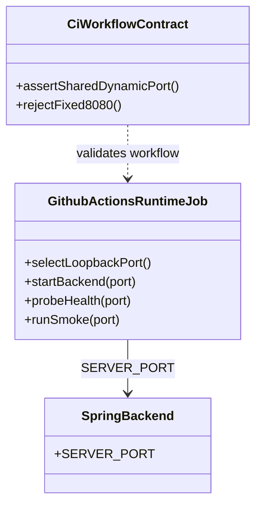
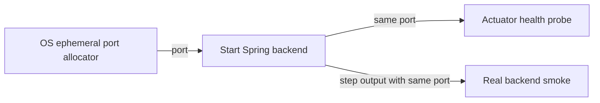
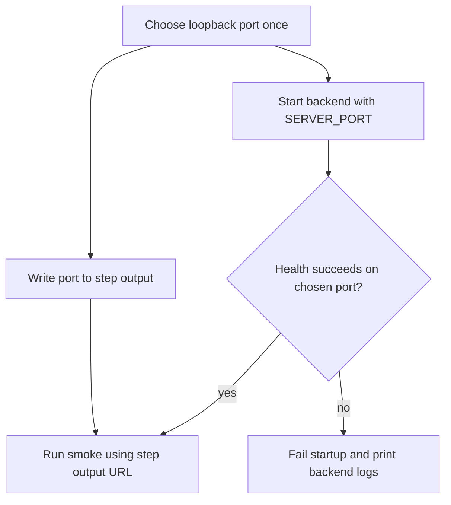

# T193 CI Runtime 동적 Backend 포트

## Approval Gate
- Status: Approved
- Approver: 사용자 — CI의 `127.0.0.1:8080` 고정 제거 요청
- Blocking ambiguity: 없음
- Competing plan branches: 없음. CI runtime job에서 사용 가능한 loopback 포트를 한 번 할당해 backend, health probe, smoke가 공유한다.

## Goal
- 사용자/운영 목표: CI runtime QA가 기본 포트에 의존하거나 다른 listener를 backend로 오인하지 않게 하고, PR CI의 모든 필수 gate를 성공시킨다.
- 비목표: CI 검증을 제거하거나 취약점을 allowlist로 우회하기, 관련 없는 리팩터링.

## Scope Revision — 2026-10-20
- Status: 사용자 승인 — “별도로 조사하여 ci 성공시켜줘”.
- 확장 목표: `qa-runtime`과 `qa-security`까지 포함해 PR CI 전체를 성공시킨다. 실패 gate를 끄거나 취약점을 allowlist로 우회하지 않는다.
- 근거: PR CI run `39436118827`에서 backend/frontend/qa-toolchain은 성공, `qa-runtime`은 `Real backend smoke`에서 8분 이상 진행 중, `qa-security`는 frontend 및 backend OSV/npm 결과에 unallowlisted 취약점을 보고했다.
- 조사 우선: API smoke에 요청별 시작/완료 지점과 유한 HTTP timeout을 두어 멈춘 요청을 특정한다. timeout과 job timeout은 진단/상한 장치이며 최종 수정으로 간주하지 않는다.
- 런타임 원인 및 수정: `JdbcGatewayEventLog.latestSequence()`가 저장된 행의 `MAX(event_sequence)`를 반환하는 반면, `allocateSequence()`는 identity sequence만 전진시키고 행은 추가하지 않는다. `InMemoryGatewayService.appendBusEvent()`는 세션의 마지막 sequence보다 행 최대값이 작으면 행 추가 전까지 sequence를 반복 할당하므로 PostgreSQL에서 진행하지 못했다. `latestSequence()`가 identity sequence의 실제 `last_value`를 읽게 수정했고, 할당 후 행 삽입 전 값을 확인하는 PostgreSQL 통합 테스트를 추가했다. 수정 뒤 로컬 PostgreSQL 17에서 API smoke 전체가 통과했으며 voice join/state/leave도 응답했다.
- 풀 적용 가설 검증: `PGSimpleDataSource`를 Hikari로 바꾸고 연속 `getConnection()` 간 `pg_backend_pid()` 재사용을 확인하는 임시 통합 테스트는 RED→GREEN이었지만, 실제 스모크는 해결하지 못했다. 풀 변경은 롤백했으며 최종 수정은 sequence 조회 계약을 일치시킨 것이다.
- 보안 수정 방침/결과: backend의 OSV finding은 0건이다. frontend Vue/server-renderer를 3.5.44로 통일해 해당 finding을 제거했다. npm registry에는 공식 `braces`/`node-forge` 수정 릴리스가 없다. 검증한 최소 downstream backport를 `vendor/ci-dependency-patches/`에서 유지하고, direct dev dependency를 통해 기존 transitive 경로에 적용한다. `braces`는 depth limit과 compile/expand/stringify AST 한도 및 cycle 방어를 적용하고 stringify 호환성 회귀 테스트를 추가했다. `node-forge`는 count 검사 패치를 배제하고 canonical DigestInfo 재인코딩/비교를 backport했다. local versions는 `3.0.4+discord.1`, `1.4.1+discord.1`이며 기존 라이선스 파일을 보존했다. Node 22 workspace tests 9/9 backport cases 포함 PASS, npm audit high 차단 0, `qa/security-gate.ps1`의 npm/SBOM/OSV 전체 게이트 `SECURITY_GATE_PASS`. 공식 fixed release가 나오면 local 패키지를 공식 버전으로 교체한다.
- 현재 확인한 backend 보안 목표 버전: Jackson 2.21.7 및 3.1.7, Tomcat 11.0.27, lz4-java 1.11.4. npm frontend dependency 업데이트 뒤 CI Node 22 전체 workspace 테스트와 build를 검증한다.

## Domain Language
- Runtime backend port: CI job 시작 시 OS에서 임시로 선택해 해당 job의 backend와 smoke 간에 전달하는 loopback TCP 포트.

## Participating Code
- `.github/workflows/ci.yml`: 포트를 한 번 선택하고 backend 실행, health probe, smoke URL에 같은 값을 전달한다.
- `qa/ci-workflow.contract.ps1`: 동적 포트 전달 및 runtime 구간의 고정 8080 회귀를 검사한다.
- `qa/real-backend-browser-smoke-default.contract.ps1`: workflow smoke URL이 동적 backend URL을 전달하는지 확인한다.
- `backend/boot/.../JdbcGatewayEventLog.java`와 PostgreSQL 통합 테스트: row insert 전에도 할당된 DB sequence 값이 latest sequence로 조회되는지 보장한다.
- backend/frontend 의존성 및 local backport: `qa-security` finding을 수정하고 취약 입력 회귀 테스트와 기존 scanner gate를 유지한다.
- `qa/api-smoke.ps1`와 contract: 실제 smoke 요청에 유한 timeout과 요청별 로그를 적용한다.

## Expected Changed Files
- `docs/01-plan/features/T193-ci-runtime-dynamic-port.plan.md`, `docs/02-design/features/ci-runtime-security-repair.blueprint.md`: 승인 범위, 실제 원인, 변경, 검증 기준을 일치시킨다. Confidence: high.
- `.github/workflows/ci.yml`, `qa/ci-workflow.contract.ps1`, `qa/real-backend-browser-smoke-default.contract.ps1`: runtime 포트 전달과 고정 포트 회귀를 검증한다. Confidence: high.
- `backend/boot/src/main/java/com/example/discord/gateway/JdbcGatewayEventLog.java`, `backend/boot/src/test/java/com/example/discord/gateway/JdbcGatewayEventLogTest.java`: PostgreSQL sequence의 row insert 전 할당값 조회와 회귀 테스트. Confidence: high.
- `backend/boot/build.gradle.kts`: backend OSV에서 지적된 Jackson, Tomcat, LZ4 fixed version 적용. Confidence: high.
- `qa/api-smoke.ps1`, `qa/real-backend-e2e.contract.ps1`: 요청 단위 로그/timeout 및 계약 검증. Confidence: high.
- `apps/web/package.json`, `apps/web/.nuxtrc`, `package-lock.json`: frontend advisories를 수정하는 Nuxt/Vue/test-utils/Vitest 버전 갱신. Confidence: high.
- `vendor/ci-dependency-patches/braces/**`: `braces` 3.0.3 기반 depth hardening fork; license preserved. Confidence: medium.
- `vendor/ci-dependency-patches/node-forge/**`: `node-forge` 1.4.0 기반 exact canonical DigestInfo hardening fork; license preserved. Confidence: medium.
- `packages/dependency-backports/**`: untrusted-depth, compatibility, malformed DER, trailing-byte rejection with parser option disabled, canonical control regressions. Confidence: high.
- `package.json`, `package-lock.json`: 두 local package를 transitive dependency tree에 적용하고 workspace tests/SBOM에서 scan. Confidence: high.

## Tier And Layer Responsibilities
- UI/client: 변경 없음.
- Desktop/native: 변경 없음.
- API/controller: 변경 없음.
- Application/service: 기존 event publication 경로를 유지한다.
- Domain: 변경 없음.
- Persistence/adapter: `JdbcGatewayEventLog.latestSequence()`가 PostgreSQL sequence의 현재 할당값을 반환한다.
- Infrastructure/runtime: CI workflow가 loopback 포트를 선택해 backend/health/smoke 간 공유하고, 의존성 버전을 안전한 릴리스 또는 검증된 backport로 고정한다.
- QA/contracts: workflow의 포트 전달·고정값 부재, API smoke timeout/logging, 의존성 보안 회귀를 검증한다.

## Structure Diagram

## System Flow Diagram

## Behavior Flow

## Invariants And Boundaries
- Auth/security: CI backend listener는 `127.0.0.1`에만 bind한다.
- Transactions/idempotency: 해당 없음.
- Error handling: 기존 startup retry와 backend 로그 수집을 유지한다.
- Generated contracts: 변경 없음.
- Platform boundaries: Ubuntu GitHub Actions의 Python 3 표준 `socket` 모듈로 사용 가능한 포트를 선택한다. 포트 선택 후 backend bind 사이의 극히 짧은 재할당 가능성은 OS port reservation을 backend에 넘길 수 없는 현재 실행 방식의 한계다.

## Implementation Steps
- 동적 포트 계약: `qa/ci-workflow.contract.ps1` 및 browser-smoke 계약으로 포트 출력·전달과 runtime 구간의 고정 `:8080` 부재를 먼저 검사하고, `.github/workflows/ci.yml`에서 같은 loopback 포트를 backend, health probe, smoke에 전달한다.
- Runtime 원인 수정: PostgreSQL 회귀 테스트에서 할당 후 row insert 전 sequence 값이 조회되는지 먼저 확인하고, `JdbcGatewayEventLog.latestSequence()`가 현재 DB sequence 값을 반환하도록 고친다. `InMemoryGatewayService.appendBusEvent()`의 기존 발행 경로는 유지한다.
- Smoke 진단: `qa/api-smoke.ps1` 요청마다 시작/응답 로그와 30초 timeout을 적용하고 `qa/real-backend-e2e.contract.ps1`에서 파싱 및 계약을 검증한다.
- 보안 의존성: advisory별 최소 안전 버전 또는 local backport를 적용한다. Backport는 테스트를 먼저 추가해 기존 의존성에서 실패를 확인하고, 구현 후 workspace 테스트·audit·SBOM/OSV scan을 실행한다.
- 전체 검증: Node 22 workspace test와 frontend build, 관련 Gradle PostgreSQL/backend tests, QA contracts, workflow YAML parse, `git diff --check`를 실행한다.

## Verification Gates
- Push 전 게이트: 관련 QA contract와 테스트, `npm audit --audit-level=high`, backend SBOM/OSV gate, workflow YAML parse, `git diff --check`.
- Contract checks: runtime job에서 loopback bind와 backend port의 동적 할당, backend/health/smoke 간 동일 포트 사용을 검사한다.
- Push 후 수용 게이트: PR CI의 frontend, backend, qa-runtime, qa-security, qa-toolchain 모두 성공해야 한다. timeout만으로 성공 처리하거나, 실패 gate를 비활성화하거나, 취약점을 allowlist 처리하지 않는다.
- Dependency backport gates: `npm test --workspaces`, frontend production build, `npm audit --audit-level=high`, 그리고 qa-security의 OSV/SBOM scan. `braces` compile/expand/stringify의 기본 및 과도 depth·escape compatibility, `node-forge`의 malformed DigestInfo 거부와 canonical positive controls를 검사한다.

## Review Score Preset
- Preset: Implementation Review
- Push pass threshold: spec review 및 quality/security review 각각 90/100 이상, P0/P1 없음. 구현 품질 점수도 모든 category 50% 이상.
- Categories: blueprint alignment 20, correctness 20, security/privacy 15, tests/verification 20, maintainability 15, operations/docs 10.
