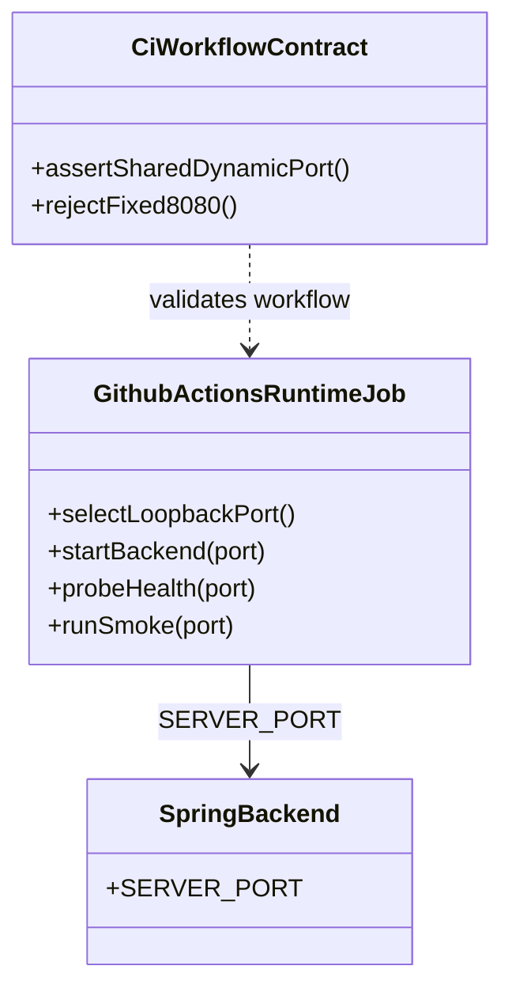
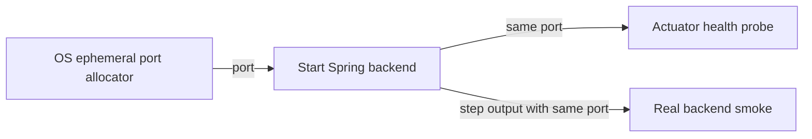
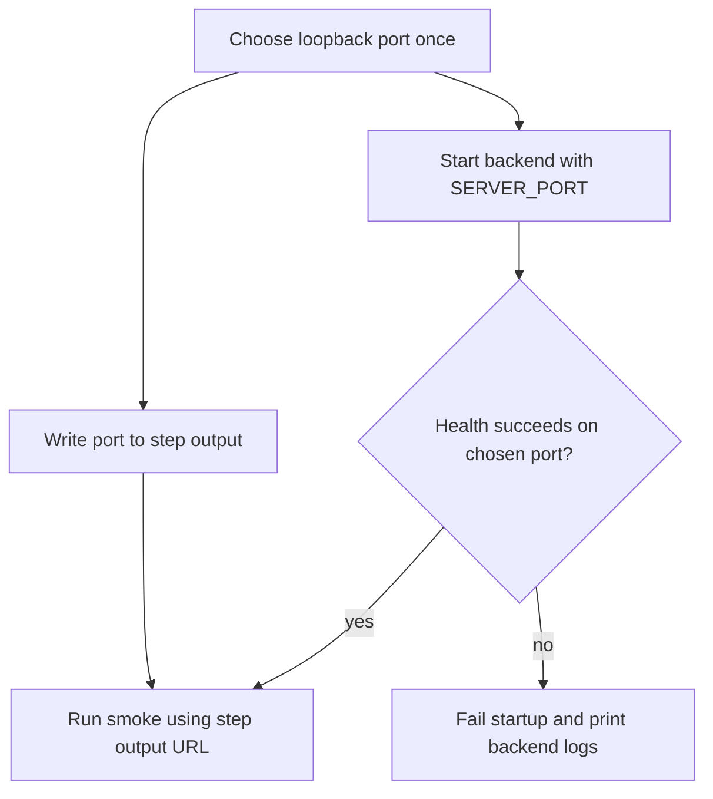

# T193 CI Runtime 동적 Backend 포트

## Approval Gate
- Status: Approved
- Approver: 사용자 — CI의 `127.0.0.1:8080` 고정 제거 요청
- Blocking ambiguity: 없음
- Competing plan branches: 없음. CI runtime job에서 사용 가능한 loopback 포트를 한 번 할당해 backend, health probe, smoke가 공유한다.

## Goal
- 사용자/운영 목표: CI runtime QA가 기본 포트에 의존하거나 다른 listener를 backend로 오인하지 않게 한다.
- 비목표: API/browser smoke의 지연 원인 분석, job timeout 변경, backend 애플리케이션 포트 설정 변경.

## Domain Language
- Runtime backend port: CI job 시작 시 OS에서 임시로 선택해 해당 job의 backend와 smoke 간에 전달하는 loopback TCP 포트.

## Participating Code
- `.github/workflows/ci.yml`: 포트를 한 번 선택하고 backend 실행, health probe, smoke URL에 같은 값을 전달한다.
- `qa/ci-workflow.contract.ps1`: 동적 포트 전달 및 runtime 구간의 고정 8080 회귀를 검사한다.

## Expected Changed Files
- `docs/01-plan/features/T193-ci-runtime-dynamic-port.plan.md`: 승인된 범위와 검증 기준. Confidence: high.
- `qa/ci-workflow.contract.ps1`: runtime 포트 계약 회귀 검사. Confidence: high.
- `.github/workflows/ci.yml`: 포트 선택, backend 환경변수, step output, 후속 smoke URL. Confidence: high.

## Tier And Layer Responsibilities
- UI/client: 변경 없음.
- Desktop/native: 변경 없음.
- API/controller: 변경 없음.
- Application/service: 변경 없음.
- Domain: 변경 없음.
- Persistence/adapter: 변경 없음.
- Infrastructure/runtime: CI workflow가 포트를 선택하고 단계 간 공유한다.
- QA/contracts: 정적 workflow 계약으로 포트 연결과 고정값 부재를 확인한다.

## Structure Diagram

## System Flow Diagram

## Behavior Flow

## Invariants And Boundaries
- Auth/security: 변경 없음. Listener는 loopback에서만 접근한다.
- Transactions/idempotency: 해당 없음.
- Error handling: 기존 startup retry와 backend 로그 수집을 유지한다.
- Generated contracts: 변경 없음.
- Platform boundaries: Ubuntu GitHub Actions의 Python 3 표준 `socket` 모듈로 사용 가능한 포트를 선택한다. 포트 선택 후 backend bind 사이의 극히 짧은 재할당 가능성은 OS port reservation을 backend에 넘길 수 없는 현재 실행 방식의 한계다.

## Implementation Steps
- `qa/ci-workflow.contract.ps1`: 먼저 runtime job의 포트 출력·전달 조건과 `:8080` 부재를 검사한다.
- `.github/workflows/ci.yml`: 선택된 포트로 backend를 시작하고 동일 포트를 health probe와 smoke step에 전달한다.

## Verification Gates
- Focused tests: `pwsh qa/ci-workflow.contract.ps1`.
- Contract checks: runtime job에서 backend port가 동적으로 할당되고 세 경로에서 동일하게 사용됨을 검사한다.
- Runtime checks: 실제 GitHub Actions `qa-runtime`에서 확인한다. 이전 실행은 smoke 도중 취소되어 이 변경의 runtime 통과 증거로 사용할 수 없다.

## Review Score Preset
- Preset: Implementation Review
- Pass threshold: 80/100, P0/P1 없음, 모든 category 50% 이상.
- Categories: blueprint alignment 20, correctness 20, security/privacy 15, tests/verification 20, maintainability 15, operations/docs 10.
