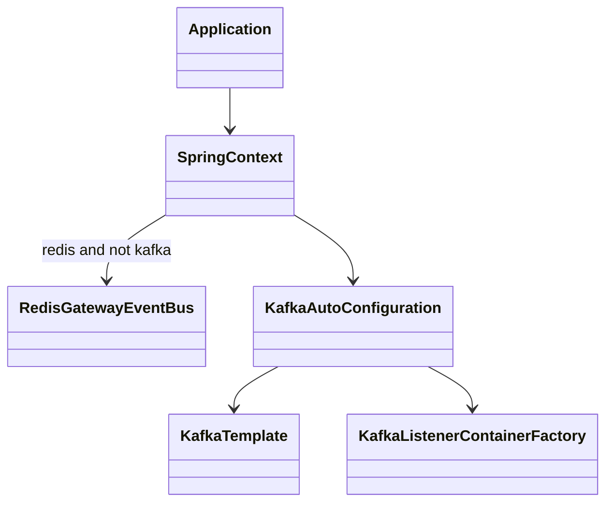
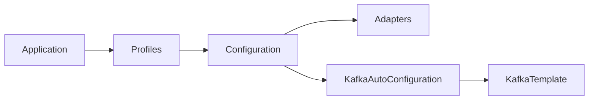
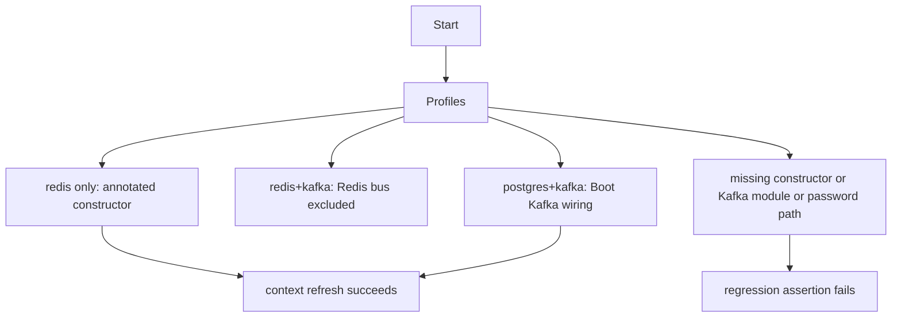

# T227 운영 프로필 기동 복구

## Approval Gate
- Status: Approved
- 승인 근거: 사용자가 운영 프로필 수정과 기동 회귀 테스트 제안 1번을 수락했고 coordinator가 본 작업을 위임했다.
- Blocking ambiguity: 없음. 새 제품 결정 없이 네 지적만 복구한다.
- 기준: main `5b6e2f87dd9d059972b12af9eb1d3245bf9f33e6`, branch `task_T227-runtime-profile-startup`.

## Backend quality task packet
- 목표/도메인: Redis 및 분리 message/websocket 런타임의 Spring 빈 기동 복구.
- 허용 경로: 아래 Expected Changed Files와 본 계획·검증 근거.
- 제외: API, 권한, 저장소 경계, 외부 연동 계약, 배포 기본값, 다른 감사 항목, commit/push/merge.
- 엔드포인트/도메인 서비스 변경: 없음. 인증·인가·입력 검증·출력 제한·트랜잭션 의미 변경 없음.
- 프로필: boot `redis`, `redis,kafka`; 두 서비스 `postgres,kafka`.
- 외부 의존: 실제 운영 DB/Redis/Kafka 접속 없음. 테스트에서 JDBC/Redis 경계만 대체하고 Kafka 리스너 자동 시작을 끈다.
- 문서: 원본 감사는 읽기 전용이며 이 문서에 검증 가능한 관찰만 승격한다. Wiki 게시/독립 리뷰는 coordinator 소유.
- Wiki 사용: index.md, Backend Architecture.md, QA Infra Operations.md, Agent Development Guide.md.

## 관찰과 대안
- Raw Source: `C:/git/discord/docs/04-report/ponytail-architecture-audit-2026-11-20/backend-runtime/KafkaWiringProbe.java`, `boot-delivery/RedisWiringProbe.java` (원본 읽기 전용, 관찰 2026-11-21, 감사 산출물).
- Extraction: 아래 세 관찰을 현재 코드 및 RED 실행으로 재검증한다. 용어는 NoIO(외부 I/O 없는 실제 빈 구성 검증), Kafka auto-configuration(클래스패스 기반 Boot 빈 공급)이다.
- Synthesis Target: coordinator가 수용 후 Backend Architecture / QA Infra Operations 및 log.md에 선별 게시한다. 새 페이지는 필요하지 않으며 index 변경 없음. 외부 연결 성공은 미검증이고 현재 소스가 판정 근거다.
- RedisGatewayEventBus에는 세 생성자가 있으나 주입 선택 표시가 없다. 실제 컴포넌트 등록으로 실패를 재현한다.
- boot는 spring-boot-kafka를 선언하지만 두 분리 서비스는 spring-kafka만 선언한다. 같은 Boot 모듈을 추가한다.
- websocket YAML의 password가 datasource 밖에 있다. 들여쓰기만 복구한다.
- 수동 Kafka 빈 선언/새 starter/생성자 삭제 대신 기존 Boot 의존성과 전체 설정 생성자 선택을 재사용한다.

## Expected Changed Files / 참여 코드
- `backend/boot/src/main/java/com/example/discord/gateway/RedisGatewayEventBus.java`: 전체 설정 생성자 @Autowired 선택.
- `backend/boot/src/test/java/com/example/discord/gateway/RedisGatewayEventBusContextTest.java`: 실제 Redis 컴포넌트 등록 및 kafka 동시 프로필 제외 검증.
- `backend/services/message/build.gradle.kts`, `backend/services/websocket/build.gradle.kts`: boot와 같은 spring-boot-kafka 추가.
- 각 서비스 `src/test/java/com/example/discord/{messageservice,websocketservice}/ProductionProfileContextTest.java`: 실제 Application + postgres,kafka, KafkaTemplate/리스너 팩토리/소비자 배선 검증.
- `backend/services/websocket/src/main/resources/application-postgres.yml`: datasource.password 복구, 위 테스트에서 sentinel 바인딩 검증.
- 신뢰도: 코드와 원본 NoIO probe 확인으로 높음.

## 계층 및 구조
UI/API/domain 변경 없음. 런타임은 빈 구성, adapter는 기존 구현, QA는 외부 I/O 차단과 실제 빈 검증을 소유한다.



## 시스템 흐름


## 성공/실패 흐름 및 경계

비밀은 출력하지 않는다. sentinel은 합성 값이며 비밀번호 assertion에는 값이 출력되지 않도록 boolean 비교한다.
NoIO는 JDBC 경계 mock, DB auto-config 제외, Flyway 비활성, listener auto-startup=false를 사용한다. 검증 대상 Kafka 빈/auto-config/실제 소비자 자체는 mock하지 않는다.

## 구현 및 검증
테스트 작성 → focused RED 실행 → 최소 수정 → 같은 명령 GREEN → `./gradlew test checkstyleMain checkstyleTest` → `git diff --check`.
첫 환경 검증 `./gradlew --version`: Gradle 8.14.3 / JDK21, exit 0. Git Bash 직접 shell 실행은 런처의 WSL 오류로 실패하여 PowerShell에서 명시적 Git Bash 프로세스를 호출한다(실제 저장소 명령은 Bash).
외부 운영 연결/컨테이너 설치/배포는 실행하지 않는다.

## 리뷰 기준
Plan Review 85/100 이상, Implementation Review 80/100 이상 및 P0/P1 없음. 독립 검수와 Wiki 수용 판단은 coordinator가 담당한다.

## Blueprint Alignment (구현자 확인)
- Matches blueprint: yes. 제품 diff는 네 지정 경로에서 5행 추가/1행 삭제이며 회귀 테스트 3개 파일을 추가했다.
- Mismatch: 없음. 테스트 scheduler mock은 message relay의 자동 JDBC 작업을 차단하기 위한 경계이며 Kafka 빈은 실제 구성이다.
- Correct owner of fix: implementation. 테스트 작성 중 ObjectMapper 생성자 참조의 overload 모호함을 lambda로 수정했다. Redis mock 빈의 Spring lifecycle 호출은 I/O가 아니므로 managed lifecycle 없는 singleton 등록으로 NoIO assertion을 정확히 했다.
- Required Loop Action: coordinator 독립 리뷰 및 수용 후 Wiki 게시. 현재 문서는 독립 검수 통과를 주장하지 않는다.

## 검증 근거 (T227-evidence/)
- `./gradlew --version`: exit 0, Gradle 8.14.3, JDK 21.0.7.
- `red.log` / `red.exit`: exit 1. 두 실제 Application에서 KafkaTemplate 누락을 확인했다. boot는 이 첫 실행에서 테스트 컴파일 오류였으므로 해당 부분은 원인 RED로 계산하지 않는다.
- `redis-red.log` / `redis-red.exit`: exit 1. 컴파일 수정 후 실제 컴포넌트에서 NoSuchMethodException 재현; `redis-red-cause.log` 보존.
- `password-red.log` / `password-red.exit`: exit 1. Kafka 의존성 복구 후 websocket의 datasource password assertion 실패, Kafka wiring 테스트 통과. Redis의 lifecycle mock assertion 과잉도 이 실행에서 확인해 테스트만 바로잡았다.
- `green.log` / `green.exit`: exit 0. 아래 focused 명령으로 모두 통과했다(message는 직전 동일 입력 통과 결과 UP-TO-DATE).

```sh
./gradlew :backend:boot:test --tests '*RedisGatewayEventBusContextTest' :backend:services:message:test --tests '*ProductionProfileContextTest' :backend:services:websocket:test --tests '*ProductionProfileContextTest' --continue
```

- `classpath-before.log`: 두 서비스 runtimeClasspath에 spring-boot-kafka 없음. `classpath-after.log`: 양쪽 모두 Boot 4.1.1 모듈 확인, exit 0. 최초 잘못된 dependencyInsight 옵션 범위 실행은 재실행으로 교체했다.
- `diff-check.log` / `diff-check.exit`: exit 0.
- 전체 회귀 `./gradlew test checkstyleMain checkstyleTest --continue`: `regression.log`와 `regression.exit`에 기록한다.
- 전체 회귀 결과: exit 0, BUILD SUCCESSFUL (2m 20s), 136 tasks 중 86 실행/50 UP-TO-DATE. 기본 opt-in 외부 연동 테스트의 기존 skip 정책은 유지했다. Gradle 9 비호환 deprecated feature 및 Mockito/JVM agent 경고가 있었으며 테스트/Checkstyle 실패는 없었다.
- 미검증: 실제 DB/Redis/broker 연동, 외부 운영 연결, 설치/배포. 독립 리뷰와 Wiki 게시, commit/push/merge는 위임 범위 밖이다.
