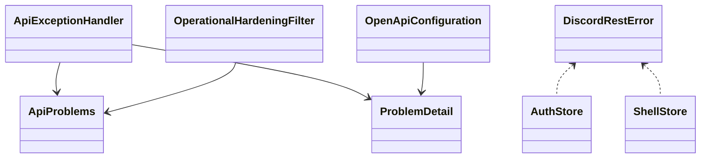
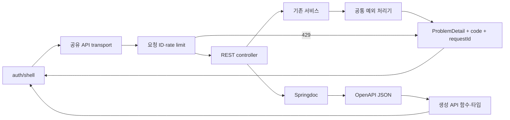
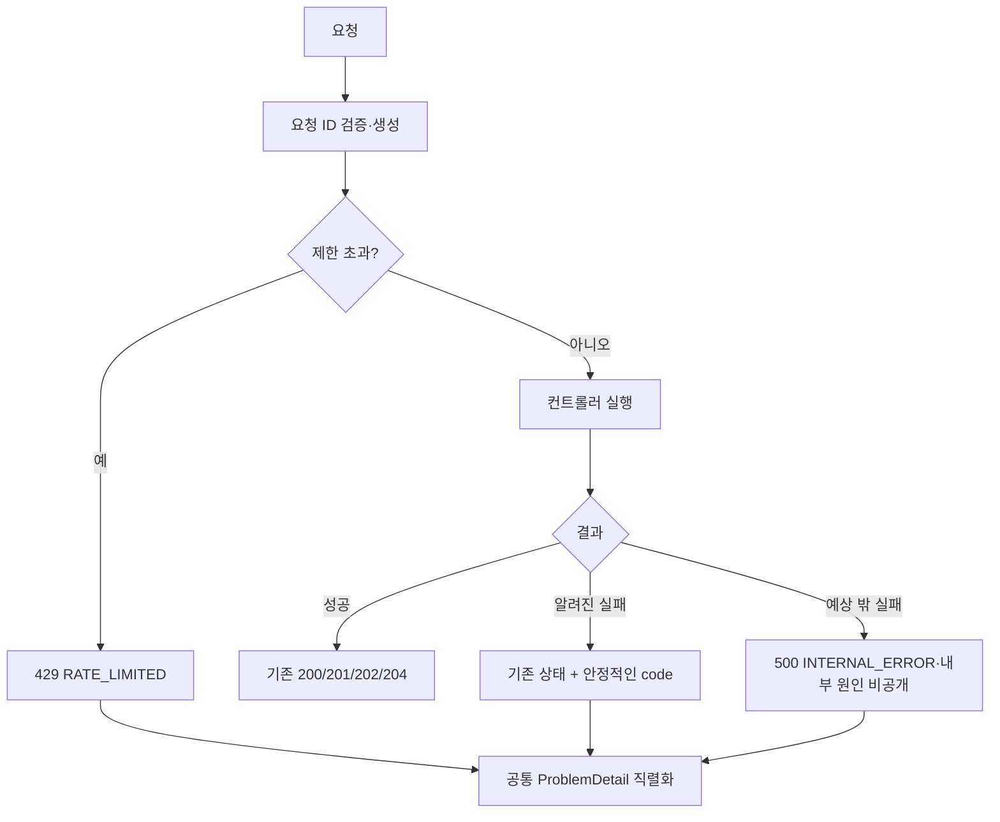

# T214 서버 오류 응답 형식 통일

## Approval Gate
- Status: Approved
- Approver: 사용자, 2026-10-24 설계서 위치 확인 후 `$test-driven-development 구현시작` 지시.
- Blocking ambiguity: 없음. nullable 후보는 converter 구현 전에 실제 직렬화 경로별 목록과 테스트로 확정한다.
- Competing plan branches: 없음. Spring `ProblemDetail`과 공통 예외 처리기로 진행한다.
- 조사 기준: `main`의 `76db98d`, 작업 브랜치 `task_T214-problem-details`. 제품 코드 변경 없음.

## 목표와 범위
- 기존 HTTP 상태와 권한 판정을 보존하면서 API 오류 본문을 RFC 9457로 통일한다.
- `application/problem+json`으로 `type`, `title`, `status`, `detail`, `instance`, `code`, `requestId`를 반환한다. `type`은 우선 `about:blank`, `instance`는 쿼리 문자열을 제외한 요청 경로다.
- 명세의 성공 상태를 실제 200·201·202·204에 맞추고 오류 응답도 기술한다. 204에는 본문 스키마를 붙이지 않는다.
- 응답 필드는 기본 required/non-null로 생성하고 실제 null인 필드만 명시적으로 nullable로 표시한다. 필드 존재와 null 허용은 별도로 취급한다. 요청 DTO의 선택 필드는 기존 호출 계약을 보존한다.
- `shell.ts`와 로그인·세션 코드도 같은 변경에서 새 계약을 사용한다.
- Node 최소 버전을 `>=22.18.0`으로 맞춘다. T215의 나머지 호출 전환은 제외한다.
- 오래된 브랜치 정리는 별도 안전 확인 대상으로 둔다. 조사상 현재 로컬 브랜치는 사용자 언급 수보다 많고 다른 worktree 사용 브랜치도 있어, 이름만 보고 삭제하지 않는다.

## Raw Source와 근거
- 출처: 사용자 T214 요구사항, 저장소 코드 직접 조사(2026-10-24).
- 관측: 17개 컨트롤러 파일 하단에 개별 advice가 존재한다. `OperationalHardeningFilter`는 별도로 429 `{message}`를 작성한다.
- durable facts: 오류 형식은 HTTP adapter 소유다. 도메인에 Spring 의존성을 추가하지 않는다. 기존 필터의 검증된 `X-Request-Id`를 재사용한다.
- 미검증: 서버 전체 예외/nullable 전수 검증 및 오류 dispatch 경로는 구현 테스트에서 확정한다. 조사만으로 완료를 주장하지 않는다.
- Synthesis Target: 승인·구현·검증 후 기존 Wiki `Backend Architecture`, `Frontend Client Architecture`, `QA Infra Operations`에 필요한 계약만 반영하고 `log.md`에 기록한다. 새 페이지가 필요하지 않아 index 변경은 없다.
- 현재 진실 원천: 코드와 실행 검증. Wiki의 오래된 프레임워크 버전 설명은 현재 build 설정을 우선한다.

## Domain Language와 참여 코드
| 요소 | 책임 | 호출/의존 관계 |
| --- | --- | --- |
| `ApiExceptionHandler` | MVC·업무 예외를 상태와 code로 변환 | 모든 boot REST controller, Spring MVC |
| `ApiProblems` | 안전한 ProblemDetail 및 요청 추적 정보 작성 | 공통 처리기, 429 필터, fallback 오류 dispatch |
| `OperationalHardeningFilter` | 기존 요청 ID·제한 헤더·관측 보존 | filter chain 앞에서 요청 ID 설정 |
| `OpenApiConfiguration` | 상태·오류 스키마·필수/nullable 계약 생성 | springdoc → OpenAPI JSON → orval |
| `DiscordRestError` | 불명확한 네트워크 오류 본문을 안전하게 읽기 | 직접 호출과 생성 클라이언트가 공유 |
| auth/shell store | code로 오류 구분, detail/추적 정보 표시 | 생성 API 함수 및 공유 오류 클래스 |

## Expected Changed Files
| 경로 | 변경 | 확실성 |
| --- | --- | --- |
| `backend/boot/src/main/java/com/example/discord/auth/ApiExceptionHandler.java` | package-private auth 예외 접근을 유지하는 공통 처리기 추가 | 높음 |
| `backend/boot/src/main/java/com/example/discord/api/ApiProblems.java` | 공통 ProblemDetail 작성 | 높음 |
| `backend/boot/src/main/java/com/example/discord/api/ApiErrorController.java` | `/error` dispatch도 같은 계약으로 처리 | 높음: 기존 기본 응답 계약 테스트 RED 확인 |
| `backend/boot/src/main/java/com/example/discord/{auth,event,expression,guild,experience,gateway,moderation,invite,social,voice,notification,presence,message,storage,thread}/*Controller.java` | 기존 advice/ErrorResponse 제거, 실제 응답 상태·nullable 메타데이터 표시 | 높음: 아래 명시된 기존 advice만 제거 |
| `backend/boot/src/main/java/com/example/discord/ops/OperationalHardeningFilter.java` | 429를 공통 형식으로 변경, 기존 헤더 유지 | 높음 |
| `backend/boot/src/main/java/com/example/discord/openapi/OpenApiConfiguration.java` 및 필요한 동일 패키지 converter | 기본 required, nullable 예외, 오류 스키마 | 높음 |
| `backend/boot/src/test/java/com/example/discord/auth/ApiExceptionHandlerTest.java` | 중앙 오류 계약·누출 방지 회귀 | 높음 |
| `backend/boot/src/test/java/com/example/discord/openapi/OpenApiContractTest.java` | 상태·스키마 계약 검증 | 높음 |
| `backend/boot/src/test/java/com/example/discord/{auth/AuthControllerTest,gateway/GatewayControllerTest,guild/GuildControllerTest,invite/InviteControllerTest,storage/AttachmentControllerTest,ops/OperationalHardeningFilterTest,ops/OperationalHardeningFilterTrustedProxyTest}.java` | message 검증을 새 계약으로 전환 | 높음 |
| `backend/boot/src/test/java/com/example/discord/{event/ServerEventOpenApiExportConfiguration,notification/NotificationOpenApiExportConfiguration}.java` | 제거된 advice의 export 테스트 bean도 제거 | 높음 |
| `docs/api/openapi.json`, `packages/api-client/src/generated/**` | 도구로 재생성 | 높음 |
| `packages/api-client/src/http/discord-fetch.ts`, `.test.ts` | 공유 오류의 안전한 필드 접근 및 회귀 테스트 | 높음 |
| `apps/web/stores/{shell,auth}.ts` | detail/code/requestId 사용, 중복 응답 검사 축소 | 높음 |
| `apps/web/tests/components/{auth-api-client,app-shell,shell-contracts}.test.ts` | 영향받는 오류/세션 계약 회귀 | 중간: 실제 관련 assertion만 수정 |
| `qa/openapi-contract.test.mjs` | 재생성 일치와 required/nullable 검증 | 높음 |
| `package.json`, `package-lock.json`의 루트 engines | Node 최소 버전 변경 | 높음 |
| `docs/03-analysis/T214-{openapi-tdd,tdd-verification}.md` | TDD·검증 실행 증거 | 높음 |

advice 제거 대상은 `Auth`, `ServerEvent`, `Expression`, `Guild`, `Premium`, `Stage`, `Gateway`, `Soundboard`, `Moderation`, `Invite`, `Social`, `Voice`, `Notification`, `Presence`, `Message`, `Attachment`, `Thread`다. 도메인 로직·DB·의존성 추가는 범위 밖이다.

## Tier And Layer Responsibilities
- UI/client: 서버 메시지 문자열에서 오류 종류를 추론하지 않고 code를 사용한다. 쿠키·Bearer·요청 ID 전송, 메모리 전용 access token, 세션 경쟁 방지 로직을 유지한다.
- Desktop/native: 변경 없음.
- API/controller: HTTP 상태와 직렬화, nullable 표식만 담당한다.
- Application/domain/persistence: 기존 예외·트랜잭션·권한 의미를 보존한다.
- Infrastructure/runtime: 필터의 429와 fallback 오류 경로도 동일한 직렬화 계약을 사용한다.
- QA/contracts: 실제 응답, export된 명세, 생성 타입을 함께 검증한다.

## Structure Diagram

## System Flow Diagram

## Behavior Flow

## Invariants And Boundaries
- `LOGIN_LOCKED`와 `FORBIDDEN`은 서로 다른 code다. 인증 관련 `INVALID_CREDENTIALS`, `DUPLICATE_ACCOUNT`, `INVALID_REFRESH_TOKEN`, `REFRESH_TOKEN_REUSE_DETECTED`도 분리한다.
- 기존 gateway `RESYNC_REQUIRED` code 및 409 의미를 보존한다.
- 기존 not-found→404, 초대 소진/만료/삭제→410, publish 거절→409, mutation/policy 거절→403 의미를 보존한다.
- `IllegalStateException`은 Stage에서 400, Thread에서 403이었다. 모든 IllegalStateException을 전역 400으로 처리하지 않는다. 해당 두 HTTP 경계에서 기존 매핑을 명시하고 예상 밖 내부 IllegalStateException은 500으로 처리한다.
- malformed JSON, 검증 오류, 잘못된 파라미터, 지원하지 않는 method/media type, 미존재 경로, fallback 500도 계약 테스트한다. 예외 원문·스택·토큰·본문을 detail에 그대로 노출하지 않는다.
- `requestId`는 본문과 `X-Request-Id` 헤더가 일치해야 한다. rate limit의 `Retry-After`, `X-RateLimit-*`를 보존한다.
- null 후보: channel `parentId`, gateway event `guildId/channelId`, invite/premium `expiresAt`, message page `nextCursor`, moderation report `moderatorId`, attachment `messageId`, DM notification `guildId`. notification 추가 필드와 audit 값은 실제 mapping을 더 확인한다. 후보를 일괄 nullable 처리하지 않는다.
- 내부 outbox의 선택적 author/target 필드는 공개 웹 계약에 노출하지 않는다.
- 내부 outbox도 export된 OpenAPI의 진실성 검증 대상이다. author `userId/botId/webhookId`, target `guildId/channelId/threadId/conversationId/recipientId`는 필수 존재·nullable로 선언하고 variant projection을 회귀 검증한다.
- 예상 밖 500은 requestId·예외 종류·발생 위치를 서버에 기록한다. 예외 message와 raw stack trace는 비밀 누출 위험 때문에 기록하지 않는다.
- `MessageResponse.sequence`는 실제 primitive long 경로를 사용하므로 선택 필드로 남기지 않는다.

## Implementation Steps
1. 대표 오류 계약 테스트를 작성하고 현재 `{message}`/빈 본문 때문에 실패함을 확인한다.
2. 기존 advice별 예외/상태 표를 중앙 처리기로 옮긴 후 17개 중복 advice를 제거한다. Stage/Thread 상태 예외는 해당 경계에서 명시한다.
3. 필터와 fallback 오류 dispatch를 통합하고 상태·헤더·누출 방지 테스트를 통과시킨다.
4. 실제 `ResponseEntity` 상태에 맞는 메타데이터를 추가한다. 생성 201, 삭제 등 204, 내부 outbox 재처리 202를 포함한다.
5. 응답 required 기본 규칙 및 실제 nullable 필드를 반영하고 명세와 클라이언트를 재생성한다.
6. 공유 오류 클래스·shell·auth를 새 계약으로 전환하고 기존 응답 검사 helper를 축소한다.
7. Node engines를 맞추고 아래 검증·독립 리뷰를 통과시킨다. 통과 전 commit/push/merge하지 않는다.

## Verification Gates
- 환경 선확인: Git Bash 직접 실행 확인, `./gradlew --version` 성공(Gradle 8.14.3, Java 21).
- 기준선: `./gradlew :backend:boot:test --tests com.example.discord.auth.AuthControllerTest --tests com.example.discord.openapi.OpenApiContractTest`.
- RED/GREEN: 새 `ApiExceptionHandlerTest`, 429 필터 및 기존 auth/gateway/invite/thread/stage 대표 테스트.
- 명세: `npm run openapi:write` 후 `npm run openapi:check`, `OpenApiContractTest` 재실행. 성공 상태·204 무본문·ProblemDetail·필수/nullable·재생성 일치를 검증한다.
- 프론트: `npm test -w packages/api-client`, `npm run test -w apps/web`, web build/typecheck에서 생성 타입 사용을 확인한다.
- 공통 변경 회귀: `./gradlew test`, `npm run lint:backend`, `npm run lint:frontend`, `git diff --check`, `git status --short`.
- 인프라 의존 테스트는 기존 opt-in 정책을 유지한다. 실행하지 못한 gate는 미통과로 명시한다.
- 별도 spec 및 품질/보안 독립 리뷰 각각 90/100 이상, 미해결 P0/P1 없음. merge-review 증거도 독립 검수한다.

## Review Score Preset
- 설계: Plan Review 100점(범위20, 구조20, 파일15, 모호성15, 검증20, 위험10), 최소85.
- 구현: Implementation Review 100점(blueprint20, 정확성20, 보안15, 검증20, 유지보수15, 운영10). 저장소 push/merge 기준에 따라 최소90, P0/P1 없음.
- 인증·오류 노출: Security Review 최소90, 미해결 높은 심각도 없음.
- 현재 점수: 미평가. 승인·검증·리뷰 완료로 표시하지 않는다.

## Blueprint Alignment / Required Loop Action / Acceptance
- Matches blueprint: 아직 구현 전.
- Update blueprint: 승인 및 새 코드 근거가 설계에 영향을 주면 먼저 갱신한다.
- Update implementation / Re-run verification: 승인 후 수행.
- Accepted blueprint: 대기.
- Accepted implementation / verification: 아님.
- Publishable knowledge: 아직 없음.

## Wiki used
- `index.md`
- `wiki/Backend Architecture.md`
- `wiki/Frontend Client Architecture.md`
- `wiki/QA Infra Operations.md`
- `wiki/Agent Development Guide.md`
