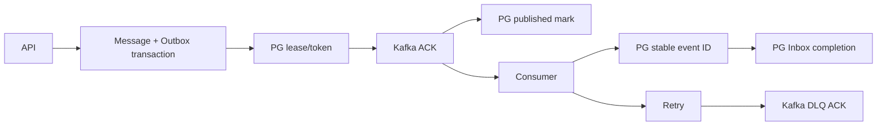

# 메시지 발행 재해 테스트 확장

## 승인과 조사 근거
- 상태: Approved. 사용자가 2026-10-22 서브에이전트 조사 후 개발을 명시적으로 지시했다.
- 기존 설계: `message-publication-resilience-observability.blueprint.md`의 경계와 at-least-once 계약을 유지한다.
- 원자료: outbox_fault_inventory, consumer_fault_inventory, infra_fault_inventory의 읽기 전용 코드 조사. 관측일 2026-10-22.
- 모호성/경쟁 구현 경로: 없음. 기존 Kafka error handler, Outbox lease, 영속 Gateway event ID 중복 방지를 사용한다.
- 핵심 정정: 통합 테스트 메서드 4개가 전체 장애 커버리지를 뜻하지 않는다. 단위 예외 주입, 실제 의존성 장애, 프로세스 종료를 구분한다.

## 필수 동작과 검증 계층

| 장애 조건 | 기대 결과 | 기존 증거/이번 작업 |
|---|---|---|
| 메시지 저장 중 Outbox INSERT 실패 | 메시지·멱등키·projection 전체 rollback | 기존 JdbcMessageStoreTest 실제 PG |
| broker ACK 실패 | Outbox published 금지 | 기존 dispatcher/relay 단위, 이번 실제 producer의 비응답 endpoint metadata timeout 후 정상 broker 경로로 복구 |
| ACK 이후 published 기록 실패 | 같은 event ID 재발행 허용, 유실 금지 | 이번 relay fault injection |
| mark와 release가 연속 실패 | 최초 예외 보존, 후속 실패 suppressed | 이번 RED→최소 수정 |
| batch 중 첫 발행 실패 | 미시도 항목은 lease 이후 재처리 가능 | 이번 relay 계약 |
| lease 직전·정각 | 직전 재claim 거부, 정각 재claim 허용 | 이번 실제 PG 고정시각 경계 |
| 두 relay 동시 claim | 한 lease 안에서 동일 이벤트 단일 소유자 | 이번 실제 PG barrier |
| 이전 claim 소유자 늦은 mark/release | 새 소유자의 상태 보존 | 이번 실제 PG fencing |
| 순차 중복 | Inbox·Gateway 효과 각각 1 | 기존 실제 Kafka/PG |
| 동시 중복 | 영속 Inbox·Gateway 효과 각각 1 | 이번 barrier/실제 PG |
| DB 조회 실패 | 완료하지 않고 재시도 | 기존 단위 및 실제 PG pause |
| Gateway 이후 Inbox INSERT 실패 | 재처리 후 효과·Inbox 각각 1 | 이번 실제 PG trigger |
| 실제 소비자 JVM 종료 | 같은 DB/Kafka에서 재시작 후 효과·Inbox 각각 1 | 이번 자식 JVM kill/restart |
| schema-invalid JSON | 메타데이터 DLQ, 본문 비노출 | 기존 실제 Kafka |
| 문법상 깨진 JSON/빈값/null | DLQ 생성 자체가 실패하지 않음 | 이번 빠른 RED 및 실제 Kafka 후속 정상 이벤트 |
| poison 다음 정상 이벤트 | 같은 partition 처리 진행 | 이번 실제 Kafka |
| DLQ 동기 실패/ACK 실패/timeout/interruption | handler 처리 미완료 반환, 성공 metric 금지, 복구 후 재시도 가능 | 이번 실제 handler+I/O 경계 단위; 실제 committed offset 장애 검증은 아님 |
| retry 소진과 DB 복구 후 재전달 | 양쪽 group DLQ 확인 후 효과 1 | 기존 실제 Kafka/PG |
| 소비 중단과 backlog drain | lag 상승 후 0 | 기존 실제 Kafka |

경계값 검증은 입력·시간·상태를 고르는 방법이고, 화이트박스/블랙박스는 관찰·주입 방식이다. MockMvc와 내부 SQL/metric을 사용하는 테스트를 외부 HTTP만 사용하는 블랙박스 검증으로 부르지 않는다.

## 참여 코드와 변경 경계
- `MessageKafkaConfiguration` 및 `MessageKafkaConfigurationTest`: DLQ metadata 생성; 깨진 JSON 파싱 실패를 안전하게 처리한다.
- `MessageKafkaRecoveryFailureTest`: 실제 Spring Kafka error handler의 recovery 결과. Kafka I/O만 실패 future로 대체한다.
- `DefaultMessagePublicationRelay` 및 모듈 테스트: ACK/완료/release 순서와 원인 보존.
- `MessageOutboxLeaseFailureIntegrationTest`: Spring context 없는 Testcontainers PG, 실제 Outbox adapter의 lease/fencing/경합.
- `MessagePublicationFailureIntegrationTest` 및 test-only child fixture(`MessagePublicationConsumerProcess`): 실제 Kafka·PG·프로세스 장애. 운영 코드에 테스트 전용 API를 추가하지 않는다.
- `backend/boot/build.gradle.kts`: 자식 JVM에 기존 test runtime classpath를 전달할 때만 최소 변경한다.
- 기존 Guild/Moderation 전환 파일은 이번 재해 확장 범위에 포함하지 않는다.

## TDD와 검증 게이트
1. 기존 동작은 테스트를 추가해 통과하면 characterization으로 기록한다. 인위적으로 실패시키지 않는다.
2. 깨진 JSON과 연속 release 실패는 테스트가 올바른 assertion에서 실패하는 RED를 먼저 기록한다.
3. 그 실패를 해결하는 최소 운영 코드만 수정하고 같은 명령으로 GREEN을 확인한다.
4. 빠른 테스트: `:backend:modules:message:test`, boot의 Configuration/RecoveryFailure/Consumer focused tests.
5. 실제 재해는 `DISCORD_RUN_MESSAGE_PIPELINE_FAILURE_TESTS=true`로만 실행한다. 공유 Kafka/PG를 중지하지 않고 테스트 소유 PG 및 자식 JVM만 제어한다.
6. 최종 게이트: 전체 `test`, `npm run lint:backend`, `git diff --check`, 독립 구현 검수. 명령 원문은 `.gradle/message-failure-expansion/`에 보존한다.
- 검수 기준: Implementation Review 80/100 이상, P0/P1 없음. 검증되지 않은 실제 broker 중단/외부 HTTP/운영 SLO를 검증했다고 주장하지 않는다.

## 지식 반영
- 수용 후 `wiki/Backend Architecture.md`, `wiki/QA Infra Operations.md`, `log.md`에 재해 분류·결함·명령을 요약한다. 새 wiki page가 없으므로 index 변경은 불필요하다.
- 이전 4건 통과 기록은 당시 범위의 결과로 보존한다. 확장 결과와 섞어 덮어쓰지 않는다.

## 최종 검증 결과
- 추가 실행 케이스 28개: poison 입력 파라미터 9개, DLQ 실패 4개, relay 실패 순서 3개, PG lease 5개, Kafka/PG/JVM 재해 7개.
- 집중 검증 총 48건 통과(2026-10-22 확장 시점, `be1c9a9` 이전 수치): Configuration 18, RecoveryFailure 4, Consumer 5, Relay 5, 실제 PG lease 5, 실제 Kafka/PG/JVM 11. 각 명령의 XML을 별도 보존했으며 서로 다른 실행의 지연 수치를 합치지 않았다.
  - 2026-10-24 T216 이후 수치: Configuration 22, Consumer 8, Mention consumer 3, RecoveryFailure 4, 실제 Kafka/PG/JVM 11(78.818초). 근거는 `docs/03-analysis/task_T216-message-pipeline-followups.blueprint.md`.
- TDD RED: 깨진 JSON 3종의 DLQ encoding 실패, mark/release 연속 실패 시 최초 원인 상실. 두 결함 모두 해당 테스트를 먼저 실패시킨 뒤 운영 코드를 수정해 GREEN을 확인했다. 나머지 추가 테스트는 기존 동작 검증이다.
- JVM 강제 종료 테스트 22.185초, Kafka/PG 전체 class 77.559초. PG lease 본문 0.824초(컨테이너 준비 시간 제외). 고정 sleep을 추가하지 않았다.
- 전체 `test`와 `npm run lint:backend`, `git diff --check` 통과. runtime은 opt-in이며 기본 test에서 infra 테스트를 자동 실행하지 않는다.
- 범위 한계: broker 자체 중단/재시작, 외부 HTTP만 사용하는 black-box, DLQ 실패 시 실제 committed offset, 독립 Gateway instance 경합과 WebSocket 전달 횟수는 미검증이다. concurrent consumer는 같은 Gateway service를 사용한다.
- 실측 JSON: `docs/04-report/message-publication-failure-expansion-evidence.json`. 이전 수치와 구분해 HTML portfolio에 날짜별로 추가했다.
- 2026-10-24 T216 정정
  - message topic의 JSON `null` record도 `IllegalArgumentException`으로 분류돼 두 group 모두 재시도 없이 DLQ로 간다. 이전에는 NPE로 group마다 3회 시도했다(drill `jsonNullDeadLetters…` 7.1~7.2초 → 4.4초).
  - DB 장애 drill의 retry 수치는 `consumer.retries` 정의 변경으로 6 → 4(group당 실제 재시도 2회)다. 실패 3회와 DLQ 2건은 그대로다.
  - 공유 recoverer는 authorization projection listener의 소진 record도 message DLQ topic으로 보낸다. 재생 도구는 DLQ metadata의 `topic` 필드로 걸러야 한다.
