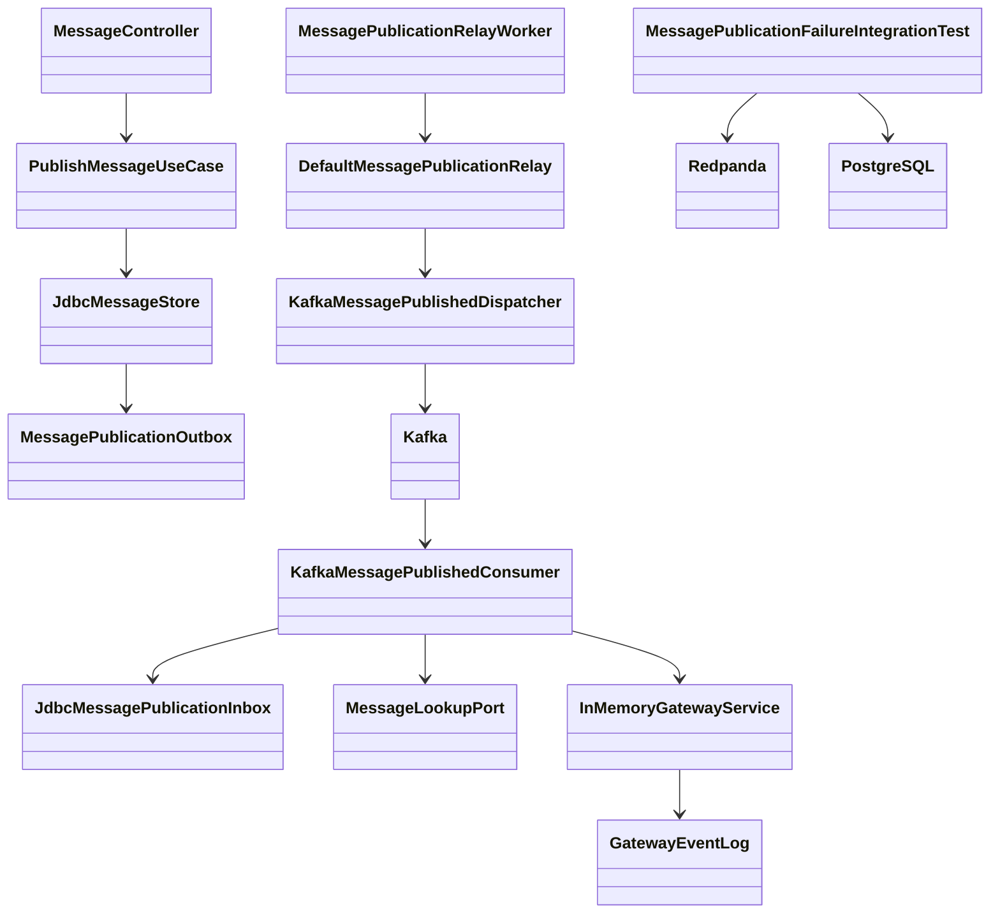
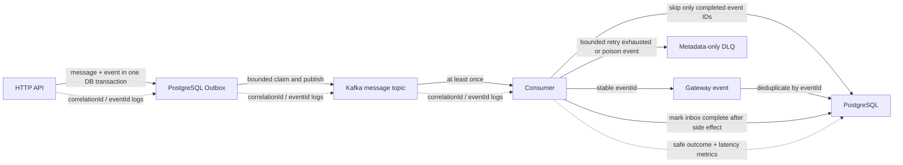
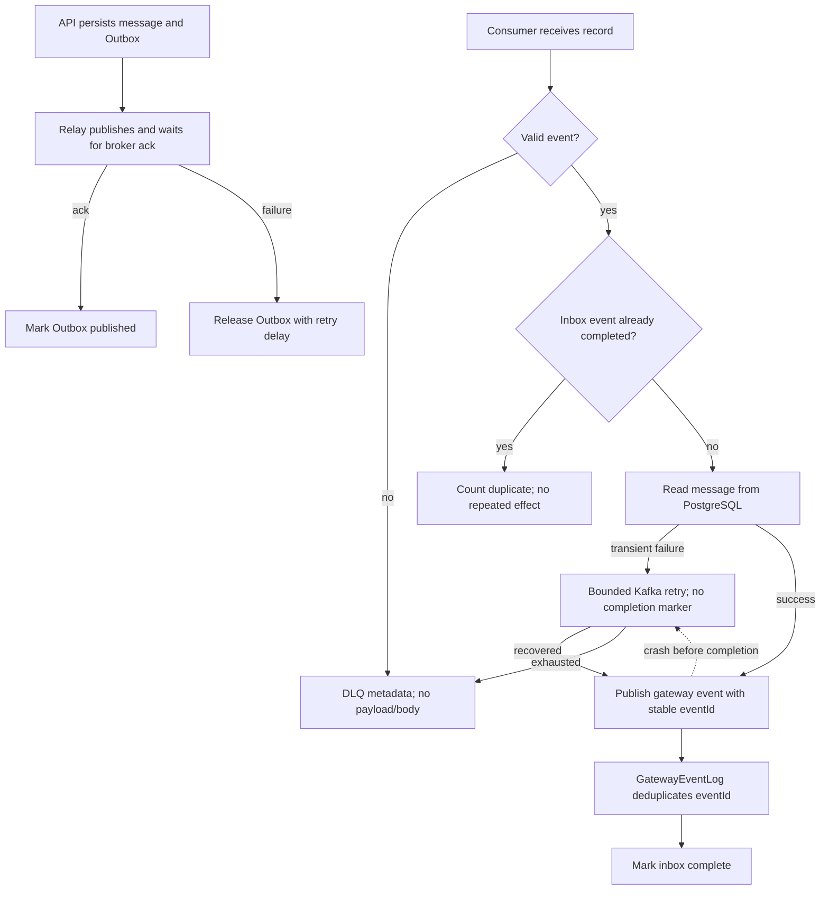

# Message Publication Resilience and Observability

## Approval Gate
- Status: Approved
- Approver: User (conversation approval: “구현 진행하자”)
- Blocking ambiguity: None
- Competing plan branches: Use the existing Redpanda/PostgreSQL Compose services with opt-in integration tests; do not add a broker, exporter, or test dependency.

## Goal
- Reproduce failure and recovery behavior for the existing channel-message publication flow and collect reproducible operational evidence.
- Make one API request traceable through message persistence, Outbox relay, Kafka, consumer, and gateway/database effects using the existing `correlationId` and safe `eventId` fields.
- Produce a Korean portfolio report with measured runtime values and clearly bounded claims.
- Non-goals: New microservice, frontend work, changing message/event schema, exactly-once claims across PostgreSQL and Kafka, general Kafka platform dashboard, unrelated consumers.

## Domain Language
- Message publication: `POST /api/channels/{channelId}/messages` stores a message and a `MessagePublished` Outbox row atomically.
- Outbox relay: `DefaultMessagePublicationRelay` claims rows, waits for Kafka broker acknowledgement, then marks them published or releases them for retry.
- Inbox completion: `(consumer_name,event_id)` persistence written only after the stable-ID gateway side effect succeeds; `JdbcGatewayEventLog` deduplicates the event ID if the consumer dies after the side effect but before inbox completion.
- Consumer lag: Kafka topic partition latest offset minus committed offset; a partition with no committed offset uses offset zero so pre-first-commit backlog is visible.
- DLQ: Existing metadata-only `*.message.published.v1.dead-letter` record; it intentionally contains no message body or raw exception text.

## Participating Code
- `MessageController` / `PublishMessageUseCase`: accept the authenticated HTTP request, use the filter-sanitized request ID as correlation ID (generate a fallback if absent), persist the message and Outbox.
- `JdbcMessageStore` / `JdbcMessagePublicationOutbox`: transactional write, bounded claim, retry metadata, backlog query.
- `DefaultMessagePublicationRelay` / `KafkaMessagePublishedDispatcher`: dispatch and broker acknowledgement boundary.
- `KafkaMessagePublishedConsumer` / `JdbcMessagePublicationInbox`: skip completed IDs, look up persisted message, publish with the stable event ID, then mark inbox completion; a failure before completion is retried.
- `MessageKafkaConfiguration`: bounded consumer retry and metadata-only DLQ recovery policy.
- Existing `MeterRegistry`, `/actuator/prometheus`, Prometheus, Loki, and Alloy: metrics/log collection; reuse these.

## Expected Changed Files
- `backend/boot/src/test/java/com/example/discord/message/KafkaMessagePublishedConsumerTest.java`: RED tests for duplicate delivery after consumer recreation, no premature inbox completion on failure, and malformed payload handling.
- `backend/boot/src/test/java/com/example/discord/message/MessageKafkaConfigurationTest.java`: assert retry classification/count and metadata-only DLQ contract.
- `backend/boot/src/test/java/com/example/discord/message/MessagePublicationFailureIntegrationTest.java` (new, opt-in): call the actual message HTTP endpoint with MockMvc, use an isolated Testcontainers PostgreSQL and a unique topic prefix on the existing local Redpanda, then exercise duplicate delivery across listener restart, crash after gateway-event append but before inbox completion, DB outage→both-group DLQ→republication of the retained payload as a new source-topic record, malformed event→DLQ, and measured lag/latency. No DB/broker dependency in default tests.
- `backend/boot/src/main/java/com/example/discord/message/KafkaMessagePublishedConsumer.java`: safe lifecycle logs/counters and end-to-end latency; complete the inbox only after the gateway side effect, relying on the existing stable-event-ID deduplication in `GatewayEventLog` for a crash between side effect and inbox completion.
- `backend/boot/src/main/java/com/example/discord/message/MessageKafkaConfiguration.java`: non-retryable malformed-event policy if RED evidence confirms wasteful transient retries; retain bounded retry for DB/network failures and metadata-only DLQ.
- `backend/boot/src/main/java/com/example/discord/message/MessagePublicationConsumerLag.java`: include all partitions even when the group has no committed offset; run its bounded AdminClient polling on a dedicated scheduler so it cannot delay the Outbox relay.
- `backend/boot/src/main/java/com/example/discord/message/MessageKafkaConfiguration.java`: count retry and DLQ metrics only for the message publication source topic because the configured error handler is shared across listeners.
- `backend/boot/src/main/java/com/example/discord/message/DefaultMessagePublicationRelay.java` and/or `KafkaMessagePublishedDispatcher.java`: stage timing and safe correlation/event logs; no event IDs as metric labels.
- `backend/boot/src/main/java/com/example/discord/message/MessageConfiguration.java` or a small existing-runtime wiring point: register the bounded outbox backlog gauge and relay metrics.
- `backend/boot/src/main/java/com/example/discord/message/MessagePublicationInbox.java`, `JdbcMessagePublicationInbox.java`, and `InMemoryMessagePublicationInbox.java`: change claim-before-effect semantics to check-completed / mark-completed-after-effect without adding a new inbox state table.
- `backend/boot/src/main/resources/application-kafka.yml`: only if a verified Kafka listener metric or recovery setting needs explicit configuration.
- `qa/message-publication-resilience-smoke.ps1` (new only if the opt-in integration test cannot safely orchestrate compose failure/recovery itself): repeatable setup/teardown, bounded waits, evidence artifact output.
- `docs/04-report/message-publication-resilience-portfolio.html` (new): Korean portfolio based on the required interactive report template; include measured evidence, scenario table, search, contents, dark mode, and limitations.
- `docs/04-report/message-publication-resilience-evidence.json` (new): preserve the opt-in integration run values and measurement limits in a machine-readable artifact.
- `C:\tmp\ObsidianVaults\discord-llm-wiki\wiki\Backend Architecture.md`, `wiki\QA Infra Operations.md`, and `log.md`: accepted durable contract and exact opt-in verification command after review and tests pass.

## Tier And Layer Responsibilities
- API/controller: use the filter-sanitized `X-Request-Id` as correlation ID when available; retain a generated fallback for non-HTTP callers.
- Application/domain: preserve current publication and event invariants; do not introduce observability framework abstractions into the domain module.
- Persistence: keep message + Outbox in the existing single transaction; keep consumer inbox behavior durable in `postgres`.
- Infrastructure/runtime: collect bounded counters/timers/backlog and Kafka consumer lag using existing Micrometer/Actuator/Prometheus surfaces.
- QA: fast default tests remain infra-free; real Kafka/PostgreSQL failure drill is explicitly opt-in and emits raw machine-readable evidence for the report.
- Portfolio: distinguish simulated, opt-in integration, and live measured evidence; do not claim production traffic or exactly-once delivery.

## Structure Diagram

## System Flow Diagram

## Behavior Flow

## Invariants And Boundaries
- Security/privacy: never log message content, authorization, secrets, or raw SQL/connection strings; DLQ remains metadata-only.
- Transactions/idempotency: message + Outbox stay atomic; broker delivery remains at-least-once; GatewayEventLog deduplicates the stable event ID; inbox completion is recorded after the side effect; no cross-system exactly-once claim.
- Retries: transient DB/broker failures use the existing bounded retry policy; malformed/schema-invalid input follows the current bounded DLQ path unless RED tests justify a narrower classification change.
- Recovery: after retry exhaustion, operator-controlled recovery republishes the retained original event payload to the same source topic (a new Kafka record/offset); this scoped drill does not reset consumer offsets. Keep PostgreSQL unavailable until both consuming groups acknowledge their DLQ records, then restore it and replay. Prove that a crash between gateway append and inbox completion replays safely through stable event-ID deduplication.
- Metrics: bounded labels only (`outcome`, fixed consumer group/topic, optional partition); never event/message/correlation IDs as labels.
  - `discord.message.publication.outbox.backlog` gauge.
  - `discord.message.publication.relay` timer with `outcome=published|failed`.
  - `discord.message.publication.consumer.events` counter with `outcome=processed|duplicate|failed|dead_letter`.
  - `discord.message.publication.end_to_end` timer from event `occurredAt` to consumer completion.
  - `discord.message.publication.consumer.lag` gauge for fixed group `gateway-service-v1`, including topic partitions before their first committed offset; poll on a dedicated scheduler.
  - Shared error-handler retry/DLQ callbacks increment message-publication counters only when their source topic is the configured message publication topic.
- Tracing: log `correlationId` and `eventId` at each pipeline boundary; use existing request ID when safely available, otherwise preserve current generated correlation ID.
- Tests: default suite stays infra-free; Kafka/PostgreSQL tests require explicit opt-in and use only task-owned records/topics/consumer groups.

## Implementation Steps
1. Add failing tests proving request ID reaches the event record, inbox completion occurs after gateway append, duplicate delivery is suppressed across consumer recreation, a crash between gateway append and inbox completion replays safely, and malformed payload behavior; run each and preserve expected RED evidence.
2. Add opt-in integration tests against isolated PostgreSQL Testcontainers plus existing Redpanda for HTTP API→Outbox→Kafka→consumer flow, listener restart/redelivery, crash-window recovery, DB connection loss→both-group DLQ→retained-payload republication as a new source-topic record, poison event DLQ, and consumer lag rising/falling.
3. Implement only behavior exposed by RED: safe retry classification/recovery and required consumer lifecycle semantics; do not expand to other event consumers.
4. Add pipeline correlation logs and low-cardinality counters/timers/backlog/lag metrics using existing Micrometer and Kafka client metrics; test names, tags, and outcomes. Snapshot consumer counters before each injected scenario and record scenario deltas.
5. Run focused default tests, opt-in failure drill, full backend tests, and backend lint sequentially; retain XML/log/metrics evidence.
5a. Regression cases: lag includes a topic partition with no committed offset; retry/DLQ meters ignore unrelated source topics; lag polling uses an isolated scheduler, and unqualified `@Scheduled` work keeps running on the default `taskScheduler` while lag polling is blocked (context test, not annotation-only).
6. Generate the portfolio HTML from the executed evidence and state untested cases explicitly.
7. Review implementation against this blueprint, fix mismatches, then publish accepted architecture/QA knowledge to the external wiki.

## Verification Gates
- RED/GREEN: `./gradlew :backend:boot:test --tests com.example.discord.message.KafkaMessagePublishedConsumerTest --tests com.example.discord.message.MessageKafkaConfigurationTest`
- Opt-in real dependency drill: `$env:DISCORD_RUN_MESSAGE_PIPELINE_FAILURE_TESTS='true'; .\gradlew.bat :backend:boot:test --tests com.example.discord.message.MessagePublicationFailureIntegrationTest` with Docker and Redpanda at `SPRING_KAFKA_BOOTSTRAP_SERVERS` (default `127.0.0.1:29092`).
- Metrics contract: assert Prometheus meter names, outcomes, low-cardinality tags, backlog, end-to-end latency, and lag movement.
- Shared-handler contract: unrelated topic retry/DLQ events do not change message-publication counters; uncommitted message partitions contribute to lag.
- DB failure drill: wait for both message-topic consumer groups' DLQ acknowledgements before restoring PostgreSQL so measured retry/DLQ deltas are scenario-stable.
- Regression: `./gradlew :backend:boot:test`, `./gradlew test`, `npm run lint:backend`.
- Evidence: preserve the successful opt-in run values, scenario-specific retry/DLQ deltas, observed recovery latency, and consumer lag in the committed evidence JSON; Gradle XML is a generated local artifact and can be overwritten by a later default run that skips the opt-in tests.

## Test Runtime Follow-up
- Goal: make routine TDD feedback fast while preserving real broker/database failure evidence in the explicitly opt-in suite.
- Keep `MessagePublicationFailureIntegrationTest` opt-in and dependency-free beyond the existing Spring Kafka/Testcontainers stack. Replace arbitrary `Thread.sleep` condition polling with bounded blocking signals from the Kafka listener container; use Kafka `poll` only where the test is waiting for an actual DLQ record.
- Preserve the production Kafka retry backoff at its existing 1000 ms value so the opt-in drill continues to exercise the real retry timing.
- Keep `MessageControllerTest` on the shared default `@SpringBootTest` context: its auth, membership, and permission cases exercise the real application graph. MockMvc does not open a listening server, and matching Spring test configurations reuse the cached context. Do not convert it to a slice unless startup measurements show this class creates a distinct expensive context and the slice can preserve those security contracts.
- Verification: focused Kafka consumer/config unit tests, `MessageControllerTest` with one other default-profile controller test to observe context reuse and elapsed time, and the opt-in failure drill when Docker and Redpanda are available. Confirm no `Thread.sleep` remains in the failure drill and no test-only production API or dependency is added.

## Review Score Preset
- Preset: Plan Review
- Pass threshold: 85/100
- Categories: scope clarity, architecture fit, file impact, ambiguity control, verification plan, risk handling

## Implementation Review Loop
- Reviewed revision: working-tree implementation after P2 review fixes; independent code review completed.
- Initial findings: P0 0, P1 0, P2 3 (uncommitted-partition lag false zero; shared-handler retry/DLQ metric contamination; lag poll blocking shared scheduler).
- Fixes: enumerate all topic partitions and use committed offset zero when absent; filter retry/DLQ metric updates by source topic; assign lag polling to a dedicated scheduler.
- Follow-up findings fixed: scenario retry/DLQ counters use deltas; keep PostgreSQL unavailable until both message consumer groups acknowledge DLQ; recovery documentation consistently describes retained-payload republication as a new source-topic record without offset reset.
- Final acceptance review: 89/100, P0 0, P1 0, P2 0. Threshold 80/100; accepted.
- Blueprint alignment: Yes after the metric boundaries above were added to this blueprint before the code fixes.
- Runtime evidence: opt-in integration tests 4/4 passed; `./gradlew test` passed; `npm run lint:backend` passed.
- Evidence markers from the successful opt-in run: duplicate event=1; DB failure callbacks delta=6 across gateway and notification groups; Gateway consumer failed attempts delta=3; DLQ record delta=2 (both acknowledgements observed before PostgreSQL recovery); DB failure→DLQ=10,756ms; replay→Inbox=140ms; consumer lag=5→0.
- Durable evidence is summarized in `docs/04-report/message-publication-resilience-evidence.json`; Gradle XML is a generated local artifact and can be overwritten by a later default run that skips the opt-in tests.
- Residual boundary: the listener was stopped/restarted in integration; hard process termination is not claimed. The Gateway-append/inbox-completion crash window is covered by a unit test using the stable event ID.
- Publishable knowledge: completion-after-side-effect inbox contract, Kafka consumer lag definition, opt-in local failure drill and shared-handler metric scope.

## Test Runtime Follow-up Review
- Blueprint alignment: Yes. `MessagePublicationFailureIntegrationTest` now waits on Kafka record-interceptor callbacks through a blocking queue, Kafka partition assignment callbacks, and Spring Kafka pause events. DLQ assertions use bounded Kafka consumer polls for the actual records. No `Thread.sleep`, production behavior change, or test dependency was added.
- `MessageControllerTest` remains `@SpringBootTest`: it exercises real auth, membership, permissions, and message use cases through MockMvc. A paired Auth/Message test run started one application test context (6.271 seconds) and reused it for the second class; MockMvc did not open an HTTP listening port.
- Fast TDD command: `./gradlew :backend:boot:test --tests com.example.discord.message.KafkaMessagePublishedConsumerTest --tests com.example.discord.message.MessageKafkaConfigurationTest`. The 14 test methods took 2.20 seconds in XML; the incremental Gradle task completed in 5 seconds. `MessageControllerTest` has 14 methods and took 5.456 seconds in XML.
- The opt-in PostgreSQL/Redpanda drill remains intentionally slower because it pauses a real PostgreSQL container and retains the production 1000 ms retry backoff. Final run: 4/4 tests, 28.124 seconds in XML. This change removes arbitrary sleep polling; it does not claim to reduce the failure-drill runtime.
- Verification: focused Kafka unit tests and `checkstyleTest` passed; the opt-in integration suite passed 4/4; `git diff --check` passed. No unrelated full repository suite was run.
- Acceptance: accepted for test synchronization and iteration guidance; no P0/P1/P2 findings identified in the scoped diff.

## 2026-10-22 코드 리뷰 정정 (스케줄러 격리)
- 근거: `docs/04-report/2026-10-22-kafka-runtime-code-review.html` P2-1. 위 Implementation Review Loop의 "assign lag polling to a dedicated scheduler" 수정은 **격리를 달성하지 못했다.** `messagePublicationLagScheduler`가 유일한 `TaskScheduler` bean이어서 Boot 기본 scheduler 자동설정이 backoff했고, qualifier 없는 `@Scheduled`(message Outbox relay, authorization outbox relay, gateway session maintenance; `RedisGatewayEventBus`는 `redis & !kafka` 전용이라 해당 없음)가 lag 스레드(`message-publication-lag-1`)에서 실행됐다. 기존 테스트는 annotation 값만 확인했다.
- 수정: scheduler bean을 `MessagePublicationSchedulingConfiguration`(`kafka` profile)으로 분리하고, Boot 기본값(스레드 1개, `scheduling-` prefix)과 같은 기본 `taskScheduler` bean을 함께 등록한다. Spring은 다중 `TaskScheduler`에서 이름 `taskScheduler`를 기본으로 선택하므로 일반 작업은 lag 스레드와 분리된다. `ArchitectureTest.domainModulesDoNotDependOnBoot`가 `..message..` 패키지의 `org.springframework.boot..` 의존도 금지하므로 Boot `ThreadPoolTaskSchedulerBuilder`는 쓰지 않았고, 그 결과 `kafka` profile에서는 `spring.task.scheduling.*` 설정, `TaskDecorator`/`ThreadPoolTaskSchedulerCustomizer` bean, `spring.threads.virtual.enabled`가 이 bean에 적용되지 않는다(현재 저장소에 해당 설정·bean 없음). 이들을 도입하면 기본 `taskScheduler`를 ArchitectureTest 대상이 아닌 패키지로 옮겨 Boot builder로 만들어야 한다.
- RED/GREEN: `MessagePublicationSchedulingConfigurationTest.unqualifiedScheduledWorkKeepsRunningWhileLagPollingIsBlocked`는 수정 전 lag 작업이 블록된 동안 일반 작업이 5초 내 실행되지 않아 실패했고(실행 순서에 따라 일반 작업이 lag 스레드에서 실행돼 스레드 이름 단언으로 실패할 수도 있다), 수정 후 통과했다. 일반 작업 스레드는 `scheduling-` prefix로 고정 단언한다.
- 실제 context 증거: opt-in drill(`DISCORD_RUN_MESSAGE_PIPELINE_FAILURE_TESTS=true`, 로컬 broker `127.0.0.1:29092`) 44건 통과. `MessagePublicationFailureIntegrationTest` 로그에서 `DefaultMessagePublicationRelay`/`JdbcMessagePublicationOutbox`는 `scheduling-1`, `MessagePublicationConsumerLag`는 `message-publication-lag-1`에서 실행됐다(리뷰 당시 relay는 `message-publication-lag-1`). 이 스레드 관측은 coordinator 세션에서 Gradle XML을 읽어 확인한 것이며, XML은 이후 기본 실행으로 덮어써져 보존되지 않았다. 재확인은 drill을 다시 실행해 `TEST-com.example.discord.message.MessagePublicationFailureIntegrationTest.xml`의 `thread` 필드를 본다.
- 관측된 별도 flakiness: 같은 drill의 첫 실행에서 `@BeforeEach`의 `listTopics`→`createTopics` 사이 경합으로 `TopicExistsException` 5건이 났고, 단독·재실행에서는 재현되지 않았다. 이번 변경(relay가 독립 스레드에서 실행)과의 인과는 확인하지 않았다. 후속 과제: `createTopics`에서 `TopicExistsException`을 허용하도록 setup을 보강한다.
- Blueprint alignment: Kafka scheduler 격리 항목은 이 정정으로 Yes. 독립 재검수 결과는 아래에 추가한다.

## 2026-10-22 Pre-merge 리뷰 반영 (content `be1c9a9` 대상)
- 근거: Orca run `run_8608ac37c5b7`. Spec compliance 90/100(P2 2, P3 4), Code quality/security 78/100(P1 1, P2 3, P3 8). 보고서는 `C:\tmp\review-extract\premerge-spec-review.md`, `premerge-quality-review.md`(로컬 artifact).
- Expected Changed Files 추가: `backend/boot/build.gradle.kts`의 `spring-boot-kafka`. Boot 4에서 Kafka 자동설정(`KafkaTemplate`, `KafkaAdmin`, listener container factory)이 별도 모듈로 분리되어, 이 dependency가 없으면 `kafka` profile이 기동하지 않는다. 새 broker·exporter·test dependency가 아니라 자동설정 모듈 누락을 보정한 것이다. 그 결과 `messageKafkaErrorHandler` 하나가 모든 `@KafkaListener`에 적용된다.
- Spec P2-2 수정: `addNotRetryableExceptions(IllegalArgumentException)`는 공유 handler를 통해 모든 listener에 적용됐다. 이를 `setBackOffFunction`으로 바꿔, message publication topic(`*.message.published.v1`)의 `IllegalArgumentException`(원인 체인 포함)만 재시도 없이 DLQ로 보낸다. 이 topic을 구독하는 Gateway consumer(`gateway-service-v1`)와 mention consumer(`notification-service-v1`)는 둘 다 이 규칙을 적용받는다. 그래서 mention 경로의 `guild not found` 같은 IAE도 즉시 DLQ로 간다(수용한 결정). 다른 topic listener(authorization projection, gateway bus)는 기본 `FixedBackOff(1s, 2회)`를 유지한다. 테스트: `MessageKafkaConfigurationTest.invalidMessagePublicationRecordSkipsRetriesButOtherListenersKeepRetrying`(수정 전 RED).
- Quality P2-1 수정: gateway append 후 inbox 완료에 실패하고, 재전달 전에 메시지가 수정되는 경우가 있다. 이때 재전달이 현재 메시지 상태로 payload를 다시 만들어 `GatewayEventConflictException`이 나고 즉시 DLQ로 갔다(replay해도 영구 실패). 수정 후 consumer는 publish 전에 `InMemoryGatewayService.hasAppended(eventId)`(`GatewayEventLog.contains`)를 확인하고, 이미 기록돼 있으면 inbox만 완료하고 `duplicate`로 센다. 동시 전달로 생기는 conflict도 같은 방식으로 처리한다. Gateway bus 재발행은 일어나지 않는다. 이 경로는 inbox를 처음 완료하는 시점이므로 기존과 같이 `processed`와 end-to-end timer로 집계한다(`duplicate`는 inbox가 이미 완료된 경우에만 센다). 테스트: `KafkaMessagePublishedConsumerTest.redeliveryAfterMessageEditCompletesInboxWithoutRepublishingTheGatewayEvent`(수정 전 RED: `GatewayEventConflictException`).
- `TopicExistsException` 경합 수정: `MessagePublicationFailureIntegrationTest`의 `@BeforeEach`가 `createTopics`에서 이 예외를 허용한다.
- Metrics 계약 보충: `discord.message.publication.consumer.retries` counter가 있다. `consumer.events{outcome=dead_letter}`와 `retries`는 message topic을 구독하는 모든 group(gateway, notification)을 집계한다. `processed|duplicate|failed`는 Gateway consumer(`gateway-service-v1`)만 집계한다.
