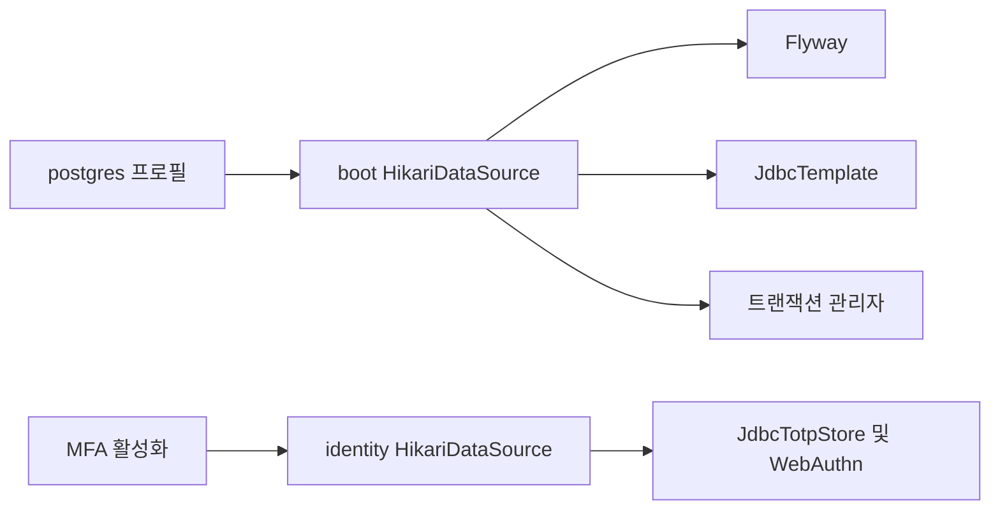

# T226 연결 풀 구현 기준

## 승인 및 범위
- 설계 승인: 사용자, 2026-11-14. 차단 질문 없음.
- boot postgres와 identity MFA의 DataSource를 HikariCP로 교체한다. 최대 연결 수 기본 10, 환경별 변경 가능. SQL과 트랜잭션 의미는 유지한다.
- 엔드포인트, 인증, 권한, 스키마, 도메인과 다른 서비스 구현은 변경하지 않는다. 기존 자격 증명을 로그に出さない.
- 연결 획득 실패는 호출자에게 전달되며 기본 대기 시간은 30초다. 인스턴스 수에 따른 DB 연결 총량은 운영 설정으로 관리한다.

## 구조 및 경계

- 기존 Bean 소비자가 같은 DataSource를 사용하고 Spring 종료 시 풀이 닫힌다. 도메인 계층은 변경하지 않는다.
- PostgreSQL Flyway는 세션 advisory lock을 사용해 풀 크기 1에서도 같은 연결로 migration한다. migration 자체의 트랜잭션 설정은 유지한다.
- boot `spring.datasource.hikari.maximum-pool-size`, identity `discord.auth.mfa.maximum-pool-size`; 해당 표준 환경 변수도 지원한다.

## Expected Changed Files
- `backend/boot/src/test/java/com/example/discord/persistence/PostgresPoolIntegrationTest.java`: 실제 PostgreSQL 풀 연결 재사용, 고갈 및 종료 검증.
- `docs/superpowers/specs/2026-11-13-t226-connection-pool-design.md`, `docs/superpowers/plans/2026-11-14-t226-connection-pool.md`, 이 blueprint: 설계와 실행 기록.
- `backend/boot/build.gradle.kts`, `backend/boot/src/main/java/com/example/discord/persistence/PostgresPersistenceConfiguration.java`: 의존성과 풀.
- `backend/boot/src/test/java/com/example/discord/persistence/PostgresDataSourceTest.java`, `backend/boot/src/test/java/com/example/discord/persistence/PersistenceBootstrapTest.java`: 설정과 실제 DB 계약.
- `backend/boot/src/main/java/com/example/discord/gateway/JdbcGatewayEventLog.java`: 중복 INSERT 충돌 rollback 후 기존 연결을 재사용해 풀 교착 방지.
- `backend/boot/src/test/java/com/example/discord/gateway/JdbcGatewayEventLogPoolTest.java`: 단일 연결 풀의 충돌 재시도와 동시 중복 호출 회귀 검증.
- `backend/boot/src/test/java/com/example/discord/gateway/JdbcGatewayEventLogTest.java`: 격리된 PostgreSQL에서 두 트랜잭션의 중복 INSERT 경합, rollback 후 조회와 payload 충돌을 검증.
- `backend/services/identity/build.gradle.kts`, `backend/services/identity/src/main/java/com/example/discord/identityservice/MfaConfiguration.java`: 의존성과 MFA 풀.
- `backend/services/identity/src/test/java/com/example/discord/identityservice/MfaDataSourceTest.java`: 설정과 종료 시험.
- `docs/03-analysis/task_T226-merge-review.md`: 승인 시 독립 리뷰 근거.

## 검증 및 리뷰
- Gateway 중복 이벤트 충돌을 재현하고 크기 1 풀의 재시도와 동시 중복 호출을 검증한다. 실제 PostgreSQL은 격리된 테스트 자원으로만 확인하고 불가하면 명시한다.
- `DISCORD_RUN_POSTGRES_TESTS=true ./gradlew :backend:boot:test --tests com.example.discord.gateway.JdbcGatewayEventLogTest`: Testcontainers PostgreSQL에서 양쪽 선행 조회를 동기화하고 실제 23505 및 rollback 후 동일 payload의 동일 sequence 반환과 다른 payload의 충돌을 확인한다.
- RED/GREEN 테스트, 설정 override와 Spring 종료, 기존 MFA 테스트, 실제 Postgres 계약을 확인한다.
- Gradle 전체 test/checkstyle/bootJar, npm lint 및 QA 계약을 계획의 검증 기준으로 실행한다. 실패·미실행은 명시한다.
- 리뷰 기준: 명세와 품질/보안 각각 90점 이상, P0/P1 없음. 독립 검토 및 증거 검증 후에만 병합한다.
- 위키 사용: index, Backend Architecture, QA Infra Operations. 승인된 결과만 위키에 게시한다.
