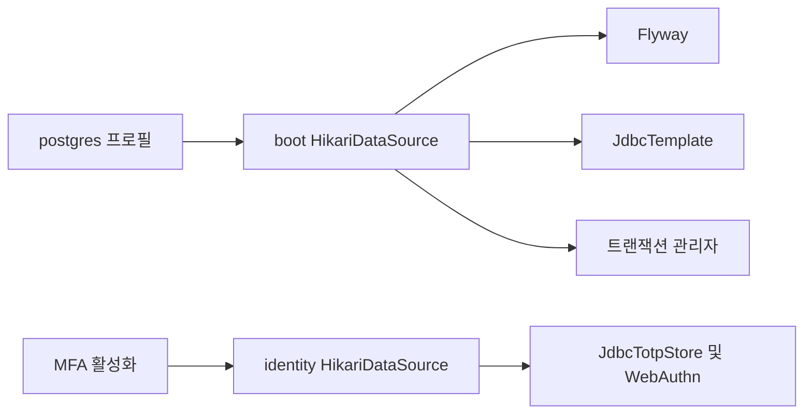

# T226 연결 풀 구현 기준

## 승인 및 범위
- 설계 승인: 사용자, 2026-11-14. 차단 질문 없음.
- boot postgres와 identity MFA의 DataSource를 HikariCP로 교체한다. 최대 연결 수 기본 10, 환경별 변경 가능. SQL과 트랜잭션 의미는 유지한다.
- 엔드포인트, 인증, 권한, 스키마, 도메인과 다른 서비스 구현은 변경하지 않는다. 기존 자격 증명을 로그に出さない.
- 연결 획득 실패는 호출자에게 전달되며 기본 대기 시간은 30초다. 인스턴스 수에 따른 DB 연결 총량은 운영 설정으로 관리한다.

## 구조 및 경계

- 기존 Bean 소비자가 같은 DataSource를 사용하고 Spring 종료 시 풀이 닫힌다. 도메인 계층은 변경하지 않는다.
- PostgreSQL Flyway는 세션 advisory lock을 사용해 풀 크기 1에서도 같은 연결로 migration한다. migration 자체의 트랜잭션 설정은 유지한다.
- boot `spring.datasource.hikari.maximum-pool-size`, identity `discord.auth.mfa.maximum-pool-size`; 해당 표준 환경 변수도 지원한다.

## Expected Changed Files
- `backend/boot/src/test/java/com/example/discord/persistence/PostgresPoolIntegrationTest.java`: 실제 PostgreSQL 풀 연결 재사용, 고갈 및 종료 검증.
- `docs/superpowers/specs/2026-11-13-t226-connection-pool-design.md`, `docs/superpowers/plans/2026-11-14-t226-connection-pool.md`, 이 blueprint: 설계와 실행 기록.
- `backend/boot/build.gradle.kts`, `backend/boot/src/main/java/com/example/discord/persistence/PostgresPersistenceConfiguration.java`: 의존성과 풀.
- `backend/boot/src/test/java/com/example/discord/persistence/PostgresDataSourceTest.java`, `backend/boot/src/test/java/com/example/discord/persistence/PersistenceBootstrapTest.java`: 설정과 실제 DB 계약.
- `backend/boot/src/main/java/com/example/discord/gateway/JdbcGatewayEventLog.java`: 중복 INSERT 충돌 rollback 후 기존 연결을 재사용해 풀 교착 방지.
- `backend/boot/src/test/java/com/example/discord/gateway/JdbcGatewayEventLogPoolTest.java`: 단일 연결 풀의 충돌 재시도와 동시 중복 호출 회귀 검증.
- `backend/boot/src/test/java/com/example/discord/gateway/JdbcGatewayEventLogTest.java`: 격리된 PostgreSQL에서 두 트랜잭션의 중복 INSERT 경합, rollback 후 조회와 payload 충돌을 검증.
- `backend/services/identity/build.gradle.kts`, `backend/services/identity/src/main/java/com/example/discord/identityservice/MfaConfiguration.java`: 의존성과 MFA 풀.
- `backend/services/identity/src/test/java/com/example/discord/identityservice/MfaDataSourceTest.java`: 설정과 종료 시험.
- `docs/03-analysis/task_T226-merge-review.md`: 승인 시 독립 리뷰 근거.

## 검증 및 리뷰
- Gateway 중복 이벤트 충돌을 재현하고 크기 1 풀의 재시도와 동시 중복 호출을 검증한다. 실제 PostgreSQL은 격리된 테스트 자원으로만 확인하고 불가하면 명시한다.
- `DISCORD_RUN_POSTGRES_TESTS=true ./gradlew :backend:boot:test --tests com.example.discord.gateway.JdbcGatewayEventLogTest`: Testcontainers PostgreSQL에서 양쪽 선행 조회를 동기화하고 실제 23505 및 rollback 후 동일 payload의 동일 sequence 반환과 다른 payload의 충돌을 확인한다.
- RED/GREEN 테스트, 설정 override와 Spring 종료, 기존 MFA 테스트, 실제 Postgres 계약을 확인한다.
- Gradle 전체 test/checkstyle/bootJar, npm lint 및 QA 계약을 계획의 검증 기준으로 실행한다. 실패·미실행은 명시한다.
- 리뷰 기준: 명세와 품질/보안 각각 90점 이상, P0/P1 없음. 독립 검토 및 증거 검증 후에만 병합한다.
- 위키 사용: index, Backend Architecture, QA Infra Operations. 승인된 결과만 위키에 게시한다.

## 보안 게이트 수정 추가 범위
- PR #24 실행 43651776119의 backend OSV 검사에서 Kafka가 가져오는 snappy-java 1.1.10.7에 high 취약점 GHSA-gwq9-9ffj-mvrv 및 GHSA-q233-g92q-qxp6이 확인됐다. main의 기존 의존성 경로이며 T226 연결 풀과 무관하다.
- Expected Changed Files: `backend/boot/build.gradle.kts`, `backend/services/message/build.gradle.kts`, `backend/services/websocket/build.gradle.kts`, 이 blueprint. 세 배포 모듈의 dependencyManagement에 두 취약점의 수정 버전 1.1.10.9를 지정한다. 보안 게이트와 allowlist는 변경하지 않는다.
- 변경 전 dependencyInsight에서 boot는 수정됐으나 message와 websocket은 1.1.10.7임을 확인했다. 세 runtimeClasspath와 bootJar, Snappy Kafka 왕복을 검증한다.
- 변경 전후 `:backend:boot:dependencyInsight --dependency snappy-java --configuration runtimeClasspath`로 해결 버전을 확인하고 관련 backend 테스트 및 보안 게이트를 실행한다. 확인하지 못한 CI 및 독립 리뷰는 별도 잔여 항목으로 남긴다.
- 실행 결과: 변경 전 1.1.10.7, 변경 후 1.1.10.9로 해결된다. main 실행 41131849410의 artifact도 동일 두 high 취약점을 보고했다. Kafka 집중 테스트와 security-gate 계약이 통과했으며, 수정 버전만 대상으로 한 OSV 실조회는 packageCount 1, 취약점 0이다.
- 기존 Windows 작업 공간의 전체 gate는 node_modules의 happy-dom 20.9.0과 lockfile 21.0.4 불일치로 중단됐다. 격리 Linux 컨테이너의 추적 파일 복사본에서 Node 22와 Java 21로 `npm ci` 및 `pwsh qa/security-gate.ps1`을 실행해 각각 종료 0, SECURITY_GATE_PASS를 확인했다. boot SBOM은 snappy 1.1.10.9이고 두 GHSA가 없으며, moderate 이하 finding은 남는다.
- 세 서비스의 수정 후 runtimeClasspath는 모두 1.1.10.9, bootJar는 `BOOT-INF/lib/snappy-java-1.1.10.9.jar`를 포함한다. 격리 Kafka 브로커에서 해당 bootJar 라이브러리로 Snappy 압축 메시지 생산·소비 왕복과 두 서비스 테스트가 통과했다. 증거: `C:/Users/KIMSUN~1/AppData/Local/Temp/discord-security-isolated-Tr4enR/`의 `linux-security-artifacts-final`, `fixed-insight-*.log`, `bootjar-snappy.log`, `snappy-kafka-roundtrip.log`, `service-tests.log`.
- GitHub Actions와 독립 리뷰는 미완료다. 요약의 npm audit 행은 backend OSV 차단 건수까지 합산하므로 두 건의 실제 출처로 해석하면 안 된다.

## CI 계약 복구 추가 범위
- Expected Changed Files: `.github/workflows/ci.yml`, `qa/central-kafka-ci-artifacts.contract.ps1`, `qa/central-kafka-ci-artifacts.ps1`, `qa/central-kafka-gateway-smoke.ps1`, `qa/ci-workflow.contract.ps1`, `qa/dashboard-guard-health-smoke.contract.ps1`, `qa/dashboard-guard-health-smoke.ps1`, `qa/production-profile-guard-smoke.ps1`, 이 blueprint.
- 사용자 승인: 네 계약 실패의 근본 원인 수정 및 실제 실행 검증. 4d4e9d1에서 추적되지 않은 스크립트 때문에 보류된 기존 job이 원인이다.
- 예상 변경: `.github/workflows/ci.yml`에 Kafka, dashboard health, production profile, web Docker job 복원; `qa/central-kafka-gateway-smoke.ps1`, `qa/production-profile-guard-smoke.ps1`의 PowerShell 자동 변수 충돌 수정; `qa/central-kafka-ci-artifacts.ps1`과 계약에서 보간된 Compose 설정의 비밀값 노출 방지. 이 blueprint에 실행 결과를 기록한다.
- `qa/dashboard-guard-health-smoke.ps1`과 계약: PowerShell 5/7에서 HTTP 오류 본문을 읽고, 응답의 토큰 노출 여부를 artifact 기록 전에 검사한다. 공통 CI 계약은 복원한 네 job 및 `qa-toolchain`에서의 계약 실행을 검사한다.
- 검증: 네 계약과 CI 추적 계약, 복원 job의 실행 스크립트 실제 실행, Kafka 및 Redis 실서비스 테스트, artifact 민감 정보 확인, `git diff --check`. 실패와 환경 제약은 분리 기록한다.
- 로컬 검증: 네 계약 및 CI 추적 계약 통과. 실제 Redis 통합 1건, Kafka Gateway smoke, production profile 거부 smoke, production 빌드 dashboard guard smoke 통과. 직접 참조 스크립트, Compose와 테스트 소스는 Git 추적 중이다. GitHub Actions 자체 실행과 독립 리뷰는 별도로 필요하다.
