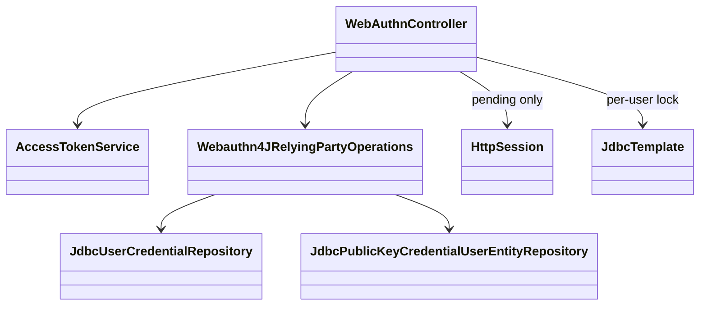
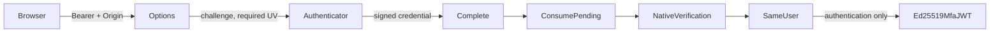
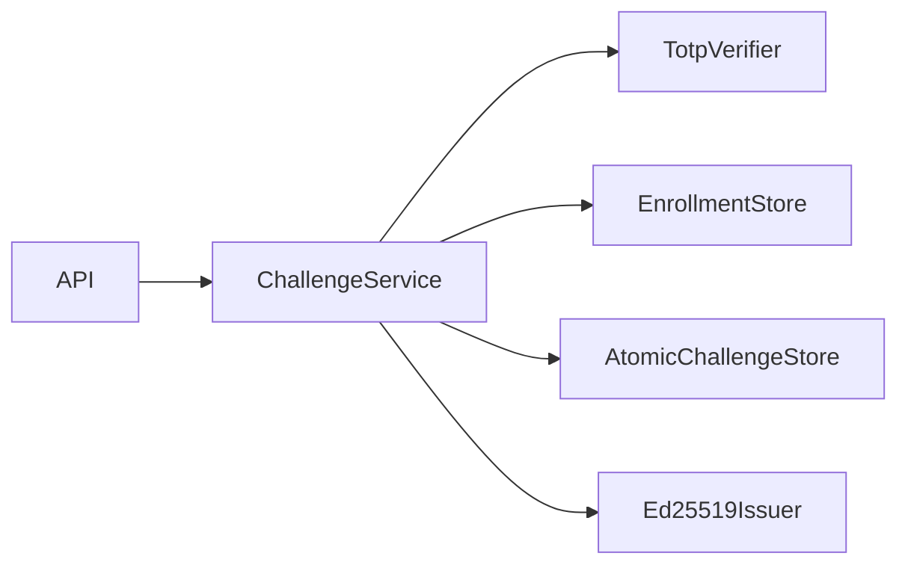
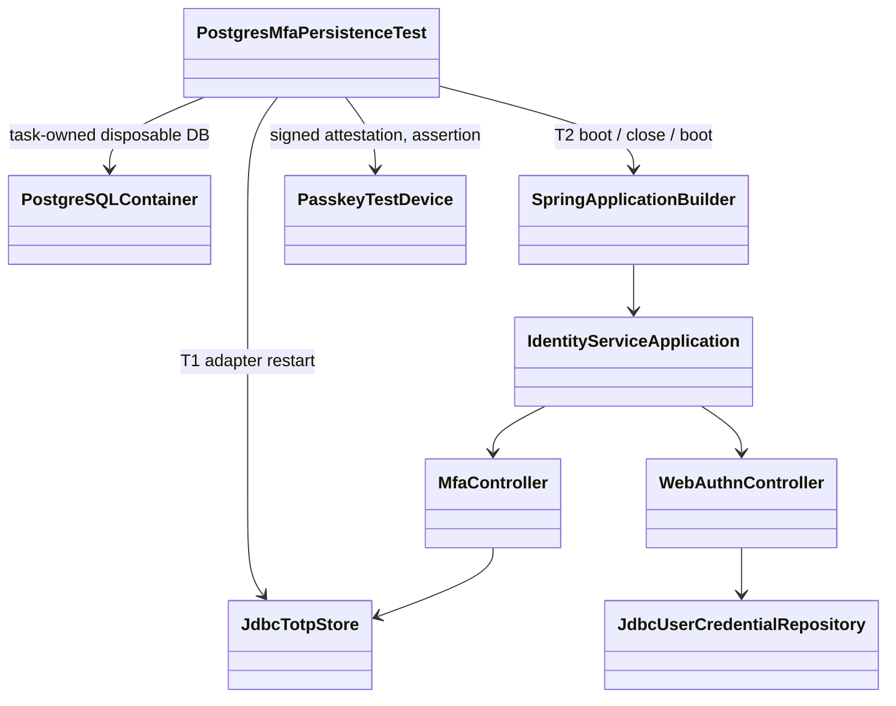
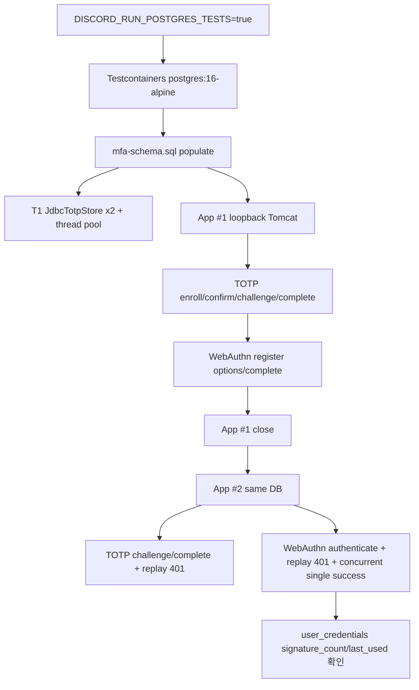
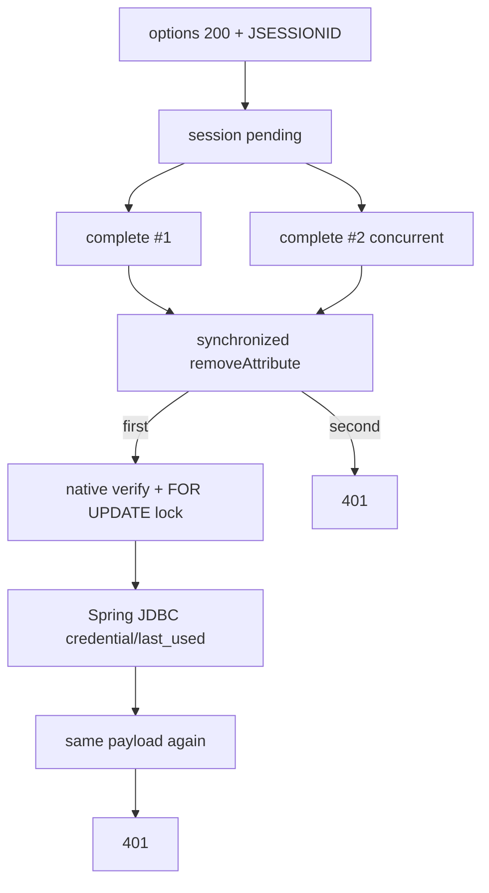
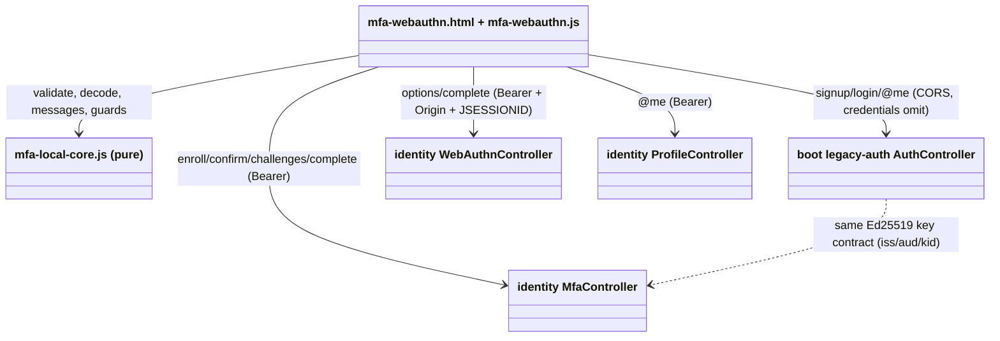
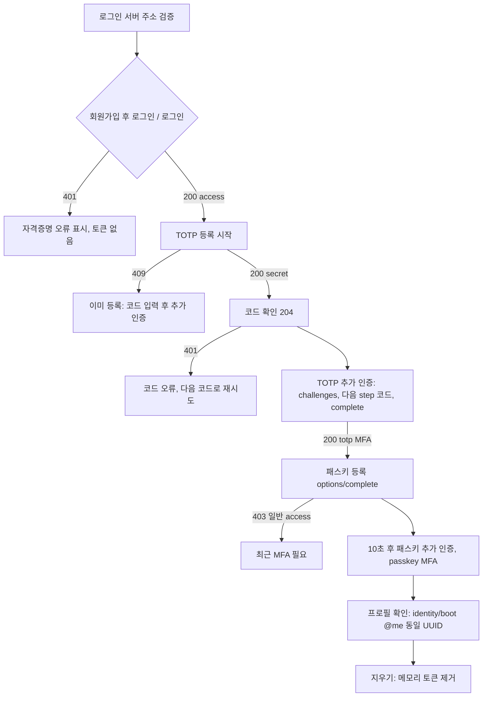
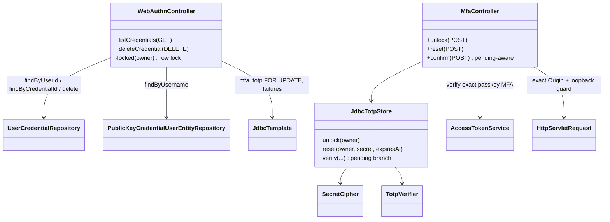
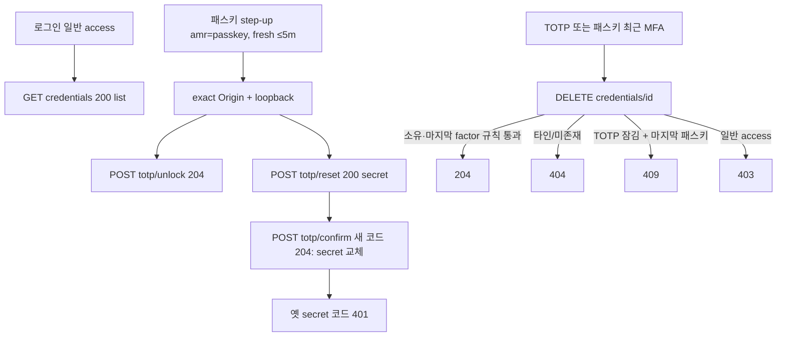

# MFA backend 이관

## 승인과 범위

사용자의 2026-09-14 남은 개발 지시에 따라 진행한다. 현재는 이관 미완료다.
작업 브랜치: `task_MFA-backend-transfer`, 기준: 로컬 main `19ee3e4`.
기존 privacy 브랜치와 예제 파일은 보존한다.

## 순서 및 완료 기준

1. identity 모듈에 Spring 의존성 없는 TOTP 검증을 이관한다. RFC vector, drift, 잘못된 입력, 재사용 step 거부를 테스트한다.
2. 사용자별 enrollment 및 secret 저장, challenge 만료·일회 소비·시도 제한을 구현한다. 공용 demo seed는 이관하지 않는다.
3. 기존 Ed25519 JWT 발급/검증에 MFA evidence를 연결한다. 임시 capability와 access의 혼동을 거부하고 consumer 호환성을 검증한다.
4. identity runtime에 Spring Security 인증·인가와 WebAuthn을 연결한다. 등록·인증·step-up 및 사용자 결속을 검증한다.
5. API/client 계약과 재현 가능한 전체 흐름을 검증하고 독립 리뷰를 받는다. 이관 완료 후에만 예제를 정리하고 main 병합·push한다.

refresh는 후속이다. SMS/email/Kakao demoCode는 소유 증명이 아니므로 실제 인증으로 이관하지 않는다.

## 첫 구현 조각

## WebAuthn 연결 조각 (2026-09-14)

- Approval Gate: Approved; 사용자 구현 지시 + 독립 Plan Review 88/100, P0/P1 없음 (문서 hash `7488d01fa55664eba1b9411c84e5e01287053bdd`). 구현/배포 승인과 구별한다.
- 선택: `Webauthn4JRelyingPartyOperations`와 Spring JDBC credential repositories를 사용한다. 기존 Bearer-only API를 세션 로그인으로 바꾸지 않으므로 기본 formLogin/WebAuthn 로그인 filter는 설치하지 않는다. 인증 프로토콜 검증을 직접 작성하지 않는다.
- 범위: 로컬 단일 인스턴스 데모만. `discord.auth.webauthn.enabled=true`, 명시적 `server.address=127.0.0.1`, RP `localhost`, 정확한 `http://localhost:<port>` Origin에서만 켠다. refresh, 공개 서비스 배포, 계정 복구/삭제, Nuxt 제품 UI 통합은 별도다.
- 사용자: JWT subject UUID만 사용한다. 등록 options와 완료 모두 유효한 5분 MFA access를 요구한다. 인증 options/완료는 일반 access도 허용하되 기존 활성 TOTP 행을 가진 사용자만 가능하다. OTP 초기 등록이 기존 첫 factor다.
- 신뢰 경계: 모든 POST에 Bearer와 정확한 Origin이 필요하다. 쿠키는 로그인 증명이 아니라 진행 중 ceremony 연결에만 사용한다. challenge는 HttpSession 한 슬롯에 사용자·종류·3분 만료와 저장하며 완료 시 검증 전에 원자적으로 제거한다. 실패도 재사용할 수 없다. 다른 사용자/다른 ceremony/만료는 거부한다.
- native 검증: 생성/인증 options 모두 `userVerification=required`, resident key required, attestation none. 검증 성공한 사용자가 JWT 사용자와 동일한 경우에만 passkey MFA JWT를 발급한다. 이전 session 결과를 토큰으로 교환하는 endpoint는 없다.
- 저장/경합: 기존 `mfa_totp` 사용자 행 잠금과 새 `webauthn_started_at` 열로 사용자별 options 발급 간격 10초를 제한한다. 같은 행 잠금 아래 Spring JDBC credential 저장을 수행하고 사용자별 최대 5개를 유지한다. session 원자 소비는 단일 JVM 전용이며 분산 session 도입은 재설계 게이트다.
- 오류: 무인증 401, MFA 부족/Origin/사용자 불일치 403 또는 일괄 인증 실패, 미등록·개수 제한 409, options 빈도 429, 잘못된 payload 400. 성공·options는 no-store. body/label 길이는 제한하고 비밀값을 기록하지 않는다.
- HTTP: `POST /api/auth/mfa/webauthn/register/options`, `/authenticate/options`는 native options JSON을 반환한다. `/register/complete`는 `{credential: <PublicKeyCredential.toJSON()>, label: <1..64자>}`를 받아 204를 반환한다. `/authenticate/complete`는 credential JSON 자체를 받아 `{accessToken: ...}`을 반환한다. payload 최대 64 KiB, challenge는 session으로 결속한다.
- 기존 DB 적용: `ALTER TABLE mfa_totp ADD COLUMN IF NOT EXISTS webauthn_started_at BIGINT`를 별도로 적용한다. CREATE IF NOT EXISTS만으로 기존 DB가 갱신된다고 가정하지 않는다.

### 쓰기 경로와 책임

| 경로 | 책임 |
| --- | --- |
| `backend/services/identity/build.gradle.kts` | BOM 관리 WebAuthn 및 validation 의존성 |
| `.../identityservice/MfaConfiguration.java` | 기존 DB DataSource 재사용 |
| `.../identityservice/WebAuthnConfiguration.java` | native operations/JDBC/Jackson module, local-only 설정 |
| `.../identityservice/WebAuthnController.java` | Bearer+Origin 경계, 세션 ceremony, DB 잠금, native 호출 및 JWT 응답 |
| `backend/services/identity/src/main/resources/db/mfa-schema.sql` | native credential schema와 throttle 열; 수동 적용 |
| `backend/services/identity/src/main/resources/static/mfa-webauthn.html`, `mfa-webauthn.js` | 동일 Origin 로컬 연결 화면, 메모리-only token 및 브라우저 native JSON 변환 |
| `backend/services/identity/src/test/java/com/example/discord/identityservice/WebAuthnControllerTest.java` | 실제 native 검증을 포함한 positive/negative 및 영속화 계약 |
| `docs/guides/mfa-webauthn-local.md` | 실행 절차, 관찰 포인트, 공식 링크, 미검증 범위 |





### 검증 게이트

- RED: 연결 전 새 endpoint/UV/저장 테스트 실패를 기록한다.
- GREEN: identity module/service 전체 테스트 및 Checkstyle, 기존 Bearer consumer 회귀.
- 실제 native verifier에 생성한 attestation/assertion을 전달하는 성공·변조·UV 미충족·다른 사용자·replay·만료 테스트. mock verifier만으로 암호 검증 완료를 주장하지 않는다.
- enabled/disabled application wiring, 기존 health/profile 회귀, 잘못된 로컬 설정 fail-closed.
- 경합: 동시 완료는 하나만 성공, 다른 session에도 사용자별 10초 throttle, credential 4개에서 동시 등록하여 총 5개를 넘지 않는 테스트.
- 브라우저 등록/인증 smoke는 실행 여부를 별도 기록한다. 가상 authenticator와 실제 사용자 장치의 차이를 가이드에 표시한다.
- Plan Review 85/100 이상 및 P0/P1 없음으로 착수; 완료 검수는 Security Review 90/100 이상과 독립 근거 검수. 미달이면 merge/push/예제 삭제 금지.
- Wiki 사용: index, Backend Architecture, QA Infra Operations, Agent Development Guide. 과거 Wiki의 Boot 3.3 설명보다 현재 build의 Boot 4.1.1/Security 7.1.1을 우선한다.

- 쓰기: `backend/modules/identity/src/{main,test}/java/com/example/discord/identity/TotpVerifier*.java`.
- 계약: secret bytes, 6자리 code, 현재 시간, 이미 소비한 step을 받아 일치한 step 또는 빈 결과를 반환한다.
- replay 원자적 소비는 후속 저장소 책임이다. verifier만으로 동시 재사용 방지를 주장하지 않는다.
- 검증: `./gradlew :backend:modules:identity:test`, 해당 모듈 Checkstyle.

## 영속 저장 구현 조각

- 쓰기: identity service의 `JdbcTotpStore.java`, `SecretCipher.java`, `db/mfa-schema.sql`, `JdbcTotpStoreTest.java`, service build의 H2 test dependency.
- secret은 사용자 UUID를 AAD로 둔 AES-256-GCM ciphertext만 저장한다. key는 runtime에서 주입하며 demo 기본값은 없다.
- 등록은 중복 사용자 행을 덮어쓰지 않는다. 확인 전에는 인증에 사용할 수 없고 등록 확인은 5분 내에 수행한다.
- 행 잠금 transaction 안에서 검증, 실패 횟수, 활성화, consumed step 변경을 commit한다. 실패 5회는 fail-closed이며 복구 API는 별도 작업이다.
- H2로 transaction 계약을 먼저 검증한다. PostgreSQL 실제 실행 증거 없이는 운영 DB 검증 완료로 선언하지 않는다.

## HTTP 연결

- `MfaController`와 `MfaConfiguration`은 `discord.auth.mfa.enabled=true`에서만 등록한다. DB URL, DB 계정, 암호화 키를 명시적으로 주입한다.
- caller는 기존 Ed25519 access 검증에서만 추출한다. `POST /api/auth/mfa/totp/enroll`, `/confirm`, `/challenges`, `/challenges/{id}/complete`를 사용한다.
- 등록 응답의 Base32 secret은 생성 직후에만 반환하고 캐시를 금지한다. 등록 확인에는 실제 TOTP가 필요하다.
- challenge는 사용자별 하나를 DB에 저장하고 3분 뒤 만료한다. 생성 간격은 30초이며, 완료는 사용자 결속·만료·소비 여부와 TOTP 소비를 한 transaction에서 검증한다.
- complete 성공 시에만 서버가 `totp` evidence를 가진 5분 Ed25519 access를 발급한다. factor와 level을 클라이언트가 지정할 수 없다.

## 현재 실행 조건과 미완료 게이트

- TOTP HTTP 연결은 구현했다. `discord.auth.mfa.enabled=true`와 `jdbc-url`, `database-user`, `database-password`, `encryption-key`가 필요하다. 이 키들은 모두 `discord.auth.mfa` 아래에 있다. encryption-key는 32 byte 랜덤 AES key의 Base64다.
- 새 MFA DB에는 `backend/services/identity/src/main/resources/db/mfa-schema.sql`을 먼저 적용한다. 자동 schema 변경은 하지 않는다. 이전 개발 schema를 쓴 DB에는 challenge 열을 추가하는 migration이 필요하며, 기존 DB를 삭제해 해결하지 않는다.
- H2 저장소 재생성·동시 요청과 MockMvc bearer 인증·타 사용자 거부·challenge 재사용 거부가 통과했다.
- MockMvc 전체 등록 HTTP 흐름(랜덤 Base32 secret → 독립 authenticator 계산 → 확인 → 새 step 코드 → MFA JWT)이 통과했다. 중복 등록이 미처리 예외였던 문제를 SQLState 23505에 한정해 409로 수정했다.
- message/community/websocket의 기존 `BearerTokenVerifierTest`가 통과했다. 새 MFA 토큰을 각 서비스의 실제 보호 endpoint로 보내는 검증까지 완료한 것은 아니다.
- WebAuthn 로컬 Bearer 연결과 간단한 동일 Origin 브라우저 화면은 구현했다. PostgreSQL 실제 실행, 제품 client 계약, 전체 이관의 독립 리뷰는 미완료다.
- 등록 중단 후 재시작, 5회 실패 후 계정 복구, secret/key rotation은 아직 API가 없다. 현재 등록은 중복 행을 덮어쓰지 않으므로 자동 reset되지 않는다.
- 이 상태는 이관 완료나 배포 승인 상태가 아니다. 예제 삭제·main 병합·push를 아직 수행하지 않는다.

## 2026-09-17 WebAuthn 조각 검증

- 새 WebAuthn endpoint 부재 RED → native 구현 GREEN. 후속 P2(실패 options 요청의 빈 session 생성)는 `rejectedOptionsDoNotCreateSessions` RED → session 생성 시점 이동 → GREEN으로 보정했다.
- identity service 23 tests 및 identity module 24 tests, service Checkstyle 성공. WebAuthnController 9개 + enabled runtime 4개를 포함한다.
- Chrome 가상 CTAP2를 통한 실제 브라우저 등록/인증 및 JWT 프로필 소비 성공. 환경은 loopback:18091, H2, 임시 테스트 키이며 서버는 종료했다. 실제 Windows Hello·PostgreSQL 성공으로 확장 해석하지 않는다.
- 독립 Security Review: 최초 92/100, P2 1개; 수정 revision 95/100, 미해결 P0/P1/P2 없음. 검수는 local WebAuthn 조각만 대상이고 merge 승인/전체 MFA 이관 승인과 다르다.
- 수정 revision SHA256: controller `7b4b64e05bae6d09d09fbd5bcf10ef676c4b483a752a4637c81a69a08a63f030`, test `db78cab98e01da0a2df09ea120a304afc65e46fe7ca2b69d705698d921b9d875`.
- 가이드: `docs/guides/mfa-webauthn-local.md`. 설정·선행 로그인/TOTP 조건·RP/Origin/UV·실패 진단·공식 문서 링크를 포함한다.
- Blueprint Alignment: yes (local WebAuthn slice); 구현/집중 검증 accepted, 전체 이관과 배포는 pending. publishable knowledge는 이 제한된 Bearer/native 경계와 검증 방법뿐이다.
- 전체 회귀 `./gradlew test` 성공(2026-09-17). Gradle 9 비호환 deprecated-feature 경고 및 기존 Java API 경고는 남아 있으며 이번 WebAuthn 검증 성공과 구별한다.
- `npm run lint:backend`, JS `node --check`, `git diff --check` 성공. 기존 원본 workspace의 dirty 변경은 보존했으며 commit/merge/push/예제 삭제는 하지 않았다.
- Raw-to-docs 계약: 출처는 위 hash의 runtime/test와 로컬 브라우저 smoke(관찰일 2026-09-17, 구현 담당 agent); durable facts는 Bearer/native 책임 분리와 로컬 제한이다. 미검증은 실제 기기·PostgreSQL·배포다. Wiki Backend Architecture/QA Infra Operations 및 log에만 승격하고 새 page/index 추가는 하지 않는다. 과거 example 성공은 이 runtime 검증의 대체 근거가 아니다.



## 2026-09-19 PostgreSQL 실측 검증 조각

### Approval Gate

- Status: Approved (rev4; 사용자 지시 + coordinator 환경 승인 + Plan Review #3 PASS. 구현/배포/merge 승인과 구별한다)
- Plan Review #3 (rev3 SHA256 `de30b293d51ac7213355965f8b179b1b6c14769891a7e89c179bc761322d19cf`, fresh reviewer): 88/100, P0 0, P1 0, P2 4(ryuk 기본 태그 오기 → 1.21.4는 `0.12.0`, cleanup 게이트를 라벨 비의존 스냅샷 기준으로, `server.port=0`+고정 origin으로 포트 경합 제거 가능, T2 Bearer/JSESSIONID 처리 명시). PASS. 네 건 모두 rev4에 반영했다.
- Plan Review #2 (rev2 SHA256 `df05da68d0bf06919e8e09fd93eb8283f217c8aff48fdb9692e3da8eff825d65`, fresh reviewer): 83/100, P0 0, P1 1(Testcontainers 의존성이 boot와 동일하다는 전제가 실측과 다름 — Boot BOM이 core만 2.0.5로 승격하는 혼합 그래프), P2 5(sessionId 검사 오탐 범위, T1/T2 사용자 분리, T2 프로퍼티 전체 목록, ryuk 버전 문구, 포트 경합 처리). 코드·bytecode 주장(remoteAddr/Origin, primary 우선, counter 시딩, 시계 진행표)은 모두 정확 판정. FAIL → 전부 rev3에 반영(단일 1.21.4 그래프 결정 포함).
- Approver: 사용자 남은 개발 지시(순차 검증) + coordinator 실행 환경 승인(2026-09-19, Docker Desktop 정상 시작·격리 task 소유 DB 사용 허용, Docker 재설치/리셋/기존 volume 삭제 금지). 독립 Plan Review 결과는 아래에 기록한다.
- Plan Review #1 (rev1 SHA256 `5d30e5877b0dab6eb18e1163094ae19cfba0181fe7a6d19d2637272cc3daed00`): 82/100, P0 0, P1 2(테스트 Clock 배치의 기존 컨텍스트 오염 위험, Webauthn4J counter 시딩 사실 오해), P2 6(127.0.0.1 접속·origin 관계, 시계 진행표·키 재사용, TOTP 코드 헬퍼 누락, 정리 게이트/ryuk·이미지 pull 사실, `.sh`·문서 명명·버전 단정, T1 단언 정밀화). FAIL → 전부 rev2에 반영.
- Blocking ambiguity: 없음. 로컬 PostgreSQL 실행 수단은 저장소 관례(`DISCORD_RUN_POSTGRES_TESTS=true` + Testcontainers `postgres:16-alpine`)로 확정한다. 기존 공용 `postgres-source`/`postgres-replica` 컨테이너와 `infra/docker` compose DB는 사용하지 않는다.
- Competing plan branches: (a) 외부 `POSTGRES_JDBC_URL` 지정 공유 DB 사용 → 공유 테이블 변경 위험으로 제외. (b) 임베디드 PostgreSQL 바이너리(zonky) → 새 의존성 계열이며 저장소 관례 밖이므로 제외. (c) Testcontainers 일회용 컨테이너 → 선택.

### Goal

- 목적: H2/MockMvc/가상 authenticator로만 확인한 TOTP·native WebAuthn 영속화 계약이 실제 PostgreSQL에서도 성립하는지 실측한다. 대상은 adapter 재생성·application 재시작 후 데이터 유지, 행 잠금 기반 동시성, challenge 일회 소비와 replay 거부다.
- Non-goals: 새 사용자 흐름, 복구/삭제 API, refresh, 예제 삭제, 운영 DB/외부 DB 검증, 실제 기기 검증, commit/merge/push.

### Domain Language

- 「adapter 재시작」: 같은 DB에 대해 `JdbcTotpStore` 인스턴스를 새로 만들어 이전 인스턴스가 기록한 상태를 읽는 것.
- 「application 재시작」: `SpringApplicationBuilder`로 띄운 identity runtime(embedded Tomcat, loopback)을 `close()`하고 같은 PostgreSQL DB로 다시 기동하는 것. DataSource·JDBC repository·Webauthn4J operations·HttpSession이 모두 새로 만들어진다.
- 「일회 소비」: TOTP challenge는 `mfa_totp.challenge_id`가 성공 시 NULL로, WebAuthn challenge는 HttpSession pending 슬롯이 검증 전에 제거되는 것. 재시도는 401이어야 한다.
- 「격리 신원」: 검증에 사용한 컨테이너 ID 앞 12자, DB 이름, DB 사용자 이름, 서버 `version()`. 암호·토큰·secret은 기록하지 않는다.

### Participating Code

| 구성요소 | 책임 | 의존 | 테스트 |
| --- | --- | --- | --- |
| `JdbcTotpStore` | `SELECT ... FOR UPDATE` 행 잠금 아래 confirm/complete/failures 갱신, 조건부 UPDATE로 challenge 발급 간격 | `DataSource`, `SecretCipher`, `TotpVerifier` | 신규 `PostgresMfaPersistenceTest` T1 |
| `MfaController` | Bearer → TOTP enroll/confirm/challenges/complete HTTP 경계 | `JdbcTotpStore`, `AccessTokenService`, `Clock` | T2 (실제 HTTP) |
| `WebAuthnController` + `WebAuthnConfiguration` | Bearer+Origin 경계, session pending 원자 소비, 행 잠금, native 등록/검증, Spring JDBC credential 저장 | `Webauthn4JRelyingPartyOperations`, `JdbcUserCredentialRepository`, `JdbcPublicKeyCredentialUserEntityRepository` | T2 |
| `IdentityServiceApplication` | runtime wiring, `Clock authClock` bean | JWT 키 fixture | T2는 `SpringApplicationBuilder.initializers(...)`의 `ApplicationContextInitializer`가 `GenericApplicationContext.registerBean("verificationClock", Clock.class, supplier, primary=true)`로 테스트 Clock을 등록한다. 테스트 소스 트리에 `@Configuration`/`@Component` 클래스를 두지 않으므로 같은 패키지를 스캔하는 기존 `@SpringBootTest`(`IdentityServiceApplicationTest`, `WebAuthnRuntimeTest`)에는 주입되지 않는다. primary 판정은 파라미터명(`authClock`) 매칭보다 우선한다 |
| `db/mfa-schema.sql` | PostgreSQL/H2 공용 schema | — | T1/T2에서 `ResourceDatabasePopulator`로 적용, 재적용 무손실 확인 |

### Expected Changed Files

| Path | Expected change | Confidence |
| --- | --- | --- |
| `backend/services/identity/build.gradle.kts` | Testcontainers test 의존성 추가. 실측(`./gradlew --offline :backend:boot:dependencies --configuration testRuntimeClasspath`): boot는 `postgresql`/`junit-jupiter`/`jdbc`/`database-commons` 1.21.3 + core `testcontainers 1.21.3 -> 2.0.5`(Boot 4.1.1 BOM `testcontainers.version=2.0.5`)의 혼합 그래프이며, 로컬 캐시에는 core 1.21.3이 없고 1.21.4·2.0.5만 있다. 결정: identity 모듈에서 `platform("org.testcontainers:testcontainers-bom:1.21.4")` + `postgresql` + `junit-jupiter`를 선언하고 core를 1.21.4로 고정해 **단일 1.21.4 그래프**(모듈 전부 캐시 존재, 오프라인 가능, 1.x API 유지)로 만든다. 구현 중 확인: `ext["testcontainers.version"] = "1.21.4"` 프로퍼티 재정의는 이 build에서 core 승격(`1.21.4 -> 2.0.5`)을 막지 못했고, 직접 선언 `dependencyManagement { dependencies { dependency("org.testcontainers:testcontainers:1.21.4") } }`(imported BOM보다 우선)로 바꾼 뒤 `dependencies` 출력이 `org.testcontainers:*` 전부 1.21.4, `docker-java 3.4.2`로 해석됨을 확인했다(blueprint 선수정 후 구현 반영). 2.0.5 신 좌표(`testcontainers-postgresql` 등)는 캐시에 없고 관례 이탈이라 제외. Step 1에서 `dependencies` 출력으로 단일 버전을 확인해 결과에 기록한다. boot의 혼합 그래프는 이 task 범위 밖이며 수정하지 않는다 | medium |
| `backend/services/identity/src/test/java/com/example/discord/identityservice/PostgresMfaPersistenceTest.java` | 신규. `@EnabledIfEnvironmentVariable(DISCORD_RUN_POSTGRES_TESTS=true)` + `@Testcontainers`, T1/T2. 테스트 내부 private 헬퍼: RFC 6238 코드 생성기(enroll 응답 Base32 디코드 + HMAC-SHA1, `TotpVerifier`는 `match`만 공개), Clock initializer(스테레오타입 어노테이션 없음), latch 기반 동시 실행기, `[pg-evidence]` 출력 | high |
| `backend/services/identity/src/test/java/com/example/discord/identityservice/PasskeyTestDevice.java` | 신규 package-private 테스트 authenticator(P-256, none attestation, UV 항상 set, assertion마다 sign counter 1씩 증가). 기존 `WebAuthnControllerTest` 내부 클래스는 보안 검수 hash 보존을 위해 수정하지 않고 별도 파일로 둔다 | high |
| `qa/mfa-postgres-verify.sh` | 신규 opt-in 실행 스크립트. `.sh` 선택 사유: 루트 `AGENTS.md`가 agent 셸 명령을 Git Bash로 고정하고 `.ps1`은 기존 Windows 전용 QA 계약이 있을 때만 허용하며, 이 스크립트는 기존 계약(`qa/*.contract.ps1`)에 편입되지 않는 로컬 opt-in 도구다(선례 `qa/verify-jwt-kubernetes-config.sh`). 동작: Docker daemon 확인 → 실행 전 `docker ps -aq` ID 스냅샷 → 환경변수 설정 → `cleanTest` + focused test → 최대 30초 동안 task label 컨테이너·`org.testcontainers.sessionId` label(ryuk 포함) 컨테이너 소거 대기 → 스냅샷 비교(기존 컨테이너 소실 없음) | high |
| `docs/superpowers/plans/2026-09-14-mfa-backend-transfer.md` | 이 blueprint와 실행 결과 | high |
| `docs/guides/mfa-webauthn-local.md` | PostgreSQL 실측 절차/결과 절 추가 | high |
| `docs/03-analysis/mfa-postgres-verification.md` | 신규 한국어 machine-handoff 보고서. 경로는 coordinator task 지시로 고정된 값이라 `*.analysis.md` 접미 관례와 다르며, 이 사유를 문서 머리에 적는다 | high |
| 외부 Wiki `QA Infra Operations`, `Backend Architecture`, `log.md` | 수락 후 durable facts만 갱신 | medium |

### Tier And Layer Responsibilities

- API/controller: 기존 `MfaController`, `WebAuthnController` 무변경. 실제 HTTP(loopback Tomcat)로 호출한다.
- Application/service: 기존 `AccessTokenService`(Ed25519) 무변경.
- Persistence/adapter: 기존 `JdbcTotpStore`, Spring JDBC WebAuthn repositories 무변경. 결함이 드러나면 최소 수정만 하고 blueprint에 먼저 기록한다.
- Infrastructure/runtime: Testcontainers가 만든 일회용 `postgres:16-alpine` 컨테이너(임의 이름, label `discord.task=mfa-postgres-verification`, DB/사용자 `mfa_pg_verify`, 임의 암호). ryuk이 JVM 종료 후 제거한다.
- QA/contracts: 기본 `./gradlew test`는 이 테스트를 skip해야 한다(backend AGENTS 규칙). 환경변수 게이트만으로 실행된다.

### Structure Diagram



### System Flow Diagram



### Behavior Flow



### Invariants And Boundaries

- Auth/security: Bearer는 테스트 JVM 안에서만 생성·사용하고 로그·문서에 기록하지 않는다. DB 암호·encryption key는 테스트 프로세스 메모리에서 임의 생성한다. 문서에는 컨테이너 ID 12자, DB/사용자 이름, `version()`만 남긴다.
- Transactions/idempotency: 동시 confirm/complete/challenge/WebAuthn complete는 각각 정확히 하나만 성공해야 한다. 성공 후 동일 challenge 재사용은 실패해야 한다.
- Error handling: 컨테이너/Docker 미가용은 테스트 실패로 드러나야 하며 skip으로 위장하지 않는다. 게이트 환경변수가 없을 때만 skip한다.
- Generated contracts: 없음. OpenAPI 변경 없음.
- Platform boundaries: 단일 JVM·loopback만. 분산 session은 범위 밖.
- 접속 리터럴과 Origin: Tomcat은 `server.address=127.0.0.1`에 바인딩하고 `WebAuthnController`는 `remoteAddr == 127.0.0.1`을 요구하므로 클라이언트는 `http://127.0.0.1:<실제 포트>`로 접속한다(`localhost`는 Windows에서 `::1`로 풀릴 수 있다). `WebAuthnConfiguration`은 origin 포트를 실제 서버 포트와 비교하지 않고 `WebAuthnController`도 `Origin` 헤더 문자열 일치만 보므로, 두 기동 모두 `server.port=0`(임의 포트, bind 경합 없음) + 고정 origin `http://localhost:8080`(기존 `WebAuthnRuntimeTest`와 동일)을 쓰고 실제 포트는 기동 후 `local.server.port`로 읽는다. `Origin` 헤더와 clientDataJSON origin은 그 고정 문자열이다.
- T2 Bearer와 세션: 초기 Bearer는 각 기동 컨텍스트의 `AccessTokenService.issue(user)`(ttl 1h, 동일 키 fixture라 App #2에서도 검증 가능)로 만들고 테스트 JVM 메모리에만 둔다. 등록 options에는 TOTP complete로 받은 실제 `totp` MFA JWT를 쓴다. 단일 `HttpClient` + `CookieManager`가 `JSESSIONID`를 보관하며, 4 thread 동시 complete는 같은 쿠키를 개별 연결에 실어 보낸다.
- WebAuthn counter 사실(bytecode 확인): Spring Security 7.1.1 `Webauthn4JRelyingPartyOperations.authenticate`는 검증 시 저장된 `signature_count`가 아니라 등록 attestation authData의 signCount(테스트 기기 0)를 기준 counter로 삼고, `AuthenticationDataVerifier`는 presented·stored 중 하나가 0보다 크고 presented ≤ stored이면 `MaliciousCounterValueException`을 던진다. 따라서 증가 counter 기기로 반복 인증이 통과하며, 성공 후 `signature_count`/`last_used`는 UPDATE로 기록만 된다. 이 테스트는 그 **쓰기 영속성**(`signature_count == 기기 counter`, `last_used IS NOT NULL`; `last_used`는 벽시계 `Instant.now()`라 값 비교 금지)만 확인하고 "재시작 후 클론 탐지"로 해석하지 않는다. 정지/감소 counter → 401 단언은 넣지 않는다.
- 재시작 간 동일성: 시간 홀더(`AtomicReference<Instant>`), `encryption-key`(임의 32 byte, 클래스 static), JWT 키 fixture, DB 접속 정보는 App #1/App #2에 동일하게 재사용한다. 키가 달라지면 secret 복호화 실패가 영속성 결함처럼 보이므로 이를 테스트 코드 상수로 고정한다.
- 공유 자원: 기존 Docker 컨테이너/volume/이미지·공용 DB를 변경·삭제하지 않는다. Testcontainers는 새 PostgreSQL 컨테이너 1개와 `testcontainers/ryuk` 정리 컨테이너 1개를 만들고, 이미지가 없으면 pull한다(현재 `postgres:16-alpine`, 1.21.4 기본 `testcontainers/ryuk:0.12.0` 로컬 존재 확인; 실제 관찰한 ryuk 태그를 결과에 기록). 정리는 이 두 컨테이너에 한정하며 스크립트가 실행 전후 `docker ps -a` ID 집합을 비교한다. 판정은 라벨에 의존하지 않고 "실행 전 스냅샷에 없던 모든 컨테이너 ID가 30초 내 0개"로 하므로 다른 worktree의 동시 세션은 스냅샷 기준으로 배제된다.
- 사용자 분리: T1은 마지막에 `failures == 5` 잠금 행을 남기므로 T1/T2는 서로 다른 임의 UUID 사용자를 쓴다. 두 테스트는 같은 일회용 DB의 같은 테이블을 공유하되 행은 공유하지 않는다.
- T2 기동 프로퍼티 전체: `WebAuthnRuntimeTest`(`WebAuthnControllerTest.java` 296행)의 집합을 기준으로 한다. `server.address=127.0.0.1`, `server.port=<port>`, `discord.auth.jwt.{issuer,audience,key-id,private-key-location,public-key-locations.identity-2026-07}`(`IdentityServiceApplicationTest`와 같은 fixture), `discord.auth.mfa.{enabled,jdbc-url,database-user,database-password,encryption-key}`, `discord.auth.webauthn.{enabled,origin}`, 부가로 `spring.main.banner-mode=off`, `logging.level.root=WARN`.

### Implementation Steps

1. `build.gradle.kts`에 `dependencyManagement { dependencies { dependency("org.testcontainers:testcontainers:1.21.4") } }` + BOM 1.21.4 + `postgresql`/`junit-jupiter` test 의존성을 추가하고 `./gradlew --offline :backend:services:identity:dependencies --configuration testRuntimeClasspath`로 `org.testcontainers:*`가 모두 1.21.4 단일 버전으로 해석됨을 RED 실행 전에 기록한다(ryuk은 1.21.4 기본 `testcontainers/ryuk:0.12.0`, 로컬 존재).
2. `PasskeyTestDevice` 작성(sign counter 증가 포함).
3. `PostgresMfaPersistenceTest` T1: schema 적용(2회 적용해 무손실 확인) → enroll(중복 enroll은 SQLState 23505 → false) → 두 store 인스턴스 8 thread 동시 confirm(하나만 성공) → 8 thread 동시 challenge(조건부 UPDATE로 하나만 발급) → 8 thread 동시 complete(하나만 성공; 패자는 조건 불충족으로 UPDATE 없이 false) → 직후 행 단언 `failures == 0`, `challenge_id IS NULL` → replay·타 사용자·consumed step 재사용 거부 → 새 challenge에 5회 실패 후 올바른 코드도 거부·다음 challenge 발급 거부(fail-closed) → 행 단언 `active`, `failures == 5`, `consumed_step` → `version()` 기록. `DriverManagerDataSource`는 풀이 없어 8 thread가 물리 연결 8개를 연다(기본 `max_connections=100` 이내).
4. T2(T1과 다른 임의 UUID 사용자): `server.port=0`·고정 origin·임의 32 byte key·컨테이너 JDBC 설정으로 App #1 기동 → TOTP HTTP 전체 흐름(totp JWT) → WebAuthn 등록(native 검증, `user_credentials` 1행) → App #1 종료(이후 접속 거부 확인) → App #2 기동 → TOTP challenge/complete 성공 후 동일 challenge replay 401 → WebAuthn authenticate 성공(`amr=[passkey]`) → 동일 payload replay 401 → 새 options 후 4 thread 동시 complete 정확히 1개 200 → `signature_count`·`last_used` 기록 확인 → App #2 종료.
   시계 진행표(테스트 Clock, T0 = 2026-09-19T00:00:00Z): T0 enroll·confirm(step S0)·challenge #1 → **+30s** complete #1(step S0+1, `consumed_step` 회피) → 같은 시각 register options(`webauthn_started_at`=+30, totp JWT authTime=+30이므로 freshMfa 300s 창 안)·register complete → App #1 close → **+60s** App #2: challenge #2(`challenge_created_at` T0 ≤ now−30 만족) → **+90s** complete #2(step S0+3)·replay 401 → 같은 시각 authenticate options(+90 ≥ +30+10 스로틀 만족) → complete·replay 401 → **+101s** authenticate options(스로틀 10s 초과) → 4 thread 동시 complete. 모든 challenge는 3분 만료 안이다.
5. `qa/mfa-postgres-verify.sh` 작성 및 실행.
6. 문서·보고서·Wiki 갱신.

### Verification Gates

- RED: 의존성 추가 전 새 테스트 컴파일 실패 또는 첫 실행의 실제 실패를 기록한다. 결과를 예측해 기록하지 않는다.
- Focused: `DISCORD_RUN_POSTGRES_TESTS=true ./gradlew :backend:services:identity:cleanTest :backend:services:identity:test --tests com.example.discord.identityservice.PostgresMfaPersistenceTest` → 2 tests, 0 skipped.
- Regression: `./gradlew :backend:services:identity:test :backend:modules:identity:test :backend:services:identity:checkstyleMain :backend:services:identity:checkstyleTest`(게이트 미설정 → 새 테스트 skip 확인 포함), `git diff --check`. 기존 `@SpringBootTest` 컨텍스트 오염 부재는 (a) 새 테스트 파일에 `@Configuration`/`@Component`/`@TestConfiguration`이 없음을 `rg`로 확인하고 (b) 기존 `IdentityServiceApplicationTest`·`WebAuthnRuntimeTest`가 그대로 통과함으로 확인한다.
- Cleanup: 스크립트가 실행 전후 `docker ps -aq` ID 집합을 비교한다. 기존 ID는 모두 남아 있어야 하고, 실행 전 스냅샷에 없던 **모든** 컨테이너 ID(PostgreSQL·ryuk, 라벨 비의존)는 최대 30초 대기 후 0개여야 한다. 기존에 돌던 다른 세션의 컨테이너는 스냅샷 기준으로 검사 대상이 아니다. 이미지·volume은 생성/삭제하지 않는다(이미지 pull은 로컬 미존재 시에만 발생하며 이번 환경은 존재 확인됨).
- 결과에 DB 버전·격리 신원·명령·테스트 수를 남긴다. 미가용이면 정확한 blocker를 기록한다.

### Review Score Preset

- Plan Review 85/100 이상으로 착수. 완료 검수는 Implementation Review(80 이상, P0/P1 없음) + Security Review(90 이상) 관점의 독립 검수를 fresh context로 수행한다.

### 2026-09-19 실행 결과

- RED: 의존성 추가 전 `compileTestJava` 실패(`package org.testcontainers.containers does not exist`). 의존성·core 고정 후 `dependencies` 출력이 `org.testcontainers:*` 1.21.4 단일, `docker-java 3.4.2`.
- GREEN(PostgreSQL 실측, 2회): `bash qa/mfa-postgres-verify.sh` → `PostgresMfaPersistenceTest tests=2 skipped=0 failures=0`, 서버 `PostgreSQL 16.14 on x86_64-pc-linux-musl`(postgres:16-alpine), 컨테이너 `809cf7704078`/`127af4e76251`, DB·사용자 `mfa_pg_verify`, ryuk `testcontainers/ryuk:0.12.0` 관찰. T1 동시 confirm/challenge/complete 각 1 성공, complete 직후 `failures=0`·`challenge_id NULL`, fail-closed 행 `failures=5`. T2 재기동 후 TOTP complete 200·replay 401, passkey authenticate 200(`amr=[passkey]`)·replay 401, 동시 4건 `[200,401,401,401]`, `signature_count=2`·`last_used` 기록.
- Regression(게이트 미설정): identity service 25 tests(`PostgresMfaPersistenceTest` 2 skipped), identity module 24 tests, `checkstyleMain`/`checkstyleTest`, `git diff --check` 성공. 새 테스트 파일에 스테레오타입 어노테이션 없음. 전체 `./gradlew --offline test`는 성공했으나 모든 `:test`가 UP-TO-DATE로 재실행되지 않아 focused 게이트가 실질 근거다.
- Cleanup: 실행 전후 컨테이너 19개 동일, 새 컨테이너 잔존 0(30초 내). 기존 컨테이너·volume·이미지·공용 DB 무변경.
- 근거·명령·격리 신원: `docs/03-analysis/mfa-postgres-verification.md`. 가이드 `docs/guides/mfa-webauthn-local.md`에 절 추가.
- 운영 코드 수정 없음(runtime 결함 미발견). commit/merge/push/예제 삭제 없음.
- 독립 검수(fresh context): Implementation Review 91/100, Security Review 91/100, P0/P1 0, P2 3. P2-1(step 재사용 거부가 failures를 1로 올리는 경로 명시)은 `failures == 1` 단언·주석을 추가해 반영하고 PostgreSQL 3회차 재실행(`tests=2 skipped=0 failures=0`, 컨테이너 `93714b61a7f2`)으로 확인했다. P2-2(기동 로그 비밀값)는 보존 XML grep으로 자격증명 없는 JDBC URL 외 노출 없음을 확인했다. P2-5(스타일)를 반영한 뒤 4회차 재실행(`tests=2 skipped=0 failures=0`, 컨테이너 `7067343c0830`)과 `checkstyleTest`가 통과했다. 최종 테스트 파일 SHA256 `9213d8057a739cab928ecb358a9b32394cc49ba4a1c463f1ffa089d629a4e24c`. P2-3(스크립트 종료 코드/동시 세션 오탐)·P2-4(테스트 기기 중복)는 유예로 기록. 상세는 `docs/03-analysis/mfa-postgres-verification.md`.
- Blueprint Alignment: yes. Accepted blueprint/implementation/verification: yes(로컬 PostgreSQL 조각에 한정). Publishable knowledge: Boot 4.1.1 BOM의 Testcontainers core 승격 사실과 identity의 1.21.4 고정 방식, `qa/mfa-postgres-verify.sh` 검증 명령, Spring Security 7.1.1 counter 시딩 사실, `server.port=0` + 고정 origin 실행 방식.

## 2026-09-19 로컬 UI 실제 로그인 연결 조각

### Approval Gate

- Status: Approved (rev2). Plan Review #1 (rev1 SHA256 `008eac0d7bd9d7c8fa9990cc89459349cdb9a34c4709819e2f3470db7a180da2`, fresh reviewer): 85/100 PASS(경계값), P0 0, P1 0, P2 10. 요청한 코드·런타임 사실 주장 10개 항목(CORS 정규식·preflight, rate/lock, boot 기본 프로필 기동 불가, WebAuthn/MFA 상태 코드, CSP 유효성, TOTP 시간 규칙, ES module, Node 24 import, main 무변경 충분성)은 모두 정확 판정. rev2는 P2 중 높음 3건(signup 필수 필드 username·displayName, Gradle daemon 하 `taskkill /T` 무효 가능 → `--no-daemon` + 포트 확인, 일반 access와 MFA access 별도 보관)과 P2 4~6·10(부정 호출은 page 컨텍스트 fetch로 브라우저 Origin 사용, TOTP 오답 negative 순서 명시, confirm 직후 `consumed+1` step 코드로 complete 가능해 30초 대기 불필요, refresh 쿠키는 `context.cookies()`로 검사), "main 무변경" 표기 한정을 반영했다. P2 7~9는 구현/가이드에서 반영한다. 구현/배포/merge 승인과 구별한다.
- Approver: 사용자 남은 개발 지시(순차) + coordinator 지시(2026-09-19): PostgreSQL 조각과 evidence review는 accepted로 보고 착수. 계정 출처는 **A**(boot `legacy-auth` + 런타임 signup/login 폼, 테스터 입력 자격증명 미저장, 기존 `/api/auth/signup`·`/api/auth/login` 계약과 real-backend e2e 선례 재사용, 다른 계정·임의 토큰 발급·Postgres 기존 계정 의존 금지).
- Blocking ambiguity: 없음.
- Competing plan branches: (a) identity 서비스에 로그인 endpoint 추가 → 실제 발급자를 복제하는 가짜 로그인이므로 제외. (b) identity가 boot 로그인을 proxy → 임의 토큰 중계 endpoint가 되므로 제외. (c) 페이지가 boot 로그인 서버를 직접 cross-origin 호출(boot `OperationalHardeningFilter`가 `http://(127.0.0.1|localhost):<port>` Origin에 CORS 허용, 실측 preflight 204) → 선택. (d) boot `legacy-auth,postgres` + 공용 compose DB → 공용 DB에 계정 행을 쓰고 coordinator가 제외한 branch.
- 실측 사실(2026-09-19 probe, 종료함): boot 기본 프로필은 `ExpressionService`/`ThreadService` bean이 `postgres` 또는 `test` 프로필에만 있어 `legacy-auth` 단독으로 기동 실패(`expressionController` UnsatisfiedDependency). boot test runtime classpath를 `bootRun`에 더한 `legacy-auth,test` 조합은 기동 성공, `POST /api/auth/signup` 201, `POST /api/auth/login` 200(`iss=discord-identity`, `aud=[discord-api]`, ttl 3600), `GET /api/users/@me` 200, `OPTIONS /api/auth/login` 204 + `Access-Control-Allow-Origin: http://localhost:18091`. 로그인 경로 자체(`AuthController`/`AuthService`/`InMemoryAuthStore`/`BCryptPasswordHasher`/`AccessTokenService`)는 main 코드이며 `test` 프로필은 auth와 무관한 expression/thread/invite/message mock만 공급한다. Wiki `Backend Architecture`의 "default: in-memory services" 설명은 이 점에서 stale이다.

### Goal

- 목적: 로컬 브라우저 화면 하나에서 **실제 legacy-auth 로그인 → 같은 사용자의 TOTP 등록·확인·추가 인증 → 패스키 등록·step-up → 같은 사용자의 보호 API(identity·boot `/api/users/@me`)** 를 메모리-only 토큰으로 완주하고, 이를 자동 브라우저 E2E와 클라이언트 단위 테스트, 부정 인증 테스트로 고정한다.
- Non-goals: identity 서버 코드/API 변경, 새 endpoint, refresh, demoCode factor, 임의 사용자 토큰 발급, 운영 로그인 대체, Nuxt 제품 UI 통합, 계정 복구/삭제, 등록 중단 후 재시작 API, 예제 삭제, commit/merge/push.

### Domain Language

- 「로그인 서버」: boot(`DiscordApplication`) `legacy-auth` 프로필의 `POST /api/auth/signup`, `POST /api/auth/login`, `GET /api/users/@me`. 접속 리터럴은 `http://127.0.0.1:<port>`(boot CORS 정규식과 동일 집합, `localhost`도 허용).
- 「일반 access」: 로그인 서버가 발급한 1시간 Ed25519 JWT(`amr` 없음). TOTP enroll/confirm/challenges/complete와 passkey authenticate options/complete, 보호 API에 쓴다.
- 「MFA access」: identity가 complete 성공 시 발급하는 5분 JWT(`amr=[totp]` 또는 `[passkey]`, `auth_time`). passkey 등록 options/complete는 최근 300초 내 MFA access만 받는다.
- 「토큰 보관 모델」: 페이지는 `accessToken`(로그인 서버 발급 1시간 일반 access)과 `mfaToken`(identity가 가장 최근 발급한 5분 MFA access)을 별도 변수로 보관한다. TOTP enroll/confirm/challenges/complete와 passkey authenticate options/complete는 `accessToken`을, passkey register options/complete는 `mfaToken`을, 보호 API 확인은 유효한 `mfaToken`이 있으면 그것을(없으면 `accessToken`) 사용하고 어느 토큰을 썼는지 status에 표시한다. 5분 MFA 토큰이 만료되어도 재로그인 없이 TOTP/패스키 추가 인증을 다시 할 수 있다.
- 「메모리-only」: 토큰·비밀번호·TOTP secret이 JS closure와 입력창에만 있고 localStorage/sessionStorage/IndexedDB/cookie에 남지 않는 상태. boot 호출은 `credentials: "omit"`이라 `dc_refresh` 쿠키가 브라우저에 저장되지 않는다. identity `JSESSIONID`는 진행 중 WebAuthn ceremony 결속 전용이다.
- 「러너 authenticator」: E2E 스크립트가 화면에 표시된 Base32 secret으로 RFC 6238 코드를 계산하고 Chrome 가상 CTAP2 authenticator를 붙이는 역할. 사람 테스터는 authenticator 앱과 실제 기기로 같은 단계를 수행한다.

### Participating Code

| 구성요소 | 책임 | 의존 | 호출자 | 테스트 |
| --- | --- | --- | --- | --- |
| `static/mfa-webauthn.html` (수정) | 단계형 화면: 로그인 서버 주소·이메일·비밀번호·사용자 이름·표시 이름 폼(회원가입은 `AuthService.signup`이 요구하는 `Username` 정규식과 non-blank displayName을 클라이언트에서도 검증), TOTP(등록 시작→secret/otpauth 표시→코드 확인→추가 인증), 패스키(등록→추가 인증), 프로필 확인(identity+boot), 토큰 상태 표시, 지우기. CSP meta `connect-src 'self' http://127.0.0.1:* http://localhost:*`. 붙여넣기 토큰 입력은 제거 | `mfa-webauthn.js` | 브라우저 | `MfaLocalUiRuntimeTest`, E2E |
| `static/mfa-webauthn.js` (수정, ESM) | DOM 배선·fetch·WebAuthn JSON API 호출. 상태 전이는 core에 위임 | `mfa-local-core.js` | 브라우저 | E2E |
| `static/mfa-local-core.js` (신규, ESM 순수 함수) | `validateLoginBaseUrl`, `decodeClaims`(표시용, 검증 아님), `describeToken`, `otpauthUri`, `failureMessage(status, step)`, `allowedActions({access, mfa})`, `validateCredentials`, `validateSignup`, `validateCode` | 없음 | `mfa-webauthn.js`, Node 테스트 | `qa/mfa-local-ui/core.test.mjs` |
| `MfaLocalUiRuntimeTest` (신규, `IdentityServiceApplicationTest` 상속, WebAuthnRuntimeTest와 같은 H2 프로퍼티) | 정적 자산 서빙 계약(200, JS content-type, CSP meta 정확 문자열, inline script 부재, `localStorage`/`sessionStorage`/`document.cookie` 문자열 부재, `credentials: "omit"` 존재) + boot 계약 토큰(동일 fixture 키·issuer·audience·kid, `amr` 없음)으로 TOTP enroll 200/`register/options` 403, 다른 Ed25519 키 서명 토큰 401 | Spring test, H2 | Gradle | 자기 자신 |
| `qa/mfa-local-ui/boot-legacy-auth.init.gradle` (신규) | `:backend:boot:bootRun` classpath에 boot test runtime classpath 추가(`test` 프로필 mock 공급). 인자는 러너가 `--args`로 전달 | Gradle | 러너/사람 | E2E |
| `qa/mfa-local-ui/identity-h2.init.gradle` (신규) | `:backend:services:identity:bootRun` classpath에 identity test runtime classpath(H2) 추가. 기존 gitignored `qa/artifacts/webauthn-smoke.init.gradle`의 classpath 부분만 승격 | Gradle | 러너/사람 | E2E |
| `qa/mfa-local-ui-e2e.mjs` (신규, Node ≥22) | 빈 포트 2개 할당 → boot(`legacy-auth,test`) 기동·health 대기 → identity(H2, `server.address=127.0.0.1`, origin `http://localhost:<port>`) 기동·health 대기 → Playwright(`channel` 기본 `chrome`) + CDP 가상 authenticator로 실제 화면 완주 → 부정 검사 → 메모리-only 검사 → 프로세스 트리 종료 → `PASS` + 요약 JSON. 두 bootRun은 `--no-daemon`으로 기동해 app JVM이 gradlew 클라이언트의 자식이 되게 하고(daemon 자식이면 `taskkill /T`가 닿지 않음), Windows는 `taskkill /F /T /PID`, 이후 두 포트 health가 30초 내 연결 거부로 바뀌는지 확인한다. Playwright는 `MFA_E2E_PLAYWRIGHT_ROOT`→repo root→`apps/web` 순으로 resolve하고 없으면 설치 안내 후 종료 | Node, Playwright, Gradle | 사람/CI 아님(opt-in) | 자기 자신 |
| `docs/guides/mfa-webauthn-local.md` (수정) | "실제 로그인 연결" 절: 토폴로지, 두 서버 기동 명령, 화면 단계, E2E 명령, 한계 | — | 사람 | — |
| `docs/03-analysis/mfa-local-ui-login.analysis.md` (신규) | 한국어 machine-handoff: 명령·결과·artifact·리뷰 점수·남은 모호성 | — | 다음 agent | — |

### Expected Changed Files

| Path | Expected change | Confidence |
| --- | --- | --- |
| `backend/services/identity/src/main/resources/static/mfa-webauthn.html` | 단계형 화면 재작성, CSP connect-src loopback 확장, token 입력 제거 | high |
| `backend/services/identity/src/main/resources/static/mfa-webauthn.js` | ESM DOM 배선 재작성 | high |
| `backend/services/identity/src/main/resources/static/mfa-local-core.js` | 신규 순수 함수 모듈 | high |
| `backend/services/identity/src/test/java/com/example/discord/identityservice/MfaLocalUiRuntimeTest.java` | 신규 정적 자산·토큰 계약 테스트 | high |
| `qa/mfa-local-ui/core.test.mjs` | 신규 Node 내장 test runner 클라이언트 테스트 | high |
| `qa/mfa-local-ui/boot-legacy-auth.init.gradle`, `qa/mfa-local-ui/identity-h2.init.gradle` | 신규 init script(classpath만) | high |
| `qa/mfa-local-ui-e2e.mjs` | 신규 opt-in 브라우저 E2E 러너 | high |
| `docs/guides/mfa-webauthn-local.md` | 절 추가 | high |
| `docs/superpowers/plans/2026-09-14-mfa-backend-transfer.md` | 이 조각과 결과 | high |
| `docs/03-analysis/mfa-local-ui-login.analysis.md` | 신규 handoff 보고서 | high |
| 외부 Wiki `QA Infra Operations`, `Backend Architecture`, `log.md` | 수락 후 durable facts만(boot 기본 프로필 기동 조건 정정, E2E 명령) | medium |
| identity/boot main **Java**, schema, `build.gradle.kts`, 의존성 | **변경 없음** (정적 자산 3개는 identity main resource이며 jar에 포함된다) | high |

### Tier And Layer Responsibilities

- UI/client: 정적 페이지가 유일한 신규 표면. 로그인 서버 주소를 loopback 정규식으로 검증하고 CSP로 이중 제한한다. 토큰 종류·사용자 UUID·만료만 표시하고 토큰·비밀번호·코드·secret은 status에 쓰지 않는다(secret은 등록 단계 전용 표시 영역에만, 확인 성공 시 제거).
- API/controller: identity `MfaController`/`WebAuthnController`/`ProfileController`, boot `AuthController` 무변경. 검증·발급 경계는 기존 그대로다.
- Application/service: `AccessTokenService` 무변경. 발급 경로는 boot 로그인(1h)과 identity complete(5분)만.
- Persistence/adapter: 무변경. identity H2(러너)·PostgreSQL(가이드) 모두 기존 schema.
- Infrastructure/runtime: 두 로컬 프로세스. boot `legacy-auth,test`(in-memory 계정, 재시작 시 소멸), identity `discord.auth.mfa/webauthn.enabled=true`, `server.address=127.0.0.1`, origin `http://localhost:<identity port>`. `production` 프로필 조합 금지.
- QA/contracts: OpenAPI 변경 없음. 기본 `./gradlew test`/`npm test`에 E2E를 넣지 않는다(opt-in 스크립트).

### Structure Diagram



### System Flow Diagram

```mermaid
flowchart TD
  Runner[qa/mfa-local-ui-e2e.mjs] --> BootRun[boot bootRun legacy-auth,test + test classpath]
  Runner --> IdRun[identity bootRun H2 + mfa/webauthn enabled]
  Runner --> Chrome[Chrome + CDP virtual authenticator]
  Chrome --> Page[http://localhost:PI/mfa-webauthn.html]
  Page -->|signup 201 / login 200| BootRun
  Page -->|enroll 200, confirm 204, challenges 200, complete 200 totp JWT| IdRun
  Page -->|register options/complete 204| IdRun
  Page -->|authenticate options/complete 200 passkey JWT| IdRun
  Page -->|@me identity 200| IdRun
  Page -->|@me boot 200| BootRun
  Runner -->|assert same UUID x3, storage 0, no dc_refresh cookie| Chrome
  Runner -->|taskkill /T| BootRun
  Runner -->|taskkill /T| IdRun
```

### Behavior Flow



### Invariants And Boundaries

- Auth/security: 로그인 서버 주소는 `^http://(127\.0\.0\.1|localhost):\d{2,5}$`만 허용하고 CSP `connect-src`도 같은 집합으로 제한한다. boot 요청은 `credentials: "omit"`, `cache: "no-store"`. 비밀번호 입력창은 요청 직후 비우고 `autocomplete="off"`. 토큰은 closure 변수 하나에만 있고 새로고침·지우기로 사라진다. 코드·토큰·비밀번호·secret을 로그·status·URL·title에 쓰지 않는다. 사용자 UUID는 항상 응답(로그인 `user.id`, `/api/users/@me`)에서 읽는다.
- 서버 무변경 불변: identity·boot main Java, schema, 의존성 무변경(정적 페이지·JS는 identity main resource로 변경된다). 페이지는 기존 endpoint 계약(`/api/auth/mfa/totp/*`, `/api/auth/mfa/webauthn/*`, `/api/users/@me`, boot `/api/auth/signup|login`, `/api/users/@me`)만 사용한다.
- Transactions/idempotency: 서버 계약 그대로. UI는 enroll 409를 "이미 등록/진행 중"으로 안내하며 재시작 API가 없음을 명시한다. confirm과 complete는 다른 30초 step 코드가 필요하므로 UI가 "다음 코드"를 안내한다.
- Error handling: HTTP 상태별 안내 문구는 core `failureMessage(status, step)`에서 나오며 서버 reason 문자열을 그대로 노출하지 않는다. 네트워크 실패·CSP 차단은 "로그인 서버 주소·기동 상태 확인"으로 안내한다.
- Rate/lock 경계(E2E): boot `auth-login`은 IP당 2회/분이므로 러너는 오답 로그인 1회 + 정답 1회만 수행한다. `LoginFailureTracker`는 3회 실패 잠금이다. TOTP 오답은 confirm 단계에서 1회만 수행하며(`failures`가 1이 되고 5회에 fail-closed) 같은 secret으로 다음 시도가 가능하다. TOTP 검증 창은 `current-1..current+1` step이고 `step > consumed_step`이므로 confirm(step S) 직후 S+1 코드로 complete할 수 있어 30초 대기가 필요 없다. 등록 후 authenticate options는 10초 스로틀을 기다린다.
- 부정 호출의 Origin: 일반 access로 `register/options` 403을 확인할 때는 page 컨텍스트의 fetch를 사용해 브라우저가 정확한 Origin을 붙이게 한다(Node fetch면 Origin 불일치 403이 되어 freshMfa 검사를 증명하지 못한다). 무토큰 401도 같은 방식으로 확인한다.
- 쿠키 검사: `dc_refresh`는 HttpOnly라 `document.cookie`에 보이지 않으므로 Playwright `context.cookies()`로 이름 목록을 검사한다(선례 `apps/web/tests/e2e/real-backend.spec.ts`).
- Generated contracts: 없음.
- Platform boundaries: 단일 머신 loopback. Windows Git Bash 실행을 기본으로 하고 프로세스 트리 종료는 Windows `taskkill /T /F`, 그 외 OS는 `detached` 프로세스 그룹 kill로 작성하되 Windows만 실측한다.
- 계정: 러너는 실행마다 `mfa-local-<stamp>@example.com`과 난수 비밀번호를 생성해 메모리에서만 쓰고 출력·artifact에 남기지 않는다. 사람 테스터는 본인이 고른 로컬 자격증명을 입력하며 저장소에 기록하지 않는다.

### Implementation Steps

1. RED: `MfaLocalUiRuntimeTest`(CSP 문자열·`mfa-local-core.js` 200·inline script 부재·boot 계약 토큰 상태 코드)와 `qa/mfa-local-ui/core.test.mjs`를 먼저 작성해 실패를 기록한다(모듈 404, CSP 불일치).
2. `mfa-local-core.js` 작성 → core 테스트 GREEN.
3. `mfa-webauthn.html`/`mfa-webauthn.js` 재작성 → runtime 테스트 GREEN. `node --check`.
4. init script 2개와 `qa/mfa-local-ui-e2e.mjs` 작성. 러너 단계: 포트 할당 → boot 기동(health) → identity 기동(health) → 페이지 → 서버 주소 입력 → 회원가입(이메일·사용자 이름·표시 이름·난수 비밀번호, 201, 가입 응답 토큰은 사용하지 않음) → 오답 로그인 1회(401 문구, 토큰 없음) → 로그인(200, `user.id` 기록, 비밀번호 입력창 빈 값) → TOTP 등록 시작(secret 읽기, otpauth URI 표시) → 오답 코드 확인 1회(401 문구) → 올바른 코드 확인(204, secret 표시 제거) → S+1 step 코드로 추가 인증(totp JWT: 응답 `amr=[totp]`, `sub` 동일) → page fetch로 일반 access `register/options` 403·무토큰 401(부정) → 패스키 등록(204) → 10.1초 대기 → 패스키 추가 인증(`amr=[passkey]`, `sub` 동일) → 프로필 확인(status에 동일 UUID 3회) → 지우기 후 프로필 확인 401 문구 → storage 0·`dc_refresh` 쿠키 없음·비밀번호 입력창 빈 값 단언 → 종료·정리.
5. E2E 실행, 실패 시 원인 수정 후 재실행. 결과·artifact 경로를 기록한다.
6. Regression: identity service/module 테스트, Checkstyle, `git diff --check`, 기존 `WebAuthnRuntimeTest`(`/mfa-webauthn.html` 200) 통과 확인.
7. 가이드·handoff 보고서·이 blueprint 결과 갱신 → fresh-context Implementation Review(80+) + Security Review(90+) → P0/P1/P2 수정 → 재검증 → Wiki 갱신.

### Verification Gates

- RED: 위 1단계 실패 기록.
- Focused: `./gradlew :backend:services:identity:test --tests com.example.discord.identityservice.MfaLocalUiRuntimeTest`, `node --test "qa/mfa-local-ui/*.test.mjs"`, `node --check` (두 JS 파일).
- Runtime(opt-in): `MFA_E2E_PLAYWRIGHT_ROOT=C:/git/discord node qa/mfa-local-ui-e2e.mjs` → `PASS` 라인과 요약(포트, 사용자 UUID, 단계별 HTTP 상태, storage 0, 쿠키 이름 목록). 토큰·비밀번호·secret 미출력.
- Regression: `./gradlew :backend:services:identity:test :backend:modules:identity:test :backend:services:identity:checkstyleMain :backend:services:identity:checkstyleTest`, `git diff --check`, `npm run lint:backend`.
- 정리: E2E 종료 후 두 포트가 연결 거부로 바뀜(러너가 30초 내 확인·출력, 실패 시 exit 3).
- 리뷰: Implementation Review 80/100+, Security Review 90/100+, P0/P1 0, fresh context. 미달 시 merge/push/예제 삭제 금지.
- Wiki 사용: `index.md`, `Backend Architecture`, `QA Infra Operations`, `Agent Development Guide`.

### Review Score Preset

- Plan Review 85/100 이상으로 착수. 완료 검수는 Implementation Review(80+) + Security Review(90+) fresh context.

### 2026-09-19 실행 결과 (로컬 UI 실제 로그인 연결)

- RED: `node --test` → `ERR_MODULE_NOT_FOUND mfa-local-core.js`; `MfaLocalUiRuntimeTest` 6 tests 1 failed(페이지 계약). 토큰 경계 테스트 2건은 기존 endpoint만 사용해 이미 통과.
- GREEN: core 8/8, `MfaLocalUiRuntimeTest` 6/6. Regression: identity service 31 tests(PostgreSQL 2 skipped), identity module 24, Checkstyle main/test, `git diff --check`, `node --check` 성공.
- Runtime E2E(`MFA_E2E_PLAYWRIGHT_ROOT=C:/git/discord node qa/mfa-local-ui-e2e.mjs`): 2회 연속 PASS(artifact `qa/artifacts/mfa-local-ui-e2e/20260919080726`, `20260919081016`). 단계 상태 signup 201 / loginWrongPassword 401 / login 200 / enroll 200 / confirmWrongCode 401 / confirm 204 / totpComplete 200(amr=[totp]) / registerOptionsWithLoginToken 403 / registerOptionsWithoutToken 401 / registerComplete 204 / authenticateComplete 200(amr=[passkey]) / identityProfile 200 / loginServerProfile 200 / profileWithoutToken 401; storage 0; 쿠키 JSESSIONID만; 두 포트 정리 확인. 1회차의 Node DEP0190 경고는 spawn을 `cmd.exe /d /s /c`+자체 quoting으로 바꿔 2회차에서 제거. 로그에 JWT·Bearer·password·secret 문자열 0건.
- 구현 중 blueprint와 달라진 점: Node 테스트 명령은 디렉터리 인자가 아니라 glob(`"qa/mfa-local-ui/*.test.mjs"`)이어야 한다(rev2에 반영). 그 외 Expected Changed Files와 일치. identity/boot main Java·schema·build 무변경.
- 문서: `docs/guides/mfa-webauthn-local.md` "실제 로그인 연결" 절, `docs/03-analysis/mfa-local-ui-login.analysis.md`(handoff).
- 독립 검수(Implementation/Security, fresh context)는 아래에 추가한다.
- 독립 검수(fresh context, 검수 revision 페이지 `017809e1…`/JS `09b631b4…`/core `e57b2e07…`/Java test `14d5a67c…`/runner `49d4f576…`): Implementation Review 90/100 PASS(P0/P1 0, P2 7), Security Review 90/100 PASS(P0/P1 0, P2 5). P2는 main Java 변경이 필요한 identity 정적 응답 보안 헤더(후속 조각)와 정상 발급 토큰으로 재현 불가한 "auth_time 300초 경과 → 403"(기존 Clock 기반 테스트에 위임)을 제외하고 모두 반영했다. 수정 revision(html `25ccf608ca81cd71`, js `615f308cacc9ef3d`, core `e57b2e07cbb791d2`, test `74e2590d6d007790`, runner `261d42f0f25936b3`)에서 core 8/8, MfaLocalUiRuntimeTest 6/6, identity service 31/module 24, Checkstyle, `git diff --check`, E2E 3회차 PASS(`qa/artifacts/mfa-local-ui-e2e/20260919082205`). 상세: `docs/03-analysis/mfa-local-ui-login.analysis.md`.
- Blueprint Alignment: yes. Implementation Steps 4의 "지우기 후 프로필 확인 401 문구"는 지우기 후 프로필 버튼이 비활성이라 문구가 생기지 않으므로 러너는 버튼 비활성 + page 컨텍스트 fetch 401로 단언한다(표현 정정). Accepted blueprint/implementation/verification: yes(로컬 UI 실제 로그인 연결 조각에 한정). 전체 이관 완료·배포·merge 승인이 아니다. Publishable knowledge: boot 기본 프로필 기동 조건(postgres 또는 test 필요)과 legacy-auth 로컬 로그인 서버 기동 방식, opt-in 브라우저 E2E 명령, 페이지 two-token·CSP loopback 경계.
- Security Review 델타 재검수(수정 revision): 93/100 PASS, 미해결 P0/P1/P2 없음(P2-2 frame 헤더는 main Java 변경이 필요한 문서화된 후속 조각).

## 2026-09-19 패스키 목록·삭제와 TOTP 잠금·분실 기기 복구 조각

### Approval Gate

- Status: Approved (rev2). 사용자가 2026-10-20 Q1~Q4의 (a) 정책을 확정했다. Original revision: 95/100 PASS, P0/P1/P2 0, SHA256 `B60DCDF506A98BB7CD0E9D931FF7523D208E510C2EA7CF54BE4CE13DD3EA3328`. Execution-correction revision: fresh Plan Review 91/100 PASS, P0/P1/P2 0, SHA256 `7C766D64E46DF1A2ED418AF4E862EE4DDCE50141B63F8928A2F8607D6BAD175B`.
- Approver: 사용자(2026-10-20: Q1~Q4 모두 (a)). 이는 구현 및 PR 준비 승인이고, 배포·main merge 승인은 아니다.
- 선행 확인 사실(코드 판독): (1) `JdbcTotpStore.verify`는 `failures >= 5`이면 영구 fail-closed이고 리셋 경로가 없다. (2) `WebAuthnController.locked()`는 `mfa_totp.active = TRUE`만 요구하고 `failures`는 보지 않으므로 **TOTP가 잠긴 사용자도 패스키 step-up으로 `amr=[passkey]` 5분 MFA 토큰을 받을 수 있다.** (3) `MfaController.enroll`은 기존 행이 있으면 23505 → 409이며 덮어쓰기·재설정 경로가 없다. (4) Spring `UserCredentialRepository`는 `findByUserId`/`findByCredentialId`/`delete(Bytes)`를 제공하고 `user_credentials.user_entity_user_id`로 소유자를 판별할 수 있다. (5) 브라우저는 same-origin GET에 `Origin` 헤더를 붙이지 않고 POST/DELETE에는 붙인다(Fetch 표준).
- Blocking ambiguity: none.
- Selected plan: 기존 `MfaController`/`WebAuthnController`와 `JdbcTotpStore`에 최소 변경을 하고, `mfa_totp` 사용자 행 잠금 안에서 복구 상태를 원자적으로 변경한다. 행 삭제 후 재등록 방식은 기존 passkey 인증을 막아 교착을 만들 수 있어 제외한다. 별도 recovery controller/session은 Bearer 경계를 불필요하게 늘려 제외한다.

### 확정된 정책 (사용자 승인, 2026-10-20)

| # | 결정 | 확정 |
| --- | --- | --- |
| Q1 복구 증명 | 잠긴/분실 TOTP 해제·교체에는 **최근 5분 `amr=[passkey]` MFA 토큰만** 요구한다. 복구 코드는 추가하지 않는다. 보유 passkey가 없는 사용자는 self-service 복구가 불가능하다고 문서화한다. | (a) |
| Q2 마지막 factor 삭제 | 마지막 passkey는 **TOTP가 활성이고 잠기지 않은(`failures < 5`) 경우에만** 삭제한다. 그 외에는 `409`; TOTP 행 삭제와 MFA 전체 해제는 범위 밖이다. | (a) |
| Q3 잠금 해제 정책 | `failures >= 5`는 Q1 증명으로 명시적 unlock 요청을 할 때만 해제한다. 시간 경과 자동 해제는 없다. | (a) |
| Q4 TOTP 교체 | 기존 행에서 5분 만료 `pending_secret_ciphertext`/`pending_expires_at`를 사용한다. 확인 전까지 기존 secret을 유효하게 유지하고, 새 secret의 올바른 코드를 확인한 transaction에서만 secret 교체 및 consumed/failures 초기화를 원자적으로 수행한다. | (a) |

### Goal

- 목적: 로그인한 사용자가 **자기 계정의 패스키 목록을 보고 개별 패스키를 삭제**하며, **TOTP 5회 실패 잠금을 스스로 풀고 분실한 TOTP 기기를 교체**할 수 있게 한다. 모든 변경은 검증된 JWT subject에 결속되고, 평범한(탈취 가능한) 일반 access 토큰만으로는 어떤 credential도 삭제·재설정할 수 없다.
- Non-goals: refresh, 운영자/관리자 복구 경로(감사 저장소가 없는 우회 금지), 이메일·SMS·복구 코드 등 별도 소유 증명 채널, TOTP 행 삭제/MFA 전체 해제, 패스키 이름 변경, Nuxt 제품 UI, 분산 session, 운영 배포, main merge, 예제 삭제.

### Domain Language

- 「최근 MFA 증명」: `amr`이 비어 있지 않고 `auth_time + 300s > now`인 identity 발급 토큰(기존 `WebAuthnController.caller(freshMfa=true)` 규칙). 「패스키 증명」은 `amr`이 정확히 `[passkey]`이고 유효 기간이 남은 토큰이다.
- 「잠김」: `mfa_totp.failures >= 5`. challenge 발급(409)과 검증이 모두 거부된다.
- 「대기 secret」: `reset`으로 만든 아직 확인되지 않은 새 secret. 기존 secret과 동시에 저장되며 확인 성공 시에만 기존 secret을 대체한다.
- 「마지막 패스키」: 소유자의 `user_credentials` 행이 1개인 상태.
- 「소유」: `user_entities.name = <JWT sub>`인 entity의 `id`와 `user_credentials.user_entity_user_id`가 같은 것. 다른 사용자의 credential id는 존재 여부를 노출하지 않고 404.

### Participating Code

| 구성요소 | 책임 | 의존 | 호출자 | 테스트 |
| --- | --- | --- | --- | --- |
| `WebAuthnController` (수정) | `GET /api/auth/mfa/webauthn/credentials`(Bearer + loopback, Origin 불요구: same-origin GET은 브라우저가 Origin을 보내지 않음) → `[{id, label, createdAt, lastUsedAt}]`; `DELETE /api/auth/mfa/webauthn/credentials/{id}`(최근 MFA + Origin + loopback) → 행 잠금 아래 소유 확인·마지막 factor 규칙·삭제 → 204 | `UserCredentialRepository`, `PublicKeyCredentialUserEntityRepository`, `JdbcTemplate`(행 잠금·failures 조회) | 페이지, 테스트 | `WebAuthnControllerTest` 신규 3~4건 |
| `MfaController` (수정) | `POST /api/auth/mfa/totp/unlock`/`reset`는 정확한 `amr=[passkey]`의 5분 토큰 + 정확한 `discord.auth.webauthn.origin` + `remoteAddr=127.0.0.1`을 요구한다. Origin 설정이 없으면 거부한다. unlock → 204; reset → `{secret}` 1회. 기존 `confirm`은 대기 secret이 있으면 그것으로 확인·교체한다. 저장소 장애는 503으로 바꾼다. | `JdbcTotpStore`, `AccessTokenService`, `Clock`, WebAuthn origin 설정 | 페이지, 테스트 | `MfaControllerTest`: token/origin/loopback/503 거부 포함 |
| `JdbcTotpStore` (수정) | `unlock(owner)`, `reset(owner, secret, expiresAt)`, `verify`의 대기 secret 분기(행 잠금 transaction 안에서 교체). Pending 동안 기존 secret 검증은 계속 성공해야 하고, pending code가 검증되기 전까지 현재 secret/상태는 보존한다. 저장소 예외는 controller가 503으로 매핑할 수 있게 구분한다. | `DataSource`, `SecretCipher`, `TotpVerifier` | 두 controller | `JdbcTotpStoreTest`: 기존 secret 보존·pending 만료·동시 confirm |
| `db/mfa-schema.sql` (수정) | `ALTER TABLE mfa_totp ADD COLUMN IF NOT EXISTS pending_secret_ciphertext VARCHAR(512)`, `... pending_expires_at BIGINT`. 비파괴, 수동 적용. 복구 코드 테이블은 만들지 않는다. | — | populator | 기존 재적용 무손실 테스트 |
| `static/mfa-webauthn.html`, `mfa-webauthn.js`, `mfa-local-core.js` (수정) | "패스키 관리" 절(목록 새로고침·행별 삭제), "TOTP 복구" 절(잠금 해제·재설정 → 기존 secret 패널·등록 확인 재사용). core: `allowedActions`에 `credentials`(일반 access), `deleteCredential`/`unlock`/`reset`(최근 MFA; unlock/reset은 패스키 증명), `failureMessage` 단계 추가, `describeCredential` 표시용 포맷 | — | 브라우저 | `qa/mfa-local-ui/core.test.mjs`, `MfaLocalUiRuntimeTest` |
| `PostgresMfaRecoveryPersistenceTest` (신규, opt-in) | 실제 PostgreSQL에서 TOTP unlock·pending reset·확인 교체·잠금 및 adapter 재생성 후 상태 유지. 추가로 WebAuthnController DELETE를 실제 PostgreSQL에 연결해 마지막 passkey 삭제가 TOTP 잠김(`failures=5`)·비활성에서 409, 활성·미잠김(`failures=4`)에서 204인지 검증한다. | Testcontainers(기존 1.21.4 그래프) | `qa/mfa-postgres-verify.sh` | 자기 자신 |
| `qa/mfa-postgres-verify.sh` (수정) | `--tests` 필터를 두 클래스로 확장 | — | 사람 | — |
| `qa/mfa-local-ui-e2e.mjs` (수정) | 패스키 인증 후: 목록 1건 → page fetch로 별도 one-shot challenge에 오답 5회(각 challenge 사이 30초 throttle 대기; 잠김, 다음 challenge 409) → 화면 **잠금 해제**(패스키 토큰) → **재설정** → 새 secret으로 등록 확인 → 옛 secret 코드 401 → 새 TOTP step-up → 패스키 **삭제**(최근 TOTP 토큰) → 목록 0건 | Playwright | 사람(opt-in) | 자기 자신 |
| `docs/guides/mfa-recovery-local.md` (신규, 한국어) | 상황별 복구 절차(잠김/TOTP 기기 분실/패스키 분실/둘 다 분실), API 표, 상태 코드, 경계·한계, 검증 명령 | — | 사람 | — |
| `docs/guides/mfa-webauthn-local.md` (수정) | "삭제/복구 API는 아직 없음" 문구 정정과 새 가이드 링크 | — | 사람 | — |
| `docs/03-analysis/mfa-recovery-passkey-management.analysis.md` (신규) | 한국어 machine-handoff: 명령·결과·리뷰·미해결 결정 | — | 다음 agent | — |

### Expected Changed Files

| Path | Expected change | Confidence |
| --- | --- | --- |
| `backend/services/identity/src/main/java/com/example/discord/identityservice/WebAuthnController.java` | 목록 GET·삭제 DELETE 추가, `caller`에 Origin 요구 여부 인자, 삭제 감사 info 로그(사용자 UUID·credential id·row count, 비밀값 없음) | high |
| `backend/services/identity/src/main/java/com/example/discord/identityservice/MfaController.java` | unlock/reset, exact passkey-only fresh MFA, configured Origin + loopback 검사, storage failure 503 mapping, safe audit logs | high |
| `backend/services/identity/src/main/java/com/example/discord/identityservice/JdbcTotpStore.java` | `unlock`, `reset`, pending/active secret 분기와 저장소 예외 구분 | high |
| `backend/services/identity/src/main/resources/db/mfa-schema.sql` | 대기 secret 열 2개 | high |
| `backend/services/identity/src/main/resources/static/mfa-webauthn.html`, `mfa-webauthn.js`, `mfa-local-core.js` | 관리·복구 절과 순수 함수 | high |
| `backend/services/identity/src/test/java/com/example/discord/identityservice/{WebAuthnControllerTest,MfaControllerTest,JdbcTotpStoreTest,MfaLocalUiRuntimeTest}.java` | 신규 테스트 메서드 | high |
| `backend/services/identity/src/test/java/com/example/discord/identityservice/PostgresMfaRecoveryPersistenceTest.java` | 신규 opt-in | high |
| `qa/mfa-postgres-verify.sh`, `qa/mfa-local-ui-e2e.mjs`, `qa/mfa-local-ui/core.test.mjs` | 필터 확장·단계 추가·테스트 추가 | high |
| `docs/guides/mfa-recovery-local.md`(신규), `docs/guides/mfa-webauthn-local.md`, `docs/03-analysis/mfa-recovery-passkey-management.analysis.md`(신규), 이 blueprint | 문서 | high |
| `backend/modules/identity` main, `AccessTokenService`, boot, 의존성, `build.gradle.kts` | **변경 없음**(`amr` allowlist·소비자 계약 불변) | high |

### Tier And Layer Responsibilities

- UI/client: 정적 페이지만. 목록은 label·생성/마지막 사용 시각·id 앞 8자만 표시하고 공개키·attestation은 받지도 표시하지도 않는다. 삭제·해제·재설정 버튼은 core의 `allowedActions`가 토큰 종류로 가드하되 서버가 최종 판정한다.
- API/controller: `WebAuthnController`는 Bearer → 사용자, 최근 MFA, Origin/loopback과 native ceremony를 담당한다. `MfaController`의 기존 TOTP endpoints는 기존 계약을 유지하고, 새 unlock/reset만 exact `amr=[passkey]`·fresh 5-minute token·설정된 exact Origin·loopback을 검사한다. origin 설정 누락 시 fail closed하며, 이 controller는 저장소 장애를 503으로 변환한다.
- Application/service: `AccessTokenService` 무변경. 새 토큰 종류·`amr` 값 없음.
- Persistence/adapter: `JdbcTotpStore`가 `SELECT ... FOR UPDATE` 행 잠금 transaction 안에서 unlock/reset/교체를 commit한다. 패스키 삭제는 `WebAuthnController.locked()`의 같은 행 잠금 아래 Spring JDBC `delete`를 수행한다.
- Infrastructure/runtime: 로컬 loopback·단일 JVM 전제 유지. schema는 수동 적용.
- QA/contracts: OpenAPI 변경 없음(identity 서비스는 생성 계약 밖). 기본 `./gradlew test`는 PostgreSQL 테스트를 skip한다.

### Structure Diagram



### System Flow Diagram



### Behavior Flow

```mermaid
flowchart TD
  A[DELETE credentials/id] --> B{Bearer 최근 MFA?}
  B -->|no| F403[403]
  B -->|yes| C{Origin·loopback?}
  C -->|no| F403
  C -->|yes| D[mfa_totp FOR UPDATE]
  D --> E{active?}
  E -->|no| F409[409]
  E -->|yes| G{credential 소유자 == sub?}
  G -->|no| F404[404]
  G -->|yes| H{마지막 패스키 && failures >= 5?}
  H -->|yes| F409
  H -->|no| I[delete + info log] --> S204[204 commit]
  U[POST unlock/reset] --> V{exact amr=[passkey] + fresh ≤5m?}
  V -->|no| U401[401/403]
  V -->|yes| W{Origin exact + remoteAddr loopback?}
  W -->|no| U403[403]
  W -->|yes| X[mfa_totp FOR UPDATE]
  X --> Y[unlock or pending reset]
  X -->|storage failure| U503[503]
```

### Invariants And Boundaries

- Auth/security: 목록은 일반 access + loopback; 삭제·unlock·reset은 최근 MFA + exact Origin + loopback. unlock/reset은 `amr`이 정확히 `[passkey]`인 검증 토큰만 받으며 일반 access·TOTP MFA·만료 passkey MFA는 거부한다. 사용자 식별은 JWT `sub`만. 응답에 공개키·attestation·secret(재설정 응답 1회 제외)을 넣지 않는다. 로그에는 사용자 UUID·credential id·row count·상태만 남기고 토큰·코드·secret은 남기지 않는다. 모든 성공 응답 `Cache-Control: no-store`.
- Transactions/idempotency: 삭제·unlock·reset·교체는 `mfa_totp` 사용자 행 잠금 transaction 안에서 한 번에 commit한다. 같은 credential 동시 삭제는 정확히 하나만 204(다른 하나 404). TOTP 잠김에서 남은 패스키 2개 동시 삭제는 정확히 하나만 204(다른 하나 409). 대기 secret 동시 confirm은 하나만 204. unlock은 멱등(이미 0이면 204).
- Error handling: 401 무/잘못된 Bearer·TOTP 확인 실패, 403 일반 access·Origin·비loopback·증명 부족, 404 타인/미존재 credential(존재 노출 없음), 409 TOTP 행 없음·마지막 factor 규칙, 400 잘못된 id 형식, 저장소/DB 장애는 `MfaController`가 503으로 변환한다. 대기 secret 만료(5분)는 새 secret 확인을 거부하며 현재 secret은 유효하게 유지한다. 새 reset으로 대기 secret을 교체할 수 있다.
- Generated contracts: 없음.
- Platform boundaries: 단일 JVM·loopback. Spring JDBC repository는 `delete(Bytes)` 단건 삭제만 제공하며 그 호출은 controller의 행 잠금 transaction 안에서 수행한다(`TransactionTemplate` 동일 DataSource).
- Rate limit: unlock/reset은 exact passkey proof(10초 options 스로틀·3분 ceremony) 뒤에서만 가능하므로 추가 카운터를 두지 않는다. 삭제는 최근 MFA 뒤에서만 가능하다. 복구 코드 경로는 없다.

### Implementation Steps

1. RED: `WebAuthnControllerTest`(목록/삭제/404/403/409/경합), `MfaControllerTest`(unlock/reset exact passkey + Origin + loopback, 일반/TOTP/만료 토큰 거부, 저장소 장애 503), `JdbcTotpStoreTest`(pending 중 기존 secret 성공, 새 code confirm 전 저장 상태 보존, pending 만료, 동시 confirm), `core.test.mjs`(새 단계·가드) 실패 기록.
2. schema 열 추가 → `JdbcTotpStore.unlock/reset/verify` → `MfaController`(요청 Origin·remote address 및 storage status 변환) → `WebAuthnController` GREEN.
3. 페이지 3파일 갱신 → `MfaLocalUiRuntimeTest`·core 테스트 GREEN, `node --check`.
4. `PostgresMfaRecoveryPersistenceTest` 작성 → `qa/mfa-postgres-verify.sh` 필터 확장 → Docker 실측.
5. E2E 러너는 one-shot challenge와 30초 throttle에 맞춰 다섯 번의 실패를 별도 challenge로 실행하고 각 제한 구간을 기다린 뒤, 잠금·unlock·reset·rotate·old-secret 거부·마지막 passkey 삭제를 확인한다.
6. 가이드·handoff·blueprint 결과 → fresh-context Implementation Review(80+) + Security Review(90+) → P0/P1/P2 수정 → 재검증 → Wiki 갱신.

### Verification Gates

- Focused: `./gradlew :backend:services:identity:test --tests com.example.discord.identityservice.WebAuthnControllerTest --tests com.example.discord.identityservice.MfaControllerTest --tests com.example.discord.identityservice.JdbcTotpStoreTest --tests com.example.discord.identityservice.MfaLocalUiRuntimeTest`, `node --test "qa/mfa-local-ui/*.test.mjs"`, `node --check` 두 JS. MfaController tests must cover exact passkey `amr`, general/TOTP/expired tokens, missing/wrong Origin, non-loopback remote address and 503 storage failure. Store tests must prove active-secret verification succeeds while pending, wrong/new code does not replace it, expiry preserves active state, and successful confirm rotates atomically.
- PostgreSQL(opt-in): `bash qa/mfa-postgres-verify.sh` → 두 클래스 모두 skipped 0, 컨테이너 잔존 0.
- Runtime(opt-in): `MFA_E2E_PLAYWRIGHT_ROOT=C:/git/discord node qa/mfa-local-ui-e2e.mjs` → PASS와 새 단계 상태(list 200, lockedChallenge 409, unlock 204, reset 200, confirmNewSecret 204, oldSecretCode 401, deleteCredential 204, listAfterDelete 200/0건).
- Regression: `./gradlew :backend:services:identity:test :backend:modules:identity:test :backend:services:identity:checkstyleMain :backend:services:identity:checkstyleTest`, `git diff --check`, `npm run lint:backend`.
- 리뷰: Plan Review 85+ 후 착수, Implementation 80+, Security 90+, P0/P1 0, fresh context. 미달 시 merge/push/예제 삭제 금지.
- Wiki 사용: `index.md`, `Backend Architecture`, `QA Infra Operations`, `Agent Development Guide`.

### Review Score Preset

- Plan Review 85/100 이상으로 착수. 완료 검수는 Implementation Review(80+) + Security Review(90+) fresh context.
