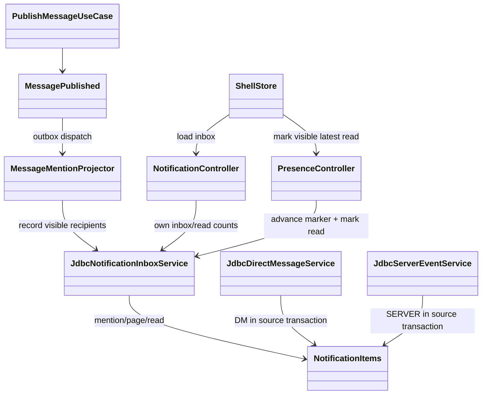

# T43 멘션·DM·서버 알림함과 브라우저 알림 Implementation Plan

> **For agentic workers:** REQUIRED SUB-SKILL: Use superpowers:subagent-driven-development (recommended) or superpowers:executing-plans to implement this plan task-by-task. Steps use checkbox (`- [ ]`) syntax for tracking.

**Goal:** 직접 멘션·`@everyone`·새 DM·서버 일정 생성/취소를 영속 알림함과 연결하고, 채널/DM 읽음 상태 및 열린 백그라운드 탭의 브라우저 알림을 일치시킨다.

**Architecture:** 기존 `MessagePublished` outbox를 멘션 알림 투영의 입력으로 사용한다. DM 전송과 서버 일정 생성·취소는 각 원본·알림을 단일 PostgreSQL transaction에 기록한다. 인증된 REST API는 현재 가시성에 맞는 세 종류의 알림과 채널/DM 읽음 위치를 반환하고, 웹은 서버 결과로 Inbox를 렌더링한다.

**Tech Stack:** Java 21, Spring Boot, JDBC/PostgreSQL, Kafka 프로필, Nuxt 4/Vue 3/Pinia, Browser Notification API, Vitest/Playwright, Gradle, OpenAPI generator.

---

**Approval Status: Approved.** 사용자 2026-10-05 개선 및 MR 지시를 근거로 아래 승인된 개선 절을 적용한다. 독립 계획 검수는 96/100, P0/P1 0으로 통과했다. 구현 스펙·품질/보안 검수와 검증은 각각 별도 게이트다.

**이전 승인 이력:** 멘션에서 DM·서버 일정까지 확장된 뒤 이전 승인 SHA `2b31191`을 승인 근거로 사용하지 않았다. 확대 범위의 재검수가 끝나기 전 작업 보존 WIP 커밋만 사용자 요청으로 생성했다.

**2026-10-05 작업 보존 예외:** 사용자가 현재 미커밋 변경의 커밋을 명시적으로 요청했다. 현재 T43 변경은 로컬 WIP 커밋으로 보존하며, 이 요청은 설계·구현 승인이나 푸시·병합 gate 통과를 뜻하지 않는다. `./gradlew test checkstyleMain checkstyleTest`, 웹 테스트(143 통과·8 skip), 웹 build, OpenAPI 검사, frontend lint는 성공했다. PostgreSQL 집중 테스트 18개는 `127.0.0.1:15432` 연결 거부로 실패했다. 독립 리뷰에서 차단 후 DM 조회·읽음 허용과 로그아웃·계정 변경 후 이전 사용자 알림/DM 상태 잔존을 발견했다. 두 결함 수정, 실제 DB 검증, 새 독립 리뷰 및 `docs/03-analysis/task_T43-merge-review.md`의 승인 근거가 필요하다.

**Branch:** `task_T43-notification-inbox`. 기존 미추적 `docs/superpowers/plans/2026-09-23-*.md` 3개는 작업 범위 밖이다.

**추가 검증:** `npm run e2e -- app-shell.spec.ts --grep notification`은 격리 포트에서 1개 smoke 테스트가 성공했다. 이 테스트는 서버 Inbox·브라우저 알림 전체 계약의 검증을 대체하지 않는다.

## 범위 결정과 파일 책임

| 경계 | 예상 변경 파일 | 책임 |
|---|---|---|
| 읽음 저장 | `backend/boot/src/main/resources/db/migration/V18__channel_read_markers.sql`, `backend/boot/src/main/java/com/example/discord/presence/PresenceController.java`, `backend/boot/src/main/java/com/example/discord/notification/JdbcNotificationInboxService.java` | 기존 사용자·채널별 단조 읽음 위치와 알림 읽음 상태를 같은 DB 처리에서 검증·보강 |
| 메시지 sequence | `backend/modules/message/src/main/java/com/example/discord/message/{MessageReadModel,InMemoryMessageService}.java`, `backend/boot/src/main/java/com/example/discord/message/{JdbcMessageStore,MessageController}.java` | 저장된 메시지의 실제 채널 sequence를 응답에 제공 |
| 알림 투영 | `backend/boot/src/main/java/com/example/discord/notification/{MessageMentionProjector,MessageMentionRecipientResolver,KafkaMessageMentionConsumer,NotificationProjectionConfiguration,JdbcNotificationInboxService}.java` | 이미 연결된 Kafka/로컬 투영 경계에서 멱등성·권한·transaction 부족분 보강 |
| DM 저장·API | `backend/boot/src/main/resources/db/migration/V19__direct_messages.sql`, `backend/boot/src/main/java/com/example/discord/social/{JdbcDirectMessageService,SocialController}.java` | 기존 1:1 DM 저장·조회·읽음 API, 차단 정책과 원본/알림 단일 transaction 검증·보강 |
| 서버 일정·API | `backend/boot/src/main/java/com/example/discord/event/{JdbcServerEventService,ServerEventController}.java` | 기존 일정 조회·생성·취소 API와 `EVENT_CREATED`/`EVENT_CANCELED` 알림의 가시성·transaction 검증·보강 |
| 사용자 API | `backend/boot/src/main/java/com/example/discord/notification/{NotificationController,JdbcNotificationInboxService}.java` | 본인 알림 세 종류의 가시 페이지·전체 unread 분리 계산, 권한 재검사 |
| 웹 | `apps/web/stores/shell.ts`, `apps/web/pages/app.vue`, `apps/web/services/discord-api.ts`, `apps/web/locales/ko-KR.json`, `apps/web/locales/en-US.json` | 구조화된 멘션 발행, 서버 Inbox/읽음 동기화, 설정과 브라우저 알림 |
| 웹 읽음 표시 | `apps/web/components/shell/ChannelSidebar.vue`, `apps/web/components/shell/ChatViewport.vue`, `apps/web/tests/components/shell-contracts.test.ts` | 서버 unread 배지와 최신 메시지 viewport 읽음 처리 및 기존 shell 회귀 계약 |
| 메시지 sequence 조회 계약 | `backend/modules/message/src/main/java/com/example/discord/message/ChannelMessageReadModelPort.java` | 메시지 응답에 저장 sequence를 제공하는 기존 read-model port 확장 |
| 계약·검증 | `qa/openapi-contract.mjs`, `docs/api/openapi.json`, `packages/api-client/src/generated/openapi-types.ts`, 해당 백엔드/웹 테스트 | API 계약과 회귀 검증 |

테스트는 기존 `PostgresNotificationInboxServiceTest`, `MessageMentionProjectorTest`, `PostgresDirectMessageServiceTest`, `SocialControllerTest`, `PostgresServerEventServiceTest`, `PostgresNotificationFlowControllerTest`, `PresenceControllerTest`, `MessageControllerTest`, `apps/web/tests/components/app-shell.test.ts`, `apps/web/tests/e2e/app-shell.spec.ts`를 우선 확장한다. 기존 파일과 경로가 충분하면 새 파일을 만들지 않는다. 이 표와 각 Task의 명시된 파일 중 부족한 동작을 수정하는 파일만 task branch의 **Expected Changed Files**다. 기존 `V18`·`V19` migration은 참조 대상이며 수정하지 않는다.

**현재 코드 기준선:** `MessageMentionProjector`, `KafkaMessageMentionConsumer`의 `notification-service-v1`, 로컬 dispatcher 연결, `JdbcDirectMessageService`의 DM 저장·읽음, `JdbcServerEventService`의 일정 알림, `NotificationController`의 페이지·별도 unread API가 이미 있다. 각 Task는 먼저 기존 테스트와 동작을 확인하고 설계에 부족한 동작만 보강한다. 이미 충족한 항목은 근거를 남기고 변경 없이 완료한다.



```mermaid
sequenceDiagram
  participant W as Web
  participant M as Message API/Outbox
  participant P as Mention projector
  participant S as DM/Server API
  participant D as PostgreSQL
  participant N as Notification API
  W->>M: POST message + USER/EVERYONE mentions
  M->>D: message + outbox in one transaction
  M-->>P: MessagePublished(messageId)
  P->>D: load message, sequence, visible recipients
  P->>D: idempotent notification insert (respect read marker)
  W->>N: GET my inbox/unread
  N->>D: visibility-filtered rows and read positions
  W->>N: PUT channel read at visible sequence
  N->>D: monotonic marker + notification read in one transaction
  N-->>W: persisted sequence
  W->>S: send DM or create/cancel server event
  S->>D: DM message + recipient notification in one transaction
  S->>D: server event + signal + visible notifications in one transaction
  W->>N: GET visible MENTION/DM/SERVER page
  N->>D: filter visibility before LIMIT; count all visible unread separately
```

**확정된 갈림길:** 채널 멘션은 이벤트 투영, DM과 서버 일정은 원본·알림의 단일 DB transaction을 사용한다. 직접 멘션과 `@everyone`, 새 DM, 일정 생성·취소만 생성하며 글쓰기 가능 사용자 전원 `@everyone` 사용 가능하다. 브라우저 알림은 백그라운드에 열린 탭에서만 표시한다. `@here`·역할 멘션·RSVP 변경·Web Push는 범위 밖이다.

**남은 모호성:** 없음. 현재 웹에는 실제 사용자 ID가 붙은 member 선택기가 없으므로 첫 구현의 직접 멘션 입력은 `<@uuid>`로 한정한다. 자유 텍스트 `@이름`은 알림 멘션으로 승격하지 않는다. `@everyone`은 독립 토큰일 때만 `EVERYONE`으로 보낸다. 사용자명 자동완성은 별도 제품 개선이다.

### Task 1: 저장 sequence와 영속 읽음 위치

**Files:** 기존 migration `V18__channel_read_markers.sql`; `MessageReadModel.java`; `InMemoryMessageService.java`; `JdbcMessageStore.java`; `MessageController.java`; `PresenceController.java`; `JdbcNotificationInboxService.java`; tests `PostgresNotificationInboxServiceTest.java`, `PresenceControllerTest.java`, `MessageControllerTest.java`, `ChannelMessageQueryServiceTest.java`.

- [ ] **Step 1: 부족한 회귀 테스트 작성.** Postgres 테스트에서 sequence 7을 읽고 5를 다시 보내도 7 유지, adapter 재생성 후에도 7 조회, sequence 7 이하 알림만 읽음, 타인 채널 403, 실제 마지막 sequence보다 큰 값 400, 메시지 응답 `sequence`를 확인한다. 기존 테스트에 있으면 재사용한다. fixture 정리 시 `channel_read_markers`를 채널보다 먼저 지운다.
- [ ] **Step 2: RED 확인.** 로컬 Postgres가 `127.0.0.1:15432`에서 실행 중일 때 `DISCORD_RUN_POSTGRES_TESTS=true ./gradlew :backend:boot:test --tests com.example.discord.notification.PostgresNotificationInboxServiceTest --tests com.example.discord.presence.PresenceControllerTest --tests com.example.discord.message.MessageControllerTest`로 새 회귀 단언의 실패를 확인한다. 이미 통과하면 그 결과를 근거로 남긴다. Postgres 테스트 skip은 통과로 인정하지 않는다.
- [ ] **Step 3: 부족한 동작만 보강.** 기존 `V18__channel_read_markers.sql`과 DB `messages.sequence` 매핑을 확인한다. 읽음 API는 실제 채널 최대 sequence를 검사하고 marker upsert와 `notification_items.read` update를 단일 transaction에서 실행한다. `!postgres` 경로는 기존 메모리 read 동작을 유지한다. 이미 배포된 migration을 수정하거나 같은 테이블을 재생성하지 않는다.

- [ ] **Step 4: GREEN 확인.** 같은 집중 명령 → PASS, skip 0 확인. `./gradlew :backend:modules:message:test`와 `git diff --check` → PASS.
- [ ] **Step 5: task 소유 파일만 커밋.** `git add`에 위 실제 변경 경로만 지정하고 `git diff --cached --name-only`를 확인한 뒤 `git commit -m "feat: persist notification read markers"`.

### Task 2: 기존 발행 이벤트 멘션 투영 보강

**Files:** 기존 `MessageMentionProjector.java`, `MessageMentionRecipientResolver.java`, `KafkaMessageMentionConsumer.java`, `NotificationProjectionConfiguration.java`, `JdbcNotificationInboxService.java`; tests 기존 `PostgresNotificationInboxServiceTest.java`, `MessageMentionProjectorTest.java`, `KafkaMessageMentionConsumerTest.java`, `NotificationProjectionConfigurationTest.java`.

- [ ] **Step 1: 실패 테스트 작성.** 직접 멘션+`@everyone` 수신자 중복 제거, 작성자 제외, 숨긴 채널 제외, `HERE`/`ROLE` 제외, 재전달 시 한 건, 읽음 위치가 이벤트보다 앞선 경우 처음부터 읽음, 권한 조회 실패 시 레코드 미공개를 검증한다.

```java
projector.project(eventFor(messageWithMentions(USER_TARGET, EVERYONE)));
projector.project(eventFor(messageWithMentions(USER_TARGET, EVERYONE)));
assertThat(inbox.inbox(USER_TARGET)).hasSize(1);
assertThat(inbox.inbox(AUTHOR)).isEmpty();
assertThat(inbox.inbox(HIDDEN_MEMBER)).isEmpty();
```

- [ ] **Step 2: RED 확인.** 기존 `MessageMentionProjectorTest`에 부족한 사례만 추가하고 집중 실행해 실패를 확인한다. 이미 통과하는 사례는 기존 테스트를 근거로 남긴다.
- [ ] **Step 3: 최소 보강.** 기존 resolver의 직접 멘션/`EVERYONE` 가시 수신자 계산, projector의 DB sequence 조회, Kafka `notification-service-v1` consumer group과 `!kafka` dispatcher 연결을 재사용한다. 부족한 경우에만 `JdbcNotificationInboxService`의 한 이벤트 삽입 transaction과 먼저 읽은 sequence 처리, 권한 조회 실패 시 재시도 경로를 보강한다. 같은 consumer·dispatcher를 새로 만들지 않는다.

```java
Set<UUID> recipients = new LinkedHashSet<>(directUserIds);
if (mentions.contains(new SpecialMentionTarget(SpecialMentionKind.EVERYONE))) {
    guildService.guild(guildId).members().stream().map(GuildMember::userId).forEach(recipients::add);
}
recipients.remove(authorId);
recipients.removeIf(id -> !guildService.canViewChannel(guildId, channelId, id));
```

- [ ] **Step 4: GREEN 확인.** 집중 projector/consumer/configuration 테스트 → PASS; Postgres 테스트는 `DISCORD_RUN_POSTGRES_TESTS=true`로 실행해 skip 0 확인; `git diff --check` → 출력 없음.
- [ ] **Step 5: task 소유 파일만 커밋.** `git commit -m "feat: project published mentions into inbox"`.

### Task 3: 인증된 세 종류 알림 조회 API와 계약

**Files:** 기존 `NotificationController.java`, `JdbcNotificationInboxService.java`; `qa/openapi-contract.mjs`; 생성물 `docs/api/openapi.json`, `packages/api-client/src/generated/openapi-types.ts`; 기존 `backend/boot/src/test/java/com/example/discord/notification/PostgresNotificationFlowControllerTest.java`, `PostgresNotificationInboxServiceTest.java`.

- [ ] **Step 1: 실패 테스트 작성.** 무토큰 401, 타인 식별자 접근 불가, 숨긴 채널 항목·개수 제외, 본인 목록 최신순·cursor 다음 페이지, 채널 unread에서 자기 메시지 제외를 검증한다. 특히 `limit=1`에서 최신 항목이 숨긴 채널이고 다음 항목이 가시 채널인 경우 가시 항목 1건이 반환되어야 한다. 다음 페이지와 별도 unread 개수에는 페이지 밖의 가시 항목도 포함한다. `DM`은 참여자만, `SERVER`는 현재 일정 채널을 볼 수 있는 사용자만 조회되는지 검증한다.

```java
mockMvc.perform(get("/api/notifications?limit=1").header(AUTHORIZATION, bearer(USER_ID)))
    .andExpect(status().isOk())
    .andExpect(jsonPath("$.length()").value(1));
mockMvc.perform(get("/api/notifications/unread-count").header(AUTHORIZATION, bearer(USER_ID)))
    .andExpect(status().isOk())
    .andExpect(jsonPath("$.unreadCount").value(2));
```

- [ ] **Step 2: RED 확인.** 기존 집중 테스트에 누락된 사례만 추가하고 실패를 확인한다. 이미 통과하면 현재 구현을 근거로 기록한다.
- [ ] **Step 3: 최소 보강.** 기존 `GET /api/notifications?limit=50&before=<itemId>`와 `GET /api/notifications/unread-count`를 유지한다. `limit`은 1..100, 정렬/cursor는 `(createdAt,id)`를 사용한다. 현재 가시 채널과 DM 참여자 조건을 SQL 페이지 조회의 `LIMIT`보다 먼저 적용하거나, 가시 항목으로 `limit`을 채울 때까지 안정적으로 다음 batch를 읽는다. cursor는 마지막 **반환한 가시 항목**을 기준으로 하며 중복·누락이 없어야 한다. 전체 가시 unread 개수는 페이지와 독립된 쿼리로 계산한다. 채널 unread는 저장된 메시지 sequence > marker, 작성자 != 본인 조건으로 계산한다. 기존 REST path/DTO와 메시지 응답 `sequence`를 OpenAPI에 반영한다.

```java
UUID userId = authenticatedUserResolver.requireUserId(authorization);
return service.page(userId, visibleChannels(userId), before, limit);
```

- [ ] **Step 4: GREEN·계약 확인.** 집중 테스트 → PASS; `npm run openapi:write && npm run openapi:check` → PASS. 생성물은 수동 편집하지 않는다.
- [ ] **Step 5: task 소유 파일만 커밋.** 변경이 있을 때만 `git commit -m "fix: keep notification pages visibility complete"`.

### Task 4: 웹의 구조화 멘션, 세 종류의 서버 Inbox와 읽음 연결

**Files:** `apps/web/stores/shell.ts`, `apps/web/pages/app.vue`, `apps/web/services/discord-api.ts`, `apps/web/locales/ko-KR.json`, `apps/web/locales/en-US.json`; tests `apps/web/tests/components/app-shell.test.ts`, `apps/web/tests/e2e/app-shell.spec.ts`.

- [ ] **Step 1: 실패 웹 테스트 작성.** 작성창의 `<@uuid> @everyone` 전송 요청에 `mentions: [{type:'USER',id:<uuid>},{type:'EVERYONE'}]`가 포함되고, Inbox는 로컬 `messages`가 아니라 서버의 `MENTION`·`DM`·`SERVER` 결과를 표시한다. 각 알림 클릭 시 채널·DM 대화·일정으로 이동한다. 채널과 DM은 열기만 해서는 읽음 요청이 없고 최신 메시지가 보인 뒤 각 읽음 API 성공 시에만 배지가 사라지는 사례를 검증한다. 서버 일정은 항목 열기 후 본인/가시성 검사에 성공해야 읽음으로 표시한다.

```ts
expect(sendBody.mentions).toEqual([
  { type: 'USER', id: mentionedUserId },
  { type: 'EVERYONE' }
])
expect(screen.getByTestId('workbench-inbox-mention-server-message-id')).toBeVisible()
```

- [ ] **Step 2: RED 확인.** `npm run test -w apps/web -- app-shell.test.ts` → 새 단언 실패.
- [ ] **Step 3: 최소 구현.** 작성창의 `<@uuid>`를 실제 사용자 ID로 구조화하고, `@everyone`은 공백·문장 경계로 분리된 토큰일 때만 포함한다. 이미 있는 `sendBackendMessage` body에 `mentions`를 넣는다. 인증된 bootstrap/Inbox 진입 시 기존 알림 API의 세 종류 항목과 별도 unread 개수를 읽고, 채널·DM·일정별 이동 대상을 연결한다. 채널/DM의 최신 메시지가 viewport에서 보일 때 각각 저장된 `sequence`로 읽음 API를 호출한다. 서버 일정은 항목 열기 후 개별 읽음 API를 호출한다. 성공 응답으로만 store를 갱신한다. 로컬 seeded 데모 경로는 인증이 없을 때만 유지한다.

```ts
await client.post(discordApiPaths.channel.messages(channelId), {
  content: body,
  idempotencyKey: clientEventId,
  mentions: mentionTargets
}, { bearerToken, requestId })
```

- [ ] **Step 4: GREEN 확인.** `npm run test -w apps/web -- app-shell.test.ts`와 `npm run e2e -w apps/web -- app-shell.spec.ts --grep "notification inbox"` → PASS.
- [ ] **Step 5: task 소유 파일만 커밋.** `git commit -m "feat: connect web inbox and read state"`.

### Task 5: 명시적 브라우저 권한과 백그라운드 알림

**Files:** `apps/web/pages/app.vue`, `apps/web/stores/shell.ts`, `apps/web/locales/ko-KR.json`, `apps/web/locales/en-US.json`; tests `apps/web/tests/components/app-shell.test.ts`, `apps/web/tests/e2e/app-shell.spec.ts`.

- [ ] **Step 1: 실패 테스트 작성.** 설정 클릭 전 권한 요청 0회, 클릭 후 1회, `denied`/미지원 상태 문구, foreground 0건, hidden+granted 상태에서 새로 생긴 미읽음 멘션·DM·일정 알림, 기존 미읽음 항목 0건, 같은 알림 ID의 `tag` 사용, 알림 클릭 시 종류별 이동을 검증한다.

```ts
expect(requestPermission).not.toHaveBeenCalled()
await user.click(screen.getByTestId('settings-browser-notifications-enable'))
expect(requestPermission).toHaveBeenCalledTimes(1)
```

- [ ] **Step 2: RED 확인.** `npm run test -w apps/web -- app-shell.test.ts` → 새 단언 실패.
- [ ] **Step 3: 최소 구현.** 설정 버튼의 사용자 제스처에서만 `Notification.requestPermission()`을 호출한다. 허용되면 브라우저별 선택을 localStorage에 보관한다. 현재 웹에는 실행 중 Gateway WebSocket 연결이 없으므로 hidden 탭에서만 10초 간격으로 인증된 Inbox API를 조회한다. 시작 시 기존 항목 ID를 기준 집합으로 잡아 과거 미읽음을 다시 알리지 않고, 이후 새로 생긴 세 종류의 미읽음/가시 항목에만 `new Notification(title, { body: '', tag: item.id })`을 호출한다. `visibilitychange`/로그아웃/unmount 시 polling을 정리하고 클릭하면 채널·DM·일정의 기존 이동 경로를 호출한다. `Notification` 미지원 또는 `denied`면 버튼 상태와 설명만 바꾼다.

```ts
if (enabled && Notification.permission === 'granted' && document.visibilityState === 'hidden' && item && !item.read) {
  new Notification(`${item.kind} · ${item.summary}`, { body: '', tag: item.id })
}
```

- [ ] **Step 4: GREEN 확인.** 웹 component 테스트와 Playwright notification mock smoke → PASS; `npm run build -w apps/web` → PASS.
- [ ] **Step 5: task 소유 파일만 커밋.** `git commit -m "feat: add opted-in browser mention notifications"`.

### Task 6: DM 저장·조회·읽음과 알림

**Files:** 기존 `V19__direct_messages.sql`, `JdbcDirectMessageService.java`, `SocialController.java`, `JdbcNotificationInboxService.java`, `qa/openapi-contract.mjs`; tests 기존 `PostgresDirectMessageServiceTest.java`, `SocialControllerTest.java`, `PostgresNotificationFlowControllerTest.java`.

- [ ] **Step 1: 부족한 회귀 테스트 작성.** 기존 친구·차단 정책을 통과한 1:1 전송이 영수증·본문·대화별 단조 sequence·수신자 `DM` 알림을 저장하고, 재조회·읽음 위치가 재시작 후 유지되는지 확인한다. 타인/차단된 사용자와 그룹 DM 경로는 조회·읽음 권한이 없어야 한다. 수신자 설정이 꺼지면 알림만 생략한다. 저장 또는 알림 삽입 실패 시 원본과 알림이 함께 rollback되는지 PostgreSQL에서 검증한다.
- [ ] **Step 2: 집중 RED 확인.** `DISCORD_RUN_POSTGRES_TESTS=true ./gradlew :backend:boot:test --tests com.example.discord.social.PostgresDirectMessageServiceTest --tests com.example.discord.social.SocialControllerTest`를 실행한다. 이미 통과하는 기존 동작은 근거로 남기고 부족한 사례만 실패시킨다.
- [ ] **Step 3: 최소 보강.** 기존 `POST /api/social/dms/{targetUserId}/messages`, `GET /api/social/dms/{targetUserId}/messages`, `GET|PUT /api/social/dms/{targetUserId}/read`와 `JdbcDirectMessageService`를 재사용한다. 참여자·차단 정책을 각 조회/읽음에서도 검사하고, 읽음 sequence를 실제 저장 범위로 검증한다. DM 원본과 알림 삽입, DM marker와 `DM` 알림 읽음 변경은 각각 동일 connection/transaction으로 처리한다. 기존 `V19`를 다시 만들지 않는다.
- [ ] **Step 4: GREEN·계약 확인.** 같은 집중 테스트가 skip 없이 통과하고 DM API/DTO가 `qa/openapi-contract.mjs`와 생성 계약에 반영되는지 확인한다.

### Task 7: 서버 일정 생성·취소 알림

**Files:** 기존 `JdbcServerEventService.java`, `ServerEventController.java`, `NotificationController.java`, `JdbcNotificationInboxService.java`, `qa/openapi-contract.mjs`; tests 기존 `PostgresServerEventServiceTest.java`, `PostgresNotificationFlowControllerTest.java`.

- [ ] **Step 1: 부족한 회귀 테스트 작성.** `EVENT_CREATED`와 `EVENT_CANCELED`의 서로 다른 signal ID로 각 1건만 기록하고 행위자·숨긴 채널 구성원을 제외한다. RSVP 변경은 알림을 만들지 않는다. 관리 권한 없는 생성·취소와 열람 권한 없는 목록은 거부하며, 권한 회수 뒤 알림·unread에서 제외한다. 일정/신호/알림 중 하나가 실패하면 전부 rollback되는지 PostgreSQL에서 검증한다.
- [ ] **Step 2: 집중 RED 확인.** `DISCORD_RUN_POSTGRES_TESTS=true ./gradlew :backend:boot:test --tests com.example.discord.event.PostgresServerEventServiceTest --tests com.example.discord.notification.PostgresNotificationFlowControllerTest`를 실행한다. 이미 충족한 사례는 기존 테스트를 근거로 남긴다.
- [ ] **Step 3: 최소 보강.** 기존 `GET|POST /api/guilds/{guildId}/events`, `PUT /api/guilds/{guildId}/events/{eventId}/cancel`과 `JdbcServerEventService`를 재사용한다. 생성·취소 각각 일정 원본, signal, 가시 수신자별 `SERVER` 알림을 한 transaction에 묶는다. 현재 가시성을 조회·개별 읽음 때 다시 확인하고 기존 알림 설정을 적용한다. 별도 이벤트 버스나 중복 API를 만들지 않는다.
- [ ] **Step 4: GREEN·계약 확인.** 같은 집중 테스트가 skip 없이 통과하고 일정 API/DTO가 OpenAPI에 반영되는지 확인한다.

### Task 8: 통합 검증과 리뷰 근거

**Files:** 변경된 테스트와 `docs/03-analysis/T43-notification-inbox.analysis.md` (검증 근거가 필요할 때만 생성).

- [ ] **Step 1: 환경 확인.** `./gradlew --version` → wrapper/Java 21 확인; `git status --short` → T43 외 경로가 staged되지 않음.
- [ ] **Step 2: 전체 게이트.** `DISCORD_RUN_POSTGRES_TESTS=true ./gradlew :backend:boot:test :backend:modules:notification:test :backend:modules:message:test`, `npm run test -w apps/web`, `npm run build -w apps/web`, `npm run openapi:check`, `git diff --check` → 전부 PASS/skip 0. DM 저장·조회·읽음·rollback, 일정 생성·취소·rollback, 권한 회수, PostgreSQL adapter 재생성·이벤트 재전달을 실제 DB 통합 테스트로 확인한다. Playwright smoke는 격리된 포트에서 실행한다. 새 migration이 있으면 `pwsh qa/migration-guard.contract.ps1`로 확인한다.
- [ ] **Step 3: 요구사항 대조.** 직접 멘션/`@everyone`, DM 저장·조회·읽음, 일정 생성·취소와 signal별 알림, 종류별 설정, 가시성, 중복 방지, 단조 읽음, 재시작 유지, 인증 API, 세 종류의 서버 Inbox, 가시 페이지·독립 unread 개수, 명시적 브라우저 권한, hidden 탭만 알림, `@here`·역할 멘션·RSVP 제외를 현 설계의 각 절과 대조한다.
- [ ] **Step 4: 리뷰.** 고정 SHA·diff 범위·테스트 결과를 기록하고 프로젝트 review-loop의 P0/P1 0 기준으로 spec 및 품질/보안 검수를 완료한다. 실패하면 수정 후 새 SHA에서 다시 검수한다. 리뷰 전에는 push/merge하지 않는다.

## 계획 자체의 검증 게이트

- 구현 착수 전 사용자 계획 승인과 프로젝트 blueprint 승인 상태를 확인한다.
- `backend/AGENTS.md`와 `.agents/rules/backend/{architecture,logging}.md`를 구현 시작 시 읽는다.
- Wiki used: `index.md`, `wiki/Agent Development Guide.md`, `wiki/Backend Architecture.md`, `wiki/Frontend Client Architecture.md`, `wiki/QA Infra Operations.md`, `wiki/Current Roadmap And Risks.md`.

## 2026-10-05 승인된 개선 및 MR 게이트

### Approval Gate
- Status: Approved
- Approver: 사용자 (2026-10-05, 개선 진행 및 MR 요청, 각 리뷰 90점 이상·P0/P1 전부 해결)
- Blocking ambiguity: 없음. 원래 T43 제품 범위와 아래 보완을 대상으로 한다.
- 앞의 작업 보존 기록은 이전 revision의 결과이며 현재 승인/검증 결과를 대체하지 않는다.

### 결함과 최소 수정
1. DM: 모든 조회·읽음·전송 경로에서 기존 `requireNotBlocked`를 사용한다. 차단 방향에 관계없이 차단 후 양쪽 사용자 요청을 403으로 거부한다. Inbox 페이지·unread도 차단된 DM을 제외한다.
2. 사용자 경계: 로그아웃 및 계정 전환 시 서버 workspace/메시지/알림/DM/읽음/일정 상태를 초기화한다. 이전 사용자 요청의 지연 응답은 현재 상태를 덮어쓰지 못한다. 토큰 갱신과 계정 전환을 구별하되 인증 주체를 확정할 수 없으면 안전하게 초기화한다.
3. 읽음 observer: 각 observer가 자체 pending 상태와 수명을 소유한다. 이전 채널/DM 요청이 새로운 observer를 해제할 수 없다. DOM 갱신·계정 전환·unmount 후 stale callback을 무효화한다. 숨긴 탭에서 읽음 처리하지 않는다.
4. 브라우저 polling: unmount/로그아웃/계정 전환 때 generation을 증가시켜 지연 응답·알림 클릭을 무효화한다. interval 요청 중첩과 과거 알림 재표시를 회귀 테스트로 검사한다.
5. 검증: 기존 Docker/로컬 PostgreSQL 실행 수단을 재사용하고, 새 schema/dependency 없이 실제 DB rollback·가시성·재생성·단조 읽음 경계를 검사한다.

### 참여 경계
- `SocialController → JdbcDirectMessageService → requireNotBlocked`: 인증 주체 기반 1:1 DM 정책.
- `NotificationController → JdbcNotificationInboxService`: 현재 가시성·차단 정책을 적용한 bounded 페이지와 별도 unread.
- `auth store → shell store → App/ChatViewport`: 사용자 경계 초기화, 요청 generation 및 observer lifecycle.
- 위 class/sequence diagram과 이 절의 수정 항목이 합쳐져 이번 구현 blueprint를 구성한다.

### Expected Changed Files — 전체 MR 기준
아래 목록은 `origin/main...reviewed-content` 전체 변경 파일의 정확한 허용 목록이다. 변경하지 않는 기존 파일도 기존 T43 커밋 범위 검수에 포함한다. `docs/03-analysis/task_T43-merge-review.md`는 별도 evidence commit으로만 추가한다.

- `apps/web/components/shell/ChannelSidebar.vue`
- `apps/web/components/shell/ChatViewport.vue`
- `apps/web/locales/en-US.json`
- `apps/web/locales/ko-KR.json`
- `apps/web/pages/app.vue`
- `apps/web/services/discord-api.ts`
- `apps/web/stores/auth.ts`
- `apps/web/stores/shell.ts`
- `apps/web/tests/components/app-shell.test.ts`
- `apps/web/tests/components/shell-contracts.test.ts`
- `apps/web/tests/e2e/app-shell.spec.ts`
- `backend/boot/src/main/java/com/example/discord/event/JdbcServerEventService.java`
- `backend/boot/src/main/java/com/example/discord/event/ServerEventController.java`
- `backend/boot/src/main/java/com/example/discord/event/ServerEventRecipientResolver.java`
- `backend/boot/src/main/java/com/example/discord/message/JdbcMessageStore.java`
- `backend/boot/src/main/java/com/example/discord/message/MessageConfiguration.java`
- `backend/boot/src/main/java/com/example/discord/message/MessageController.java`
- `backend/boot/src/main/java/com/example/discord/notification/JdbcNotificationInboxService.java`
- `backend/boot/src/main/java/com/example/discord/notification/KafkaMessageMentionConsumer.java`
- `backend/boot/src/main/java/com/example/discord/notification/MessageMentionProjector.java`
- `backend/boot/src/main/java/com/example/discord/notification/MessageMentionRecipientResolver.java`
- `backend/boot/src/main/java/com/example/discord/notification/NotificationController.java`
- `backend/boot/src/main/java/com/example/discord/notification/NotificationProjectionConfiguration.java`
- `backend/boot/src/main/java/com/example/discord/presence/JdbcChannelReadService.java`
- `backend/boot/src/main/java/com/example/discord/presence/PresenceController.java`
- `backend/boot/src/main/java/com/example/discord/social/JdbcDirectMessageService.java`
- `backend/boot/src/main/java/com/example/discord/social/SocialController.java`
- `backend/boot/src/main/resources/db/migration/V18__channel_read_markers.sql`
- `backend/boot/src/main/resources/db/migration/V19__direct_messages.sql`
- `backend/boot/src/main/resources/db/migration/V20__direct_message_sender_delete.sql`
- `backend/boot/src/test/java/com/example/discord/event/PostgresServerEventServiceTest.java`
- `backend/boot/src/test/java/com/example/discord/guild/PostgresGuildServiceTest.java`
- `backend/boot/src/test/java/com/example/discord/invite/PostgresInviteServiceTest.java`
- `backend/boot/src/test/java/com/example/discord/message/JdbcMessageStoreTest.java`
- `backend/boot/src/test/java/com/example/discord/message/MessageConfigurationTest.java`
- `backend/boot/src/test/java/com/example/discord/message/MessageControllerTest.java`
- `backend/boot/src/test/java/com/example/discord/notification/KafkaMessageMentionConsumerTest.java`
- `backend/boot/src/test/java/com/example/discord/notification/MessageMentionProjectorTest.java`
- `backend/boot/src/test/java/com/example/discord/notification/MessageMentionRecipientResolverTest.java`
- `backend/boot/src/test/java/com/example/discord/notification/NotificationProjectionConfigurationTest.java`
- `backend/boot/src/test/java/com/example/discord/notification/PostgresNotificationFlowControllerTest.java`
- `backend/boot/src/test/java/com/example/discord/notification/PostgresNotificationInboxServiceTest.java`
- `backend/boot/src/test/java/com/example/discord/presence/PostgresChannelReadServiceTest.java`
- `backend/boot/src/test/java/com/example/discord/social/PostgresDirectMessageServiceTest.java`
- `backend/modules/message/src/main/java/com/example/discord/message/ChannelMessageReadModelPort.java`
- `backend/modules/message/src/main/java/com/example/discord/message/InMemoryMessageService.java`
- `backend/modules/message/src/main/java/com/example/discord/message/MessageReadModel.java`
- `backend/modules/message/src/test/java/com/example/discord/message/ChannelMessageQueryServiceTest.java`
- `backend/modules/notification/src/main/java/com/example/discord/notification/MentionNotificationCommand.java`
- `backend/services/message/src/test/java/com/example/discord/messageservice/JdbcMessagePublicationOutboxPostgresTest.java`
- `docs/api/openapi.json`
- `docs/superpowers/plans/2026-09-28-t43-mention-inbox-browser-notifications.md`
- `docs/superpowers/plans/2026-09-29-t43-design2-persistence.md`
- `docs/superpowers/plans/2026-09-29-t43-mention-projection-slice.md`
- `docs/superpowers/specs/2026-09-28-t43-mention-inbox-browser-notifications-design.md`
- `packages/api-client/src/generated/openapi-types.ts`
- `qa/openapi-contract.mjs`
- `qa/openapi-contract.test.mjs`

### Verification Gates
- 별도 message-service outbox PostgreSQL adapter 테스트는 DB claim/ACK 기록/retry/DLQ만 검사한다. 실제 DataSource/JdbcTemplate/Flyway와 기존 adapter를 직접 구성해 테스트 전용 schema에서 검증하며, Kafka와 Spring runtime 기동은 별도 opt-in smoke의 책임이다. broker 전달 성공을 이 테스트의 근거로 주장하지 않는다.
- 실제 전체 PostgreSQL 실행에서 위 세 fixture가 `premium_entitlements`를 남긴 채 부모 길드를 삭제해 FK 오류를 일으켰다. 기존 다른 fixture의 정리 순서를 재사용해 자식 행을 먼저 정리한다. 운영 schema나 데이터 삭제 동작은 변경하지 않는다.
- RED/GREEN: 실제 PostgreSQL에서 차단 후 양방향 GET messages·GET/PUT read와 Inbox 노출 회귀, DM/일정 원자 rollback·설정 억제, 웹 계정 전환·지연 응답·observer 전환·unmount 회귀.
- `./gradlew --version`, `./gradlew test checkstyleMain checkstyleTest`.
- `DISCORD_RUN_POSTGRES_TESTS=true ./gradlew :backend:boot:test` (환경 기반 PostgreSQL 테스트가 skip 없이 성공; PostgreSQL 외 별도 opt-in은 구분 기록).
- `npm run test -w apps/web -- --run`, `npm run build -w apps/web`, `npm run openapi:check`, `npm run lint:frontend`.
- `npm run e2e -- app-shell.spec.ts --grep notification` (격리 포트), `pwsh qa/migration-guard.contract.ps1`, `git diff --check`.
- 전체 SHA 고정 후 독립 spec review → 독립 quality/security review 각각 90/100 이상, P0/P1 0. Evidence artifact도 별도 독립 검수한다.
- base origin/main SHA와 reviewed content SHA 및 모든 검증 대상 SHA를 일치시킨다. 마지막 evidence commit은 merge-review 파일만 포함한다.
- gate 통과 후 feature branch push 및 main 대상 PR(MR)을 생성한다. 이번 요청은 main merge를 포함하지 않는다.

### Review Score Preset
- 스펙: Implementation Review, alignment 20 / correctness 20 / security 15 / verification 20 / maintainability 15 / operations-docs 10.
- 품질·보안: Security Review, threat 20 / access 20 / exposure 15 / regression 20 / operational 15 / config 10. Java 경계는 Principal Java 8항목도 대조한다.
- 두 리뷰 모두 90/100 이상·P0/P1 없음. 점수와 각 차감의 근거를 기록한다.
