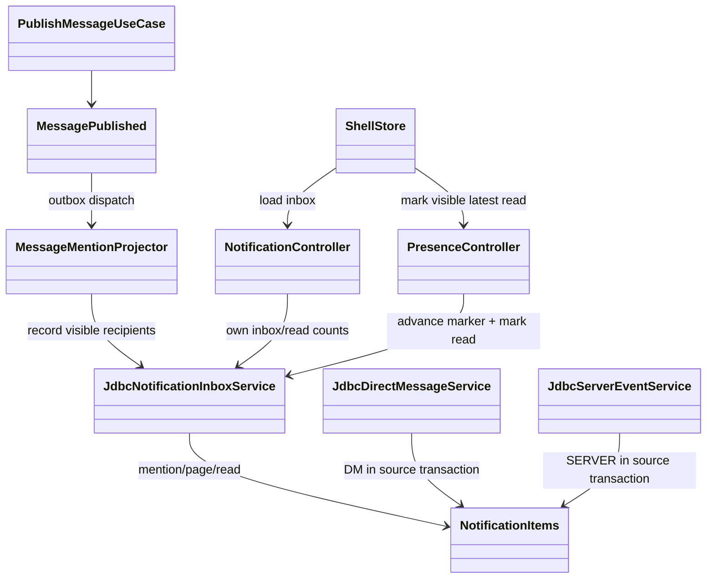

# T43 멘션·DM·서버 알림함과 브라우저 알림 Implementation Plan

> **For agentic workers:** REQUIRED SUB-SKILL: Use superpowers:subagent-driven-development (recommended) or superpowers:executing-plans to implement this plan task-by-task. Steps use checkbox (`- [ ]`) syntax for tracking.

**Goal:** 직접 멘션·`@everyone`·새 DM·서버 일정 생성/취소를 영속 알림함과 연결하고, 채널/DM 읽음 상태 및 열린 백그라운드 탭의 브라우저 알림을 일치시킨다.

**Architecture:** 기존 `MessagePublished` outbox를 멘션 알림 투영의 입력으로 사용한다. DM 전송과 서버 일정 생성·취소는 각 원본·알림을 단일 PostgreSQL transaction에 기록한다. 인증된 REST API는 현재 가시성에 맞는 세 종류의 알림과 채널/DM 읽음 위치를 반환하고, 웹은 서버 결과로 Inbox를 렌더링한다.

**Tech Stack:** Java 21, Spring Boot, JDBC/PostgreSQL, Kafka 프로필, Nuxt 4/Vue 3/Pinia, Browser Notification API, Vitest/Playwright, Gradle, OpenAPI generator.

---

**Approval Status: 사용자 제품 범위·Task 9 계획 승인; 구현 독립 검수 93/100(P0/P1/P2 0); 전체 검증 통과. 최종 보안 검수와 push/PR gate 진행 중.** 기존 94점은 Task 9 추가 전 revision에만 적용된다.

**승인 설계 식별자:** `docs/superpowers/specs/2026-09-28-t43-mention-inbox-browser-notifications-design.md`, blob SHA `81bcff60f1f92d9de5ef3e9cdbab6fb4c667d8ad` (설계 기록 commit `97ebd5d10c93949b921e3df0d9e4bf9ed2a48369`). 이전 SHA `2b31191`은 멘션 전용 초기 설계이므로 현재 범위의 승인 근거로 사용하지 않는다.

**이전 승인 이력:** 멘션에서 DM·서버 일정까지 확장된 뒤 이전 승인 SHA `2b31191`을 승인 근거로 사용하지 않았다. 확대 범위의 재검수가 끝나기 전 작업 보존 WIP 커밋만 사용자 요청으로 생성했다.

**2026-10-05 작업 보존 기록 (당시 상태):** 사용자가 당시 미커밋 변경의 로컬 WIP 커밋을 요청했다. 이는 설계·구현 승인이나 푸시·병합 gate 통과를 뜻하지 않았다. 당시 일반 테스트와 웹 검증은 성공했지만 PostgreSQL 집중 테스트 18개는 `127.0.0.1:15432` 연결 거부로 실행되지 않았고, 독립 리뷰에서 차단 후 DM 조회·읽음 허용 및 계정 경계 결함이 보고됐다. 아래 후속 변경에서 두 결함을 수정하고 실제 PostgreSQL 검증을 다시 실행했다.

**2026-10-15 기존 검증 기록:** 당시 `DISCORD_RUN_POSTGRES_TESTS=true ./gradlew :backend:boot:test :backend:modules:notification:test :backend:modules:message:test checkstyleMain checkstyleTest`, 웹 테스트(151 통과·8 skip), 웹 build, frontend lint, OpenAPI 검사, diff check가 통과했다. 아래 2026-10-20 재검증으로 갱신한다.

**2026-10-20 현재 검증:** 같은 backend/PostgreSQL/checkstyle 명령 통과. `npm run test -w apps/web -- --run` 155 passed·8 skipped, `npm run build -w apps/web`, `npm run lint:frontend`, `npm run openapi:check`, `git diff --check` 통과. 8개 skip은 환경 조건부 테스트다. 독립 구현 검수는 93/100(P0/P1/P2 0)으로 통과했다. 최신 작업 트리 보완을 포함한 보안 diff 검수와 push/PR은 남아 있다.

**Branch:** `task_T43-notification-inbox`. 기존 미추적 `docs/superpowers/plans/2026-09-23-*.md` 3개는 작업 범위 밖이다.

**추가 검증:** `npm run e2e -- app-shell.spec.ts --grep notification`은 격리 포트에서 1개 smoke 테스트가 성공했다. 이 테스트는 서버 Inbox·브라우저 알림 전체 계약의 검증을 대체하지 않는다.

## 범위 결정과 파일 책임

| 경계 | 예상 변경 파일 | 책임 |
|---|---|---|
| 읽음 저장 | `backend/boot/src/main/resources/db/migration/V18__channel_read_markers.sql`, `backend/boot/src/main/java/com/example/discord/presence/PresenceController.java`, `backend/boot/src/main/java/com/example/discord/notification/JdbcNotificationInboxService.java` | 기존 사용자·채널별 단조 읽음 위치와 알림 읽음 상태를 같은 DB 처리에서 검증·보강 |
| 메시지 sequence | `backend/modules/message/src/main/java/com/example/discord/message/{MessageReadModel,InMemoryMessageService}.java`, `backend/boot/src/main/java/com/example/discord/message/{JdbcMessageStore,MessageController}.java` | 저장된 메시지의 실제 채널 sequence를 응답에 제공 |
| 알림 투영 | `backend/boot/src/main/java/com/example/discord/notification/{MessageMentionProjector,MessageMentionRecipientResolver,KafkaMessageMentionConsumer,NotificationProjectionConfiguration,JdbcNotificationInboxService}.java` | 이미 연결된 Kafka/로컬 투영 경계에서 멱등성·권한·transaction 부족분 보강 |
| DM 저장·API | `backend/boot/src/main/resources/db/migration/V19__direct_messages.sql`, `backend/boot/src/main/java/com/example/discord/social/{JdbcDirectMessageService,SocialController}.java` | 기존 1:1 DM 저장·조회·읽음 API, 차단 정책과 원본/알림 단일 transaction 검증·보강 |
| 서버 일정·API | `backend/boot/src/main/java/com/example/discord/event/{JdbcServerEventService,ServerEventController}.java` | 기존 일정 조회·생성·취소 API와 `EVENT_CREATED`/`EVENT_CANCELED` 알림의 가시성·transaction 검증·보강 |
| 사용자 API | `backend/boot/src/main/java/com/example/discord/notification/{NotificationController,JdbcNotificationInboxService}.java` | 본인 알림 세 종류의 가시 페이지·전체 unread 분리 계산, 권한 재검사 |
| 웹 | `apps/web/stores/shell.ts`, `apps/web/pages/app.vue`, `apps/web/services/discord-api.ts`, `apps/web/locales/ko-KR.json`, `apps/web/locales/en-US.json` | 구조화된 멘션 발행, 서버 Inbox/읽음 동기화, 설정과 브라우저 알림 |
| 웹 읽음 표시 | `apps/web/components/shell/ChannelSidebar.vue`, `apps/web/components/shell/ChatViewport.vue`, `apps/web/tests/components/shell-contracts.test.ts` | 서버 unread 배지와 최신 메시지 viewport 읽음 처리 및 기존 shell 회귀 계약 |
| 메시지 sequence 조회 계약 | `backend/modules/message/src/main/java/com/example/discord/message/ChannelMessageReadModelPort.java` | 메시지 응답에 저장 sequence를 제공하는 기존 read-model port 확장 |
| 계약·검증 | `qa/openapi-contract.mjs`, `docs/api/openapi.json`, `packages/api-client/src/generated/openapi-types.ts`, 해당 백엔드/웹 테스트 | API 계약과 회귀 검증 |

테스트는 기존 `PostgresNotificationInboxServiceTest`, `MessageMentionProjectorTest`, `PostgresDirectMessageServiceTest`, `SocialControllerTest`, `PostgresServerEventServiceTest`, `PostgresNotificationFlowControllerTest`, `PresenceControllerTest`, `MessageControllerTest`, `apps/web/tests/components/app-shell.test.ts`, `apps/web/tests/e2e/app-shell.spec.ts`를 우선 확장한다. 기존 파일과 경로가 충분하면 새 파일을 만들지 않는다. 이 표와 각 Task의 명시된 파일 중 부족한 동작을 수정하는 파일만 task branch의 **Expected Changed Files**다. 기존 `V18`·`V19` migration은 참조 대상이며 수정하지 않는다.

**현재 코드 기준선:** `MessageMentionProjector`, `KafkaMessageMentionConsumer`의 `notification-service-v1`, 로컬 dispatcher 연결, `JdbcDirectMessageService`의 DM 저장·읽음, `JdbcServerEventService`의 일정 알림, `NotificationController`의 페이지·별도 unread API가 이미 있다. 각 Task는 먼저 기존 테스트와 동작을 확인하고 설계에 부족한 동작만 보강한다. 이미 충족한 항목은 근거를 남기고 변경 없이 완료한다.



```mermaid
sequenceDiagram
  participant W as Web
  participant M as Message API/Outbox
  participant P as Mention projector
  participant S as DM/Server API
  participant D as PostgreSQL
  participant N as Notification API
  W->>M: POST message + USER/EVERYONE mentions
  M->>D: message + outbox in one transaction
  M-->>P: MessagePublished(messageId)
  P->>D: load message, sequence, visible recipients
  P->>D: idempotent notification insert (respect read marker)
  W->>N: GET my inbox/unread
  N->>D: visibility-filtered rows and read positions
  W->>N: PUT channel read at visible sequence
  N->>D: monotonic marker + notification read in one transaction
  N-->>W: persisted sequence
  W->>S: send DM or create/cancel server event
  S->>D: DM message + recipient notification in one transaction
  S->>D: server event + signal + visible notifications in one transaction
  W->>N: GET visible MENTION/DM/SERVER page
  N->>D: filter visibility before LIMIT; count all visible unread separately
```

**확정된 갈림길:** 채널 멘션은 이벤트 투영, DM과 서버 일정은 원본·알림의 단일 DB transaction을 사용한다. 직접 멘션과 `@everyone`, 새 DM, 일정 생성·취소만 생성하며 글쓰기 가능 사용자 전원 `@everyone` 사용 가능하다. 브라우저 알림은 백그라운드에 열린 탭에서만 표시한다. `@here`·역할 멘션·RSVP 변경·Web Push는 범위 밖이다.

**남은 모호성:** 없음. 현재 웹에는 실제 사용자 ID가 붙은 member 선택기가 없으므로 첫 구현의 직접 멘션 입력은 `<@uuid>`로 한정한다. 자유 텍스트 `@이름`은 알림 멘션으로 승격하지 않는다. `@everyone`은 독립 토큰일 때만 `EVERYONE`으로 보낸다. 사용자명 자동완성은 별도 제품 개선이다.

### 구현 상태

| Task | 현재 상태 | 남은 작업 |
|---|---|---|
| 1. 메시지 sequence·영속 읽음 위치 | 구현 완료 | 실제 PostgreSQL에서 단조 marker, 실제 sequence 상한, `MENTION`만 읽음 처리 검증 |
| 2. 멘션 투영 | 기존 projector/resolver/Kafka·로컬 dispatcher 구현 완료 | 누락된 회귀만 보강. 새 projector, consumer group, dispatcher는 만들지 않음 |
| 3. 인증 알림 API | 페이지·가시성 필터·별도 unread API 구현 완료 | 가시성 필터가 SQL `LIMIT` 전에 적용되고, 페이지 밖 포함 unread와 `byKind` 계약 검증 |
| 4. 웹 Inbox·읽음 | 구현 완료 | 인증·계정 전환, 실제 UI 경로, 50건 이후 페이지 탐색 회귀 검증 |
| 5. 브라우저 알림 | 구현 완료 | 명시적 권한, hidden 탭, 중복 억제, polling 수명 검증 |
| 6. DM 영속성·조회·읽음·알림 | PostgreSQL 구현 완료 | 양방향 차단, transaction rollback, 설정 및 계정 경계 검증 |
| 7. 서버 일정 알림 | PostgreSQL 구현 완료 | 생성/취소 rollback, 권한 회수, 읽지 않은 `SERVER` 유지, 첫 100건 밖 일정 열기 검증 |
| 8. 전체 검증·독립 리뷰 | 진행 중 | 리뷰 P2 보완, 검증 후 새 revision에서 독립 재검수 |

DM과 일정의 저장소, API, transaction은 구현 완료 범위다. 남은 계획에는 이를 재구현하는 작업을 두지 않는다. `limit=1`에서 가장 최신 항목이 숨겨져도 다음 가시 항목을 반환해야 하며, unread 합계와 `byKind`는 페이지와 독립된 전체 가시 집계여야 한다.

### Task 9: 독립 구현 검수 P2 두 건 보완

**Files:** `apps/web/pages/app.vue`, `apps/web/stores/shell.ts`, `apps/web/locales/{ko-KR,en-US}.json`, `apps/web/services/discord-api.ts`, 기존 `apps/web/tests/components/app-shell.test.ts`; `backend/boot/src/main/java/com/example/discord/event/ServerEventController.java`, 기존 `backend/boot/src/test/java/com/example/discord/notification/PostgresNotificationFlowControllerTest.java`, `qa/openapi-contract.mjs`, `qa/openapi-contract.test.mjs`, 생성물 `docs/api/openapi.json` 및 `packages/api-client/src/generated/openapi-types.ts`.

- [x] **Inbox 페이지 이어 보기:** 첫 페이지가 50건이면 `before`를 마지막 알림 ID로 사용해 다음 페이지를 가져오는 버튼을 표시한다. 성공한 결과만 현재 목록 뒤에 중복 없이 붙이고, 50건보다 적게 받은 페이지 뒤에는 버튼을 숨긴다. 로그아웃·계정 전환 중 시작한 요청은 현재 계정 목록을 변경하지 못해야 한다. 같은 계정 새로고침으로 cursor 경계가 바뀐 경우에도 진행 중 페이지를 버린다. 기존 API와 페이지 크기 50을 재사용하며 새 endpoint나 저장소를 만들지 않는다.
- [x] **100건 이후 일정 알림 열기:** `GET /api/guilds/{guildId}/events/{eventId}`를 추가한다. 순서는 bearer 확인 → guild membership 확인 → 기존 `JdbcServerEventService.event(guildId, eventId)`로 guild 소유 이벤트를 조회 → 반환된 channel에 `canViewChannel` 확인 → 응답이다. 웹은 알림의 저장된 `eventId`로 이 endpoint를 사용하고, 조회 및 계정 세대 확인이 성공한 뒤에만 기존 읽음 API를 호출한다. 일정 전체 목록 크기를 늘리거나 새 저장/조회 추상화를 추가하지 않는다.
- [x] **RED 확인:** 웹 회귀 테스트가 기존 페이지 이어 보기, 정확한 일정 경로, 동시 새로고침 경계 보호에서 실패하는 것을 확인했다. 새 계정 Inbox 자동 갱신과 PostgreSQL 상세 API도 추가 동작 전 실패를 확인했다. PostgreSQL 테스트는 인증·guild membership·channel visibility 및 첫 100건에서 빠진 일정 ID 직접 조회를 검증한다.
- [x] **GREEN·계약 확인:** app-shell 54개와 PostgreSQL controller 흐름 및 101개 일정 경계 테스트가 통과했다. 전체 web/backend, build, lint, OpenAPI 계약도 통과했다. 독립 구현 검수는 93/100(P0/P1/P2 0)이다. 최종 보안 검수와 푸시/PR만 남았다.

### Task 8: 통합 검증과 리뷰 근거 — 완료


**Files:** 변경된 테스트와 `docs/03-analysis/T43-notification-inbox.analysis.md` (검증 근거가 필요할 때만 생성).

- [x] **Step 1: 환경 확인.** Wrapper와 Java 21을 사용했고, 현재 작업 트리의 미추적 QA 계획 3개는 T43 범위 밖으로 제외한다.
- [x] **Step 2: 전체 게이트.** Backend/PostgreSQL/checkstyle, 웹(155 passed·8 skipped), build, frontend lint, OpenAPI, diff check 통과. Playwright smoke 및 migration guard는 변경 범위상 실행하지 않았다.
- [x] **Step 3: 요구사항 대조.** 멘션/`@everyone`, DM, 서버 일정, 종류별 알림·읽음·가시성, 브라우저 권한 및 제외 동작을 설계와 구현/테스트에서 대조했다.
- [x] **Step 4: 리뷰.** 독립 계획 검수 92/100 및 구현 검수 93/100, 각각 P0/P1 0. 최종 보안 diff 검수는 정확한 commit 범위로 진행 중이다.

## 계획 자체의 검증 게이트

- 구현 착수 전 사용자 계획 승인과 프로젝트 blueprint 승인 상태를 확인한다.
- `backend/AGENTS.md`와 `.agents/rules/backend/{architecture,logging}.md`를 구현 시작 시 읽는다.
- Wiki used: `index.md`, `wiki/Agent Development Guide.md`, `wiki/Backend Architecture.md`, `wiki/Frontend Client Architecture.md`, `wiki/QA Infra Operations.md`, `wiki/Current Roadmap And Risks.md`.

## 2026-10-05 사용자 승인 보완 및 MR 게이트

### Approval Gate
- Status: 사용자 제품 범위 승인; 계획 검수 92/100, 구현 검수 93/100, 전체 런타임 게이트 통과; 최종 보안 검수 및 push/PR 전
- Approver: 사용자 (T43 범위와 구현 진행 승인). 이 승인은 현재 구현 revision의 검수 통과를 뜻하지 않는다.
- Design basis: `docs/superpowers/specs/2026-09-28-t43-mention-inbox-browser-notifications-design.md`, blob SHA `81bcff60f1f92d9de5ef3e9cdbab6fb4c667d8ad`.
- Review evidence: Task 9 계획 검수 92/100(P0/P1 0), 구현 독립 검수 93/100(P0/P1/P2 0). 두 차례 구현 검수에서 발견된 cursor 경계 변경과 계정 전환 Inbox 재조회 결함을 수정하고 회귀 테스트를 추가했다. 전체 Backend/PostgreSQL, web, build, lint, OpenAPI 검증이 통과했다.
- Blocking gate: 최종 보안 diff 검수가 90/100 이상이고 P0/P1 0이어야 한다. 정확한 commit SHA에서 보안 검수 완료 후 feature branch를 push하고 main 대상 PR을 연다.
- 앞의 작업 보존 기록과 승인 SHA `2b31191`은 초기 멘션 전용 설계 revision이므로 현재 설계/구현 승인이나 검증 근거를 대체하지 않는다.

### 결함과 최소 수정
1. DM: 모든 조회·읽음·전송 경로에서 기존 `requireNotBlocked`를 사용한다. 차단 방향에 관계없이 차단 후 양쪽 사용자 요청을 403으로 거부한다. Inbox 페이지·unread도 차단된 DM을 제외한다.
2. 사용자 경계: 로그아웃 및 계정 전환 시 서버 workspace/메시지/알림/DM/읽음/일정 상태를 초기화한다. 이전 사용자 요청의 지연 응답은 현재 상태를 덮어쓰지 못한다. 토큰 갱신과 계정 전환을 구별하되 인증 주체를 확정할 수 없으면 안전하게 초기화한다.
3. 읽음 observer: 각 observer가 자체 pending 상태와 수명을 소유한다. 이전 채널/DM 요청이 새로운 observer를 해제할 수 없다. DOM 갱신·계정 전환·unmount 후 stale callback을 무효화한다. 숨긴 탭에서 읽음 처리하지 않는다.
4. 브라우저 polling: unmount/로그아웃/계정 전환 때 generation을 증가시켜 지연 응답·알림 클릭을 무효화한다. interval 요청 중첩과 과거 알림 재표시를 회귀 테스트로 검사한다.
5. 검증: 기존 Docker/로컬 PostgreSQL 실행 수단을 재사용하고, 새 schema/dependency 없이 실제 DB rollback·가시성·재생성·단조 읽음 경계를 검사한다.
6. 독립 검수 보완: 채널 읽음은 `MENTION`만 갱신하고 열지 않은 `SERVER` 항목을 보존한다. 로그아웃 후 null 인증 상태에서 이전 token으로 시작한 후속 요청도 공유 진입점에서 거부한다. unread-count는 기존 합계와 가시성·차단 필터를 유지하며 `byKind`에 세 종류별 개수를 제공한다. 혼합 알림 PostgreSQL 회귀, HTTP 종류별 집계 및 logout continuation 회귀로 검사한다.

### 참여 경계
- `SocialController → JdbcDirectMessageService → requireNotBlocked`: 인증 주체 기반 1:1 DM 정책.
- `NotificationController → JdbcNotificationInboxService`: 현재 가시성·차단 정책을 적용한 bounded 페이지와 별도 unread.
- `auth store → shell store → App/ChatViewport`: 사용자 경계 초기화, 요청 generation 및 observer lifecycle.
- 위 class/sequence diagram과 이 절의 수정 항목이 합쳐져 이번 구현 blueprint를 구성한다.

### Expected Changed Files — 전체 MR 기준
아래 목록은 `origin/main...reviewed-content` 전체 변경 파일의 정확한 허용 목록이다. 변경하지 않는 기존 파일도 기존 T43 커밋 범위 검수에 포함한다. `docs/03-analysis/task_T43-merge-review.md`는 별도 evidence commit으로만 추가한다.

- `apps/web/components/shell/ChannelSidebar.vue`
- `apps/web/components/shell/ChatViewport.vue`
- `apps/web/locales/en-US.json`
- `apps/web/locales/ko-KR.json`
- `apps/web/pages/app.vue`
- `apps/web/services/discord-api.ts`
- `apps/web/stores/auth.ts`
- `apps/web/stores/shell.ts`
- `apps/web/tests/components/app-shell.test.ts`
- `apps/web/tests/components/shell-contracts.test.ts`
- `apps/web/tests/e2e/app-shell.spec.ts`
- `backend/boot/src/main/java/com/example/discord/event/JdbcServerEventService.java`
- `backend/boot/src/main/java/com/example/discord/event/ServerEventController.java`
- `backend/boot/src/main/java/com/example/discord/event/ServerEventRecipientResolver.java`
- `backend/boot/src/main/java/com/example/discord/message/JdbcMessageStore.java`
- `backend/boot/src/main/java/com/example/discord/message/MessageConfiguration.java`
- `backend/boot/src/main/java/com/example/discord/message/MessageController.java`
- `backend/boot/src/main/java/com/example/discord/notification/JdbcNotificationInboxService.java`
- `backend/boot/src/main/java/com/example/discord/notification/KafkaMessageMentionConsumer.java`
- `backend/boot/src/main/java/com/example/discord/notification/MessageMentionProjector.java`
- `backend/boot/src/main/java/com/example/discord/notification/MessageMentionRecipientResolver.java`
- `backend/boot/src/main/java/com/example/discord/notification/NotificationController.java`
- `backend/boot/src/main/java/com/example/discord/notification/NotificationProjectionConfiguration.java`
- `backend/boot/src/main/java/com/example/discord/presence/JdbcChannelReadService.java`
- `backend/boot/src/main/java/com/example/discord/presence/PresenceController.java`
- `backend/boot/src/main/java/com/example/discord/social/JdbcDirectMessageService.java`
- `backend/boot/src/main/java/com/example/discord/social/SocialController.java`
- `backend/boot/src/main/resources/db/migration/V18__channel_read_markers.sql`
- `backend/boot/src/main/resources/db/migration/V19__direct_messages.sql`
- `backend/boot/src/main/resources/db/migration/V20__direct_message_sender_delete.sql`
- `backend/boot/src/test/java/com/example/discord/event/PostgresServerEventServiceTest.java`
- `backend/boot/src/test/java/com/example/discord/guild/PostgresGuildServiceTest.java`
- `backend/boot/src/test/java/com/example/discord/invite/PostgresInviteServiceTest.java`
- `backend/boot/src/test/java/com/example/discord/message/JdbcMessageStoreTest.java`
- `backend/boot/src/test/java/com/example/discord/message/MessageConfigurationTest.java`
- `backend/boot/src/test/java/com/example/discord/message/MessageControllerTest.java`
- `backend/boot/src/test/java/com/example/discord/notification/KafkaMessageMentionConsumerTest.java`
- `backend/boot/src/test/java/com/example/discord/notification/MessageMentionProjectorTest.java`
- `backend/boot/src/test/java/com/example/discord/notification/MessageMentionRecipientResolverTest.java`
- `backend/boot/src/test/java/com/example/discord/notification/NotificationProjectionConfigurationTest.java`
- `backend/boot/src/test/java/com/example/discord/notification/PostgresNotificationFlowControllerTest.java`
- `backend/boot/src/test/java/com/example/discord/notification/PostgresNotificationInboxServiceTest.java`
- `backend/boot/src/test/java/com/example/discord/presence/PostgresChannelReadServiceTest.java`
- `backend/boot/src/test/java/com/example/discord/social/PostgresDirectMessageServiceTest.java`
- `backend/modules/message/src/main/java/com/example/discord/message/ChannelMessageReadModelPort.java`
- `backend/modules/message/src/main/java/com/example/discord/message/InMemoryMessageService.java`
- `backend/modules/message/src/main/java/com/example/discord/message/MessageReadModel.java`
- `backend/modules/message/src/test/java/com/example/discord/message/ChannelMessageQueryServiceTest.java`
- `backend/modules/notification/src/main/java/com/example/discord/notification/MentionNotificationCommand.java`
- `backend/services/message/src/test/java/com/example/discord/messageservice/JdbcMessagePublicationOutboxPostgresTest.java`
- `docs/api/openapi.json`
- `packages/api-client/src/generated/openapi-types.ts`
- `docs/superpowers/plans/2026-09-28-t43-mention-inbox-browser-notifications.md`
- `docs/superpowers/plans/2026-09-29-t43-design2-persistence.md`
- `docs/superpowers/plans/2026-09-29-t43-mention-projection-slice.md`
- `docs/superpowers/specs/2026-09-28-t43-mention-inbox-browser-notifications-design.md`
- `qa/openapi-contract.mjs`
- `qa/openapi-contract.test.mjs`

### Verification Gates
- 별도 message-service outbox PostgreSQL adapter 테스트는 DB claim/ACK 기록/retry/DLQ만 검사한다. 실제 DataSource/JdbcTemplate/Flyway와 기존 adapter를 직접 구성해 테스트 전용 schema에서 검증하며, Kafka와 Spring runtime 기동은 별도 opt-in smoke의 책임이다. broker 전달 성공을 이 테스트의 근거로 주장하지 않는다.
- 실제 전체 PostgreSQL 실행에서 위 세 fixture가 `premium_entitlements`를 남긴 채 부모 길드를 삭제해 FK 오류를 일으켰다. 기존 다른 fixture의 정리 순서를 재사용해 자식 행을 먼저 정리한다. 운영 schema나 데이터 삭제 동작은 변경하지 않는다.
- RED/GREEN: 실제 PostgreSQL에서 차단 후 양방향 GET messages·GET/PUT read와 Inbox 노출 회귀, DM/일정 원자 rollback·설정 억제, 웹 계정 전환·지연 응답·observer 전환·unmount 회귀.
- `./gradlew --version`, `./gradlew test checkstyleMain checkstyleTest`.
- `DISCORD_RUN_POSTGRES_TESTS=true ./gradlew :backend:boot:test` (환경 기반 PostgreSQL 테스트가 skip 없이 성공; PostgreSQL 외 별도 opt-in은 구분 기록).
- `npm run test -w apps/web -- --run`, `npm run build -w apps/web`, `npm run openapi:check`, `npm run lint:frontend`.
- `npm run e2e -- app-shell.spec.ts --grep notification` (격리 포트), `pwsh qa/migration-guard.contract.ps1`, `git diff --check`.
- 전체 SHA 고정 후 독립 spec review → 독립 quality/security review 각각 90/100 이상, P0/P1 0. Evidence artifact도 별도 독립 검수한다.
- base origin/main SHA와 reviewed content SHA 및 모든 검증 대상 SHA를 일치시킨다. 마지막 evidence commit은 merge-review 파일만 포함한다.
- gate 통과 후 feature branch push 및 main 대상 PR(MR)을 생성한다. 이번 요청은 main merge를 포함하지 않는다.

### Review Score Preset
- 스펙: Implementation Review, alignment 20 / correctness 20 / security 15 / verification 20 / maintainability 15 / operations-docs 10.
- 품질·보안: Security Review, threat 20 / access 20 / exposure 15 / regression 20 / operational 15 / config 10. Java 경계는 Principal Java 8항목도 대조한다.
- 두 리뷰 모두 90/100 이상·P0/P1 없음. 점수와 각 차감의 근거를 기록한다.
