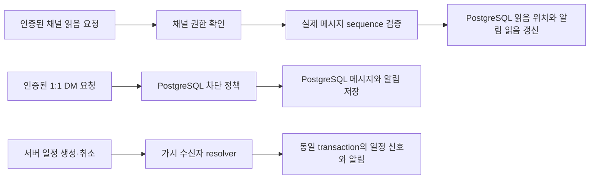

# T43 설계 2: PostgreSQL 알림·읽음·1:1 DM·서버 일정

## Approval Gate
- Status: Approved
- Approver: 사용자 (2026-09-29, "설계2 까지 진행", PostgreSQL 사용 명시)
- 범위: 채널 읽음 위치, 1:1 DM 메시지·읽음 위치·차단 상태, 서버 일정 알림, 통합 알림 조회 API를 PostgreSQL에 연결한다. 웹 화면 연결은 다음 조각에서 검토한다.

## Goal
재접속·서버 재시작 후에도 읽음 위치와 DM 본문을 잃지 않는다. 사용자별 접근 권한과 알림의 읽음 상태를 보존하고, 서버 일정 생성·취소를 가시 수신자에게 알린다.

## Task Packet
- Task ID: T43, 설계 2
- Domain: 알림, 채널 읽음, 1:1 DM, 서버 일정
- Allowed write paths: 아래 Expected Changed Files
- Forbidden changes: 그룹 DM, Web Push, 새 서비스 분리, 외부 미추적 문서
- Affected endpoints: `/api/notifications/**`, `/api/presence/channels/{channelId}/read`, `/api/social/dms/**`, `/api/guilds/{guildId}/events/**`
- Persistence/runtime profiles: `postgres`에서 PostgreSQL V18–V20; 기본 프로필의 기존 메모리 테스트 경로는 유지
- External dependencies: 로컬 Docker PostgreSQL 17.6 (통합 테스트에만 사용)
- Expected tests: 인증 누락, 숨긴 채널, 유효성, 커서 제한, 재조회, 멱등 읽음, DB 트랜잭션
- Expected docs/wiki updates: OpenAPI와 본 설계 문서. 독립 검수 전 외부 wiki 게시 보류.

## Expected Changed Files
- `backend/boot/src/main/resources/db/migration/V18__channel_read_markers.sql` (new)
- `backend/boot/src/main/java/com/example/discord/presence/JdbcChannelReadService.java` (new)
- `backend/boot/src/main/java/com/example/discord/presence/PresenceController.java`
- `backend/boot/src/test/java/com/example/discord/presence/PostgresChannelReadServiceTest.java` (new)
- `backend/boot/src/main/resources/db/migration/V19__direct_messages.sql` (new)
- `backend/boot/src/main/resources/db/migration/V20__direct_message_sender_delete.sql` (new)
- `backend/boot/src/main/java/com/example/discord/social/JdbcDirectMessageService.java` (new)
- `backend/boot/src/main/java/com/example/discord/social/SocialController.java`
- `backend/boot/src/test/java/com/example/discord/social/PostgresDirectMessageServiceTest.java` (new)
- `backend/boot/src/main/java/com/example/discord/event/JdbcServerEventService.java`
- `backend/boot/src/main/java/com/example/discord/event/ServerEventRecipientResolver.java` (new)
- `backend/boot/src/main/java/com/example/discord/event/ServerEventController.java` (new)
- `backend/boot/src/test/java/com/example/discord/event/PostgresServerEventServiceTest.java`
- `backend/boot/src/main/java/com/example/discord/notification/JdbcNotificationInboxService.java`
- `backend/boot/src/main/java/com/example/discord/notification/NotificationController.java` (new)
- `backend/boot/src/test/java/com/example/discord/notification/PostgresNotificationInboxServiceTest.java`
- `backend/boot/src/test/java/com/example/discord/notification/PostgresNotificationFlowControllerTest.java` (new)
- `qa/openapi-contract.mjs`, `qa/openapi-contract.test.mjs`
- `docs/api/openapi.json`, `packages/api-client/src/generated/openapi-types.ts` (generated)
- `docs/superpowers/specs/2026-09-28-t43-mention-inbox-browser-notifications-design.md`
- 이 계획 문서

## 구조와 흐름

## 불변식
- 읽음 sequence는 실제 저장된 범위 이내이며 감소하지 않는다. 같은 트랜잭션에서 해당 채널 알림을 읽음으로 바꾼다.
- DM 조회는 두 참여자만 허용하고 결과는 제한된 페이지로 반환한다. 그룹 DM은 제외한다.
- DM 저장과 수신자 알림은 한 PostgreSQL 트랜잭션에서 처리한다.
- 서버 일정 생성·취소와 알림도 한 트랜잭션에서 처리한다. 수신자는 채널을 볼 수 있어야 하며 행위자는 제외한다.
- 알림 API의 페이지와 개수는 현재 볼 수 있는 채널만 포함한다.
- 기존 기본 프로필의 메모리 테스트는 유지하되 `postgres` 프로필의 운영 경로는 DB를 사용한다.

## TDD와 검증
1. PostgreSQL 통합 테스트로 재생성 후 읽음 위치 유지·단조 증가·허위 sequence 거부·알림 일치를 먼저 실패시킨다.
2. 마이그레이션과 JDBC 구현을 추가해 통과시킨다.
3. DM 저장·재조회·참여자 제한·알림 원자성 테스트를 먼저 실패시킨 뒤 구현한다.
4. `DISCORD_RUN_POSTGRES_TESTS=true ./gradlew :backend:boot:test --tests ...`와 전체 `./gradlew test`, `git diff --check`를 실행한다.

## Blueprint Alignment Review
- Matches blueprint: yes. V18–V20 영속 상태, 가시 수신자 resolver, 인증 API, 한 트랜잭션의 DM·서버 알림을 구현했다.
- Mismatch: 사용자-facing 웹 Inbox 연결은 이 조각에서 진행하지 않았다. T43 후속 조각으로 남긴다.
- Correct owner of fix: 다음 웹 구현 blueprint.
- Required loop action: 현재 구현에 필요한 blueprint와 OpenAPI 계약은 갱신했다. 독립 리뷰와 웹 검증 전 wiki 게시·merge는 진행하지 않는다.
- Acceptance: blueprint와 구현의 자체 대조 및 선언한 백엔드 테스트는 통과. 독립 spec/quality/security review는 아직 수행되지 않았다.
