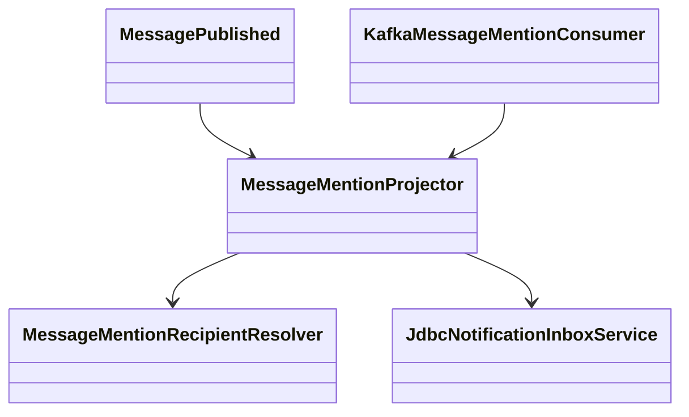
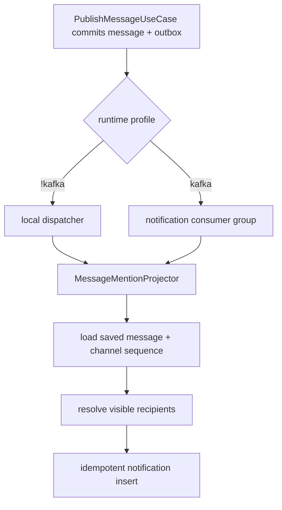
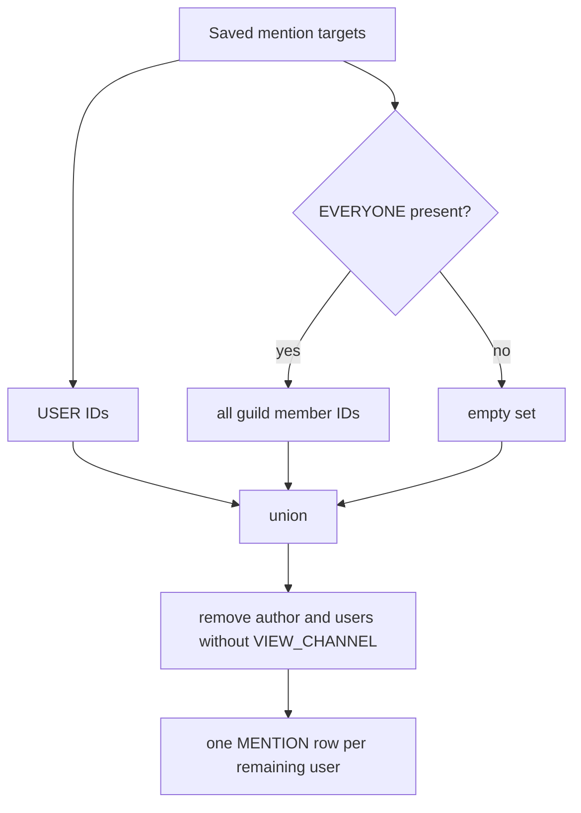

# T43 첫 조각: 멘션 수신자 계산과 알림 투영

## Approval Gate
- Status: Approved
- Approver: 사용자 (2026-09-29, "설계1 부터 개발진행")
- Blocking ambiguity: 없음. 이 조각의 입력은 채널 `MessagePublished`이며 대상은 `USER`와 `EVERYONE`이다.
- Competing plan branches: 이벤트 투영을 선택했다. 메시지 저장 경로의 동기 알림 생성과 범용 handler registry는 사용하지 않는다.

## Goal
- User/business capability: 성공적으로 발행된 채널 메시지의 직접 멘션 및 `@everyone`을 가시 사용자별 알림 행으로 영속화한다.
- Slice boundary: 백엔드 알림 생성까지. DM, 서버 일정, 조회 API, 웹 화면, 브라우저 알림은 다음 독립 검토 조각에서 연결한다.

## Domain Language
- Mention target: 저장된 메시지의 `UserMentionTarget` 또는 `SpecialMentionTarget(EVERYONE)`.
- Visible recipient: 발행 메시지의 길드 구성원이며 대상 채널을 볼 수 있는 사용자. 작성자는 제외한다.
- Notification source: 저장된 `messageId`; `(user_id, source_id, kind)`가 중복 기록을 막는다.

## Participating Code
| 코드 | 책임 | 호출/의존 | 테스트 |
|---|---|---|---|
| `MessageMentionRecipientResolver` (new, boot notification) | 구조화 멘션을 가시 사용자 ID 집합으로 해석 | `InMemoryGuildService`, `Message` | `MessageMentionRecipientResolverTest` |
| `MessageMentionProjector` (new, boot notification) | 저장 메시지와 DB sequence를 읽고 알림 명령 생성 | resolver, `MessageLookupPort`, `DataSource`, `JdbcNotificationInboxService` | `MessageMentionProjectorTest` |
| `JdbcNotificationInboxService` | 기존 고유 제약으로 사용자별 멱등 기록 | `notification_items`, preferences | 기존 `PostgresNotificationInboxServiceTest` |
| `MessageConfiguration` | `!kafka` dispatcher에서 projector 호출 | 기존 outbox relay | `MessageConfigurationTest` |
| `KafkaMessageMentionConsumer` (new) | Kafka 메시지 발행 기록을 별도 consumer group에서 projector로 전달 | `MessagePublishedRecord` | `KafkaMessageMentionConsumerTest` |

## Expected Changed Files
- `backend/boot/src/main/java/com/example/discord/notification/MessageMentionRecipientResolver.java` (new)
- `backend/boot/src/main/java/com/example/discord/notification/MessageMentionProjector.java` (new)
- `backend/boot/src/main/java/com/example/discord/notification/NotificationProjectionConfiguration.java` (new)
- `backend/boot/src/main/java/com/example/discord/notification/KafkaMessageMentionConsumer.java` (new)
- `backend/boot/src/main/java/com/example/discord/message/MessageConfiguration.java`
- `backend/modules/notification/src/main/java/com/example/discord/notification/MentionNotificationCommand.java` (non-user author permits null)
- `backend/boot/src/test/java/com/example/discord/notification/MessageMentionRecipientResolverTest.java` (new)
- `backend/boot/src/test/java/com/example/discord/notification/MessageMentionProjectorTest.java` (new)
- `backend/boot/src/test/java/com/example/discord/notification/NotificationProjectionConfigurationTest.java` (new)
- `backend/boot/src/test/java/com/example/discord/notification/KafkaMessageMentionConsumerTest.java` (new)
- `backend/boot/src/test/java/com/example/discord/message/MessageConfigurationTest.java`

## Tier And Layer Responsibilities
- UI/client: 이번 조각에서 변경 없음.
- API/controller: 이번 조각에서 변경 없음.
- Application: projector가 발행된 메시지를 알림 명령으로 투영한다.
- Domain: resolver가 기존 구조화 멘션 모델과 길드 권한만 읽어 수신자를 계산한다.
- Persistence: 기존 JDBC 알림 저장소가 고유 제약으로 재시도 시 수신자별 중복을 막는다.
- Infrastructure: Kafka는 Gateway와 다른 consumer group을 사용한다. 로컬 dispatcher는 같은 projector를 부른다.

## Structure Diagram

## System Flow Diagram

## Behavior Flow

## Invariants And Boundaries
- Only trusted persisted message/outbox is input. No user-facing event publication endpoint is added.
- `@here`, role, and channel mentions produce no notification in this slice. `EVERYONE` does not bypass channel visibility.
- Bot/webhook/system authors have no user ID; `MentionNotificationCommand.authorId` is null for them, while user authors still exclude themselves.
- A message produces at most one `MENTION` row per recipient even if both direct and `EVERYONE` target them.
- Kafka duplicate delivery and local relay retry cannot create duplicates. 일부 수신자 기록 후 실패하면 재시도에서 남은 수신자를 채운다.
- Permission lookup failure fails closed and lets the event retry. Logs use IDs/counts, never message bodies.
- Kafka producer event remains body-free; projector loads by `messageId` from the existing message store.

## Implementation Steps
1. Write failing pure resolver tests for direct, `EVERYONE`, duplicate, own author, hidden channel, ignored mention kinds.
2. Implement resolver using `guildService.guild(guildId).members()` and `canViewChannel`.
3. Write projector test that loads a saved message and DB sequence, and does nothing for no supported mention target.
4. Implement projector; wire it to `!kafka` dispatcher and a separate Kafka consumer group; test both profile paths.
5. Run gates and review this fixed slice against expected files and invariants before any next slice.

## Verification Gates
- First: `./gradlew --version`.
- Focused: `./gradlew :backend:boot:test --tests com.example.discord.notification.MessageMentionRecipientResolverTest --tests com.example.discord.notification.MessageMentionProjectorTest --tests com.example.discord.notification.KafkaMessageMentionConsumerTest --tests com.example.discord.message.MessageConfigurationTest`.
- PostgreSQL opt-in: `DISCORD_RUN_POSTGRES_TESTS=true ./gradlew :backend:boot:test --tests com.example.discord.notification.PostgresNotificationInboxServiceTest` (skip 0).
- Regression: `./gradlew :backend:boot:test :backend:modules:message:test :backend:modules:notification:test`, `npm run lint:backend`, `git diff --check`, `git status --short`.

## Review Score Preset
- Plan review: 85/100, scope/architecture/files/ambiguity/verification/risk; no unresolved branch.
- Implementation review: 80/100 and no P0/P1; security review for channel visibility follows the project 90/100 threshold.

Wiki used: `index.md`, `wiki/Backend Architecture.md`, `wiki/QA Infra Operations.md`, `wiki/Agent Development Guide.md`.
