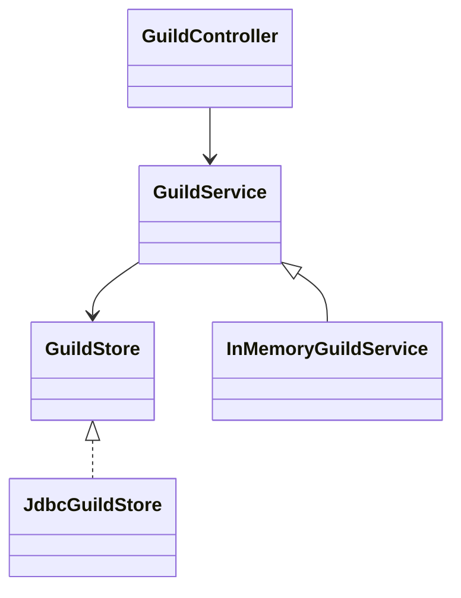
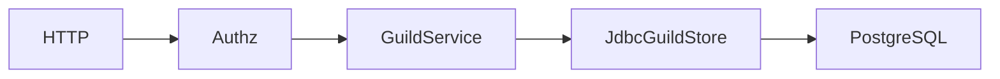
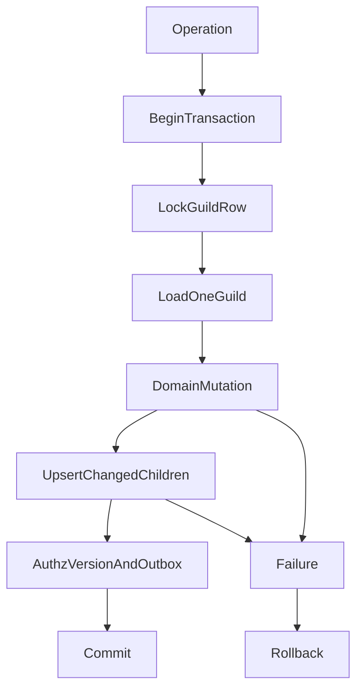

# 길드 상태 원본을 PostgreSQL로 전환

## Approval Gate
- Status: Approved
- Approver: 사용자 “전환 진행”, 기존 PostgreSQL·Redis 전환 승인 범위.
- Blocking ambiguity: 없음.
- Competing plan branches: 상태 없는 GuildService가 기존 도메인 규칙을 유지하고 JDBC store가 상태와 트랜잭션을 소유한다.

## Goal / Domain Language
운영 길드는 startup loadAll 없이 요청한 guild만 DB에서 조회한다.
멀티 인스턴스의 변경을 읽고 guild 행 잠금으로 동시 쓰기를 직렬화한다.
역할/멤버/overwrite 변경 시 기존 채널을 삭제하지 않아 메시지·이벤트 FK 데이터를 보존한다.
InMemoryGuildService는 테스트 대역이며 운영 caller는 GuildService에 의존한다.

## Participating Code / Layer Responsibilities
- GuildService: 기존 불변식과 권한 계산. 상태 보관 없음.
- GuildStore: get/create/update, 사용자 guild 목록, channel→guild 조회 계약.
- JdbcGuildStore: 단일 guild load, 공유/배타 행 잠금, 변경 child upsert 및 권한 outbox/version의 동일 트랜잭션 기록.
- InMemoryGuildService: 기존 API를 유지하는 테스트용 store.
- controllers/도메인 caller: 기존 API 보존, 주입 타입만 GuildService로 변경.
- QA: 기본 단위 테스트는 인프라 없이, integration은 opt-in 전용 DB만 사용.

## Structure Diagram

## System Flow Diagram

## Behavior Flow

## Invariants And Boundaries
- 운영 JVM Map, startup loadAll, broad synchronized DB 작업이 없다.
- 기존 권한 계산 및 HTTP/OpenAPI 계약 유지.
- 실패 시 state 및 authorization outbox/version을 함께 rollback.
- 새 서비스뿐 아니라 이미 생성된 다른 서비스도 최신 DB commit을 읽는다.
- 현재 Guild API는 추가/갱신만 지원한다. 하위 행 삭제/재삽입 대신 변경 row를 upsert.
- integration cleanup은 task 전용 DB에서만 허용한다.
- 로그는 안전한 guild ID 및 상태만 기록한다.

## Implementation Steps
1. 실제 PostgreSQL 전용 DB에서 기존 stale-instance 및 FK cascade RED 재현.
2. GuildService/GuildStore와 단일 guild transaction JDBC adapter 구현.
3. snapshot wrapper 제거 및 main caller 타입 전환.
4. focused/integration, 전체 test/style, bootJar 및 독립 리뷰.

## Verification Gates
- opt-in PostgresGuildStoreContractTest: 최신 인스턴스 가시성, 재시작, 동시성, rollback, 메시지/event 보존.
- :backend:modules:guild:test, boot GuildControllerTest/GatewayRuntimeConfigurationTest.
- ./gradlew test checkstyleMain checkstyleTest, bootJar.
- main caller InMemoryGuildService/PersistentGuildService/GuildSnapshotStore/loadAll 참조 제거 검사.
- git diff --check.
- 실제 infra 미실행을 GREEN으로 간주하지 않는다.

## Review Score Preset
Plan Review 85/100 이상. spec 및 quality/security 각각 90/100 이상, P0/P1 없음.

## Expected Changed Files
- backend/boot/src/main/java/com/example/discord/experience/PremiumController.java — 주입 타입/상태 경계 전환.
- backend/boot/src/main/java/com/example/discord/experience/SoundboardController.java — 주입 타입/상태 경계 전환.
- backend/boot/src/main/java/com/example/discord/experience/StageController.java — 주입 타입/상태 경계 전환.
- backend/boot/src/main/java/com/example/discord/expression/ExpressionController.java — 주입 타입/상태 경계 전환.
- backend/boot/src/main/java/com/example/discord/gateway/GatewayConfiguration.java — 주입 타입/상태 경계 전환.
- backend/boot/src/main/java/com/example/discord/gateway/GatewayController.java — 주입 타입/상태 경계 전환.
- backend/boot/src/main/java/com/example/discord/guild/GuildConfiguration.java — 주입 타입/상태 경계 전환.
- backend/boot/src/main/java/com/example/discord/guild/GuildController.java — 주입 타입/상태 경계 전환.
- backend/boot/src/main/java/com/example/discord/guild/PersistentGuildService.java — 주입 타입/상태 경계 전환.
- backend/boot/src/main/java/com/example/discord/guild/UserGuildController.java — 주입 타입/상태 경계 전환.
- backend/boot/src/main/java/com/example/discord/invite/InviteController.java — 주입 타입/상태 경계 전환.
- backend/boot/src/main/java/com/example/discord/message/MessageAuthorizationPolicy.java — 주입 타입/상태 경계 전환.
- backend/boot/src/main/java/com/example/discord/message/MessageConfiguration.java — 주입 타입/상태 경계 전환.
- backend/boot/src/main/java/com/example/discord/message/MessageController.java — 주입 타입/상태 경계 전환.
- backend/boot/src/main/java/com/example/discord/moderation/ModerationController.java — 주입 타입/상태 경계 전환.
- backend/boot/src/main/java/com/example/discord/presence/PresenceController.java — 주입 타입/상태 경계 전환.
- backend/boot/src/main/java/com/example/discord/storage/AttachmentController.java — 주입 타입/상태 경계 전환.
- backend/boot/src/main/java/com/example/discord/thread/ThreadController.java — 주입 타입/상태 경계 전환.
- backend/boot/src/main/java/com/example/discord/voice/VoiceController.java — 주입 타입/상태 경계 전환.
- backend/modules/gateway/src/main/java/com/example/discord/gateway/InMemoryGatewayService.java — 주입 타입/상태 경계 전환.
- backend/modules/guild/src/main/java/com/example/discord/guild/InMemoryGuildService.java — 주입 타입/상태 경계 전환.
- backend/modules/guild/src/main/java/com/example/discord/guild/GuildService.java
- backend/modules/guild/src/main/java/com/example/discord/guild/GuildStore.java
- backend/boot/src/main/java/com/example/discord/guild/GuildSnapshotStore.java
- backend/boot/src/main/java/com/example/discord/guild/JdbcGuildSnapshotStore.java
- backend/boot/src/main/java/com/example/discord/guild/JdbcGuildStore.java
- backend/boot/src/test/java/com/example/discord/guild/PostgresGuildServiceTest.java
- backend/boot/src/test/java/com/example/discord/guild/PostgresGuildStoreContractTest.java
- docs/superpowers/plans/2026-10-14-runtime-persistence-guild.md
- docs/03-analysis/runtime-persistence-guild.md

## Plan Review 및 세부 계약
- 독립 plan review 89/100, P0/P1 없음. 기존 요구 범위의 구현 착수 수용.
- update는 동일 connection/transaction에서 guild FOR UPDATE → load → mutation → child upsert → authz version/outbox → commit을 수행한다.
- get은 동일 transaction의 guild FOR SHARE로 관련 child 조회 동안 writer를 막는다.
- 두 독립 service/connection의 concurrent change를 barrier로 겹치고 두 child가 모두 남는지 검사한다.
- rollback은 live/fresh 읽기, 다음 정상 mutation, role permission, version 및 outbox 변경 없음으로 검사한다.
- FK 보존은 message, event, invite_role_grants 및 parent channel 관계를 포함한다.
- 기존 PostgresGuildServiceTest cleanup에도 current_database() task prefix 확인을 먼저 추가한다.
- opt-in 예: DISCORD_RUN_POSTGRES_TESTS=true POSTGRES_JDBC_URL=jdbc:postgresql://127.0.0.1:15432/discord_runtime_guild_20261014 ./gradlew :backend:boot:test --tests '*PostgresGuildStoreContractTest'

- backend/boot/src/test/java/com/example/discord/guild/GuildRuntimeConfigurationTest.java — 실제 JDBC wiring 및 startup 조회 없음 검증.

- backend/modules/guild/src/test/java/com/example/discord/guild/GuildServicePermissionSnapshotTest.java — 복합 권한 판정의 단일 snapshot 회귀 검증.
- 권한 판정 한 번은 Guild를 한 번만 읽는다. VIEW와 SEND/MANAGE, requester와 target role 권한을 같은 snapshot으로 판단한다.
