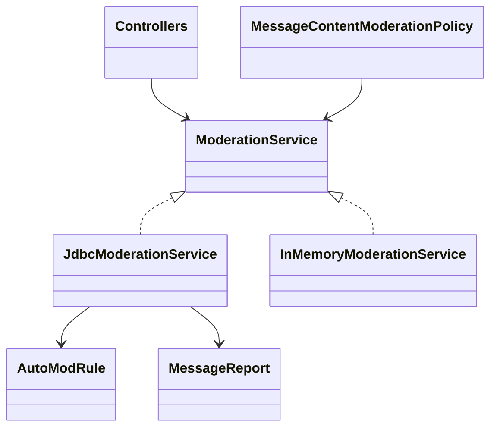
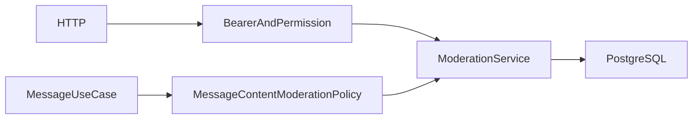
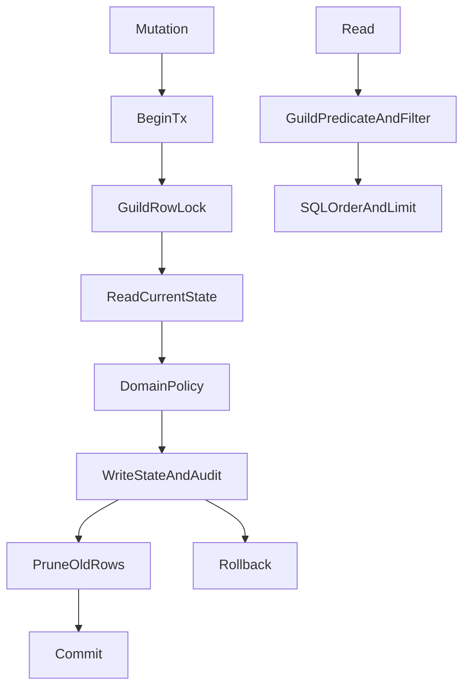

# 모더레이션 상태 PostgreSQL 전환

## Approval Gate
- Status: Approved
- Approver: 사용자 전환 진행, 운영 메모리 전체 전환 승인 범위.
- Blocking ambiguity: 없음. 기존 main 기반 cb973c1 HTTP/권한/보존 계약을 기준으로 함.
- Competing plan branches: normalized JDBC 원본, 기존 domain records/policies 재사용.

## Goal / Domain Language
운영 InMemoryModerationService Bean과 온보딩 질문·답변, AutoMod 규칙, 감사 로그, 보안 알림, 메시지 신고 Map/lastAuditCreatedAt를 PostgreSQL 원본으로 전환한다.
기존 HTTP DTO와 bearer/권한, page default50/max100, audit/alert/report guild당 최신500 보존 정책을 유지한다.
원본 C:/git/discord dirty 작업은 보존한다. startup 전체 적재나 snapshot wrapper를 추가하지 않는다.

## Participating Code / Tier And Layer Responsibilities
- ModerationService: 실제 JDBC 및 기존 test double의 use-case port. 기존 모든 production caller가 이 타입을 사용한다.
- AutoModRule.matches, MessageReport.resolve: 기존 입력/정책을 공유하는 순수 domain 연산.
- JdbcModerationService: guild별 조회, normalized SQL mutation, 원자적 audit/alert/report, bounded retention.
- ModerationConfiguration: postgres에서만 JDBC Bean; TestModerationConfiguration은 test classpath !postgres fake.
- V21: questions/answers, rules, audit logs, security alerts, message reports. keywords TEXT[], roleGrantIds UUID[]는 PostgreSQL native array.
- Controller와 MessageContentModerationPolicy: 기존 actor/permission/message-target 검증 유지. 저장 구현 선택만 전환.

## Structure Diagram

## System Flow Diagram

## Behavior Flow

## Invariants And Boundaries
- 모든 SQL에 guild predicate를 사용하고 IDs를 binding한다. 다른 guild 질문/규칙/신고/감사 데이터를 섞지 않는다.
- question+answer rows 원자적 생성, configured answers의 role grants만 반환. 기존 role hierarchy 확인은 controller/GuildService에 남는다.
- 규칙 생성+audit, AutoMod 차단+alert+audit, report+audit, resolve+audit, onboarding submit+audit를 같은 JDBC transaction에서 수행한다.
- AutoMod rules의 기존 생성 순서/첫 matching rule, enabled/type/keyword normalization, reason 및 decision shape 유지. 내용/keywords/reason은 로그에 기록하지 않는다.
- report resolve는 같은 guild/id FOR UPDATE에서 현재 state를 읽고 terminal status 입력 검증을 공유한다. 기존 terminal→terminal 수정 허용 정책은 유지한다.
- guild root FOR UPDATE로 mutation과 retention을 직렬화한다. JVM synchronized/global lock 없음. 최근500 audit/alert/report를 같은 transaction에서 유지해 동시 insert 시 boundedness를 보장한다.
- query limit<1은50, >100은100. audit/alerts 최신순, reports 생성순 유지. native seq로 timestamp 동률에도 안정 순서를 제공한다.
- audit created_at은 같은 guild 안에서 DB clock과 이전 timestamp+1micro를 사용해 단조 증가한다. process-local lastAuditCreatedAt 없음.
- 외부 GuildService 역할 변경·메시지/초대 삭제와 controller의 appendAudit는 기존 별도 use-case transaction 경계를 유지한다. 그 경계 전체의 원자성까지 주장하지 않는다. durable cross-domain outbox는 이 메모리 전환 범위에서 추가하지 않는다.
- SQL failure는 rollback, safe IDs/operation/effects INFO와 rejection/failure WARN. message body/secret/reason 문자열 로그 금지.
- 실제 PG는 기존 task DB prefix 확인 후 opt-in. 기본 tests는 인프라 독립. fresh adapter/wiring 검증이며 실제 process restart와 production 배포를 주장하지 않는다.

## Implementation Steps
1. 운영 memory Bean RED, 공유 domain matching/resolve 정책과 port.
2. V21 및 JDBC adapter 구현, controller/policy caller 타입 전환, fake Bean은 test로 이동.
3. actual PG에서 전체 상태 fresh adapter, isolation, ordering/filter/limit/retention, atomic rollback, 동시 변경 검증.
4. focused module/controller/policy/runtime, 전체 test/style/JAR/npm lint/migration guard.
5. 고정 revision 독립 spec 및 quality/security 검토, 수정·재검수 후 수용 증거와 wiki 게시.

## Verification Gates
- ModerationRuntimeConfigurationTest RED/GREEN, postgres wiring/JDBC 선택/no startup load.
- social 완료 baseline 회귀 포함 ./gradlew --version 및 :backend:modules:moderation:test, boot moderation/policy 및 caller controller tests.
- PostgresModerationServiceContractTest: questions+answers/rules/audits/alerts/reports fresh instance 내구성, guild isolation, first rule match/disabled, report state/ownership, filter/page/order,500 retention, concurrent append, audit/alert 실패 시 주 state rollback 및 복구.
- retention concurrency는 첫 transaction이 guild lock을 보유한 상태에서 두 번째 connection의 DB lock wait를 관찰하고 해제 후 결과를 단언한다. 단순 시작 barrier만으로 결정적 DB overlap을 주장하지 않는다.
- ./gradlew test checkstyleMain checkstyleTest :backend:boot:bootJar, npm run lint:backend, pwsh qa/migration-guard.contract.ps1, git diff --check.
- boot main InMemoryModerationService 참조 없음, JDBC/V21 JAR 포함.
- 독립 review와 evidence 직접 대조. 전체 runtime 전환은 미완료.

## Review Score Preset
Plan85이상, implementation spec 및 quality/security 각각90이상, P0/P1 없음.

## Expected Changed Files
- backend/modules/moderation/src/main/java/com/example/discord/moderation/ModerationService.java
- backend/modules/moderation/src/main/java/com/example/discord/moderation/AutoModRule.java
- backend/modules/moderation/src/main/java/com/example/discord/moderation/MessageReport.java
- backend/modules/moderation/src/main/java/com/example/discord/moderation/InMemoryModerationService.java
- backend/modules/moderation/src/test/java/com/example/discord/moderation/InMemoryModerationServiceTest.java
- backend/boot/src/main/java/com/example/discord/moderation/ModerationConfiguration.java
- backend/boot/src/main/java/com/example/discord/moderation/ModerationController.java
- backend/boot/src/main/java/com/example/discord/moderation/JdbcModerationService.java
- backend/boot/src/main/java/com/example/discord/guild/GuildController.java
- backend/boot/src/main/java/com/example/discord/invite/InviteController.java
- backend/boot/src/main/java/com/example/discord/message/MessageController.java
- backend/boot/src/main/java/com/example/discord/message/MessageConfiguration.java
- backend/boot/src/main/java/com/example/discord/message/MessageContentModerationPolicy.java
- backend/boot/src/main/java/com/example/discord/experience/StageController.java
- backend/boot/src/main/java/com/example/discord/experience/PremiumController.java
- backend/boot/src/main/resources/db/migration/V21__moderation_state.sql
- backend/boot/src/test/java/com/example/discord/moderation/TestModerationConfiguration.java
- backend/boot/src/test/java/com/example/discord/moderation/ModerationRuntimeConfigurationTest.java
- backend/boot/src/test/java/com/example/discord/moderation/PostgresModerationServiceContractTest.java
- docs/superpowers/plans/2026-10-14-runtime-persistence-moderation.md
- docs/03-analysis/runtime-persistence-moderation.md
