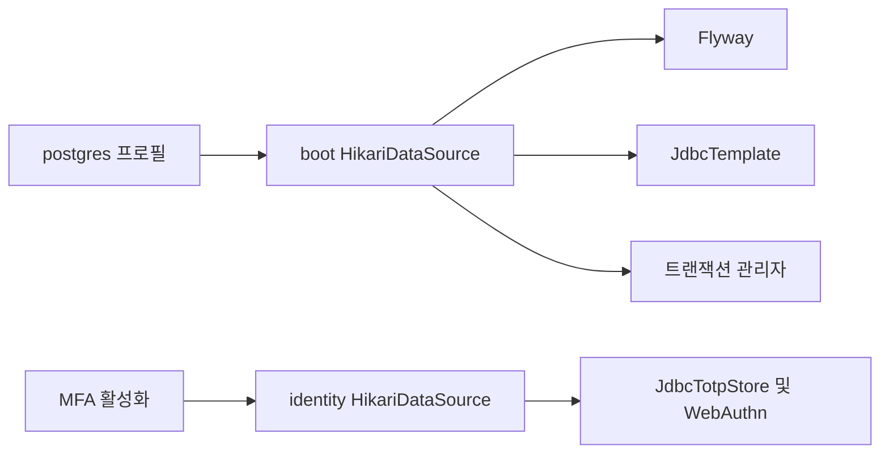

# T226 DB 연결 풀 Implementation Plan

> **For agentic workers:** REQUIRED SUB-SKILL: Use superpowers:subagent-driven-development or superpowers:executing-plans to implement this plan task-by-task. Steps use checkbox (`- [ ]`) syntax for tracking. 현재 세션의 위임 제한을 따른다.

**Goal:** boot와 identity의 PostgreSQL 연결을 재사용하고 풀 크기를 환경별로 조정한다.

**Architecture:** 기존 DataSource bean의 생성만 HikariDataSource로 변경한다. boot의 postgres 프로필과 identity의 MFA 조건을 유지하고, 각 bean을 Spring이 종료할 때 닫는다. SQL과 트랜잭션 경계는 유지한다.

**Tech Stack:** Java 21, Spring Boot, HikariCP, Gradle, JUnit, PostgreSQL.

---

## 파일과 승인

- 설계: `docs/superpowers/specs/2026-11-13-t226-connection-pool-design.md` (2026-11-14 사용자 승인).
- `backend/boot/build.gradle.kts`: HikariCP 의존성.
- `backend/boot/src/main/java/com/example/discord/persistence/PostgresPersistenceConfiguration.java`: postgres 풀 생성.
- `backend/boot/src/test/java/com/example/discord/persistence/PostgresDataSourceTest.java`: 설정과 종료 검증.
- `backend/boot/src/test/java/com/example/discord/persistence/PersistenceBootstrapTest.java`: 실제 postgres bean 검증.
- `backend/services/identity/build.gradle.kts`: HikariCP 의존성.
- `backend/services/identity/src/main/java/com/example/discord/identityservice/MfaConfiguration.java`: MFA 풀 생성.
- `backend/services/identity/src/test/java/com/example/discord/identityservice/MfaDataSourceTest.java`: 설정과 종료 검증.
- `docs/superpowers/plans/2026-11-14-t226-connection-pool.md`, 설계 문서 및 `docs/03-analysis/task_T226-connection-pool.blueprint.md`: 계획과 구현 기준.
- 리뷰 후 `docs/03-analysis/task_T226-merge-review.md`: 검증 근거. 기존 미추적 파일은 포함하지 않는다.

**설정 계약:** boot는 `spring.datasource.hikari.maximum-pool-size` (환경 변수 `SPRING_DATASOURCE_HIKARI_MAXIMUM_POOL_SIZE`), identity는 `discord.auth.mfa.maximum-pool-size` (환경 변수 `DISCORD_AUTH_MFA_MAXIMUM_POOL_SIZE`)를 사용한다. 설정이 없으면 각각 10이다. 환경 변수는 Spring relaxed binding에만 의존하지 않도록 `Environment`에서 명시적으로 fallback한다. 연결 시간 제한은 Hikari 기본값 30초를 사용한다. 비밀번호나 URL을 로그에 출력하지 않는다.

### Task 1: 구현 기준과 기존 서비스 확인

- [ ] **Step 1:** 위 파일 목록과 아래 관계·검증 기준을 `docs/03-analysis/task_T226-connection-pool.blueprint.md`에 기록한다. 사용자는 설계와 이 계획을 승인했으므로 상태는 `Approved`, 승인자는 사용자, 차단 질문은 없음으로 기록한다. 문서에 설계·계획·blueprint 파일 자체도 Expected Changed Files에 명시한다. 기존 두 서비스의 DataSource 호출 경로, 프로필, 동일 인스턴스 사용과 아래 도식을 포함한다.



- [ ] **Step 2:** 기존 서비스 확인 및 Gradle 실행 환경을 확인한다.

```bash
./gradlew --version
./gradlew :backend:services:message:dependencyInsight --dependency HikariCP --configuration runtimeClasspath
./gradlew :backend:services:websocket:dependencyInsight --dependency HikariCP --configuration runtimeClasspath
```

예상: wrapper 버전이 출력되고 두 dependencyInsight에 HikariCP가 나타난다. 자동 설정 제외가 postgres 프로필에서 해제되는지도 각 `application*.yml`에서 확인한다. 실제 DataSource 유형을 증명하지 못한 경우 계획의 검증 결과에 미확인으로 남기고 필요하면 postgres 실행 확인을 추가한다. Git Bash 실행 불가 시 오류를 기록하고 Windows wrapper `./gradlew.bat`을 사용한다.

- [ ] **Step 3:** blueprint를 스스로 점검한다. 설계의 범위, 실패 시 동작, 파일, 검증, 리뷰 점수 기준(명세·품질/보안 각 90 이상, P0/P1 0)을 포함하고 빠진 항목이 없어야 한다. 프로젝트의 독립 리뷰 요구를 충족하기 전 승인된 리뷰로 표시하지 않는다. 설계·계획·blueprint를 task 소유 문서만 지정해 stage하고 `git diff --cached --name-only`와 `git diff --cached --check`를 확인한다. 커밋 전 프로젝트 문서 리뷰 규칙과 브랜치 규칙을 적용한다.

### Task 2: boot 풀

**Files:** boot build, configuration, `PostgresDataSourceTest.java`, `PersistenceBootstrapTest.java`.

- [ ] **Step 1: 실패 테스트 작성.** 아래를 `PostgresDataSourceTest.java`에 저장한다. `dataSource` 메서드의 입력 계약은 다음 구현과 일치한다.

```java
package com.example.discord.persistence;

import static org.assertj.core.api.Assertions.assertThat;

import com.zaxxer.hikari.HikariDataSource;
import org.junit.jupiter.api.Test;
import org.springframework.context.annotation.AnnotationConfigApplicationContext;
import org.springframework.mock.env.MockEnvironment;

class PostgresDataSourceTest {
    @Test
    void configuresAndClosesPool() {
        var env = new MockEnvironment()
            .withProperty("spring.datasource.url", "jdbc:postgresql://localhost/example")
            .withProperty("spring.datasource.username", "test-user")
            .withProperty("spring.datasource.password", "test-password");
        var config = new PostgresPersistenceConfiguration();
        try (HikariDataSource defaults = config.postgresDataSource(env)) {
            assertThat(defaults.getMaximumPoolSize()).isEqualTo(10);
            assertThat(defaults.getJdbcUrl()).isEqualTo("jdbc:postgresql://localhost/example");
            assertThat(defaults.getUsername()).isEqualTo("test-user");
            assertThat(defaults.getPassword()).isEqualTo("test-password");
        }
        env.setProperty("spring.datasource.hikari.maximum-pool-size", "4");
        var context = new AnnotationConfigApplicationContext();
        context.registerBean("pool", HikariDataSource.class, () -> config.postgresDataSource(env));
        context.refresh();
        var pool = context.getBean(HikariDataSource.class);
        assertThat(pool.getMaximumPoolSize()).isEqualTo(4);
        assertThat(pool.getPoolName()).isEqualTo("discord-boot");
        context.close();
        assertThat(pool.isClosed()).isTrue();
    }
}
```

- [ ] **Step 2:** `./gradlew :backend:boot:test --tests com.example.discord.persistence.PostgresDataSourceTest` 실행. 예상: HikariCP 및 새 메서드 계약이 아직 없어 컴파일 실패.

- [ ] **Step 3: 최소 구현.** build dependencies에 `implementation("com.zaxxer:HikariCP")`를 추가한다. 기존 `postgresDataSource` bean 메서드와 관련 import만 다음으로 바꾼다. `JdbcTemplate`, 트랜잭션 관리자, Flyway 메서드는 유지한다.

```java
@Bean
HikariDataSource postgresDataSource(Environment environment) {
    var dataSource = new HikariDataSource();
    dataSource.setJdbcUrl(environment.getRequiredProperty("spring.datasource.url"));
    dataSource.setUsername(environment.getRequiredProperty("spring.datasource.username"));
    dataSource.setPassword(environment.getRequiredProperty("spring.datasource.password"));
    dataSource.setMaximumPoolSize(environment.getProperty(
        "spring.datasource.hikari.maximum-pool-size", Integer.class,
        environment.getProperty("SPRING_DATASOURCE_HIKARI_MAXIMUM_POOL_SIZE", Integer.class, 10)));
    dataSource.setPoolName("discord-boot");
    return dataSource;
}
```

필요 import는 `com.zaxxer.hikari.HikariDataSource`, `org.springframework.core.env.Environment`이고 `PGSimpleDataSource`는 제거한다. 잘못된 크기는 Hikari 검증에 맡긴다. 설정의 환경 변수 override를 시험에 추가한다. `PersistenceBootstrapTest`의 기존 테스트 시작 부분에 `assertThat(dataSource).isInstanceOf(HikariDataSource.class);`를 추가하고 import한다.

- [ ] **Step 4:** 위 집중 테스트를 다시 실행해 성공을 확인한다. 변경 파일만 stage하고 `git diff --cached --name-only`, `git diff --cached --check` 확인 후 `git commit -m 'fix(T226): pool boot postgres connections'`.

### Task 3: identity MFA 풀

**Files:** identity build, configuration, `MfaDataSourceTest.java`.

- [ ] **Step 1: 실패 테스트 작성.** 아래를 `MfaDataSourceTest.java`에 저장한다.

```java
package com.example.discord.identityservice;

import static org.assertj.core.api.Assertions.assertThat;

import com.zaxxer.hikari.HikariDataSource;
import org.junit.jupiter.api.Test;
import org.springframework.context.annotation.AnnotationConfigApplicationContext;
import org.springframework.mock.env.MockEnvironment;

class MfaDataSourceTest {
    @Test
    void configuresAndClosesPool() {
        var env = new MockEnvironment()
            .withProperty("discord.auth.mfa.jdbc-url", "jdbc:postgresql://localhost/example")
            .withProperty("discord.auth.mfa.database-user", "test-user")
            .withProperty("discord.auth.mfa.database-password", "test-password");
        var config = new MfaConfiguration();
        try (HikariDataSource defaults = config.mfaDataSource(env)) {
            assertThat(defaults.getMaximumPoolSize()).isEqualTo(10);
            assertThat(defaults.getJdbcUrl()).isEqualTo("jdbc:postgresql://localhost/example");
            assertThat(defaults.getUsername()).isEqualTo("test-user");
            assertThat(defaults.getPassword()).isEqualTo("test-password");
        }
        env.setProperty("discord.auth.mfa.maximum-pool-size", "3");
        var context = new AnnotationConfigApplicationContext();
        context.registerBean("pool", HikariDataSource.class, () -> config.mfaDataSource(env));
        context.refresh();
        var pool = context.getBean(HikariDataSource.class);
        assertThat(pool.getMaximumPoolSize()).isEqualTo(3);
        assertThat(pool.getPoolName()).isEqualTo("discord-identity-mfa");
        context.close();
        assertThat(pool.isClosed()).isTrue();
    }
}
```

- [ ] **Step 2:** `./gradlew :backend:services:identity:test --tests com.example.discord.identityservice.MfaDataSourceTest` 실행. 예상: 새 DataSource 반환 타입과 Hikari 의존성이 없어 컴파일 실패.
- [ ] **Step 3: 최소 구현.** identity build dependencies에 `implementation("com.zaxxer:HikariCP")`를 추가하고 `mfaDataSource` 메서드만 다음으로 바꾼다. 기존 `@ConditionalOnProperty`와 `jdbcTotpStore`는 유지한다.

```java
@Bean
HikariDataSource mfaDataSource(Environment environment) {
    String prefix = "discord.auth.mfa.";
    var dataSource = new HikariDataSource();
    dataSource.setJdbcUrl(environment.getRequiredProperty(prefix + "jdbc-url"));
    dataSource.setUsername(environment.getRequiredProperty(prefix + "database-user"));
    dataSource.setPassword(environment.getRequiredProperty(prefix + "database-password"));
    dataSource.setMaximumPoolSize(environment.getProperty(prefix + "maximum-pool-size", Integer.class,
        environment.getProperty("DISCORD_AUTH_MFA_MAXIMUM_POOL_SIZE", Integer.class, 10)));
    dataSource.setPoolName("discord-identity-mfa");
    return dataSource;
}
```

`HikariDataSource` import를 추가하고 `DriverManagerDataSource` import를 제거한다. 설정의 환경 변수 override를 시험에 추가한다.

- [ ] **Step 4:** 위 집중 테스트와 `./gradlew :backend:services:identity:test --tests com.example.discord.identityservice.MfaControllerTest --tests com.example.discord.identityservice.WebAuthnControllerTest`를 실행해 성공을 확인한다. 변경 파일만 stage하고 목록 및 whitespace 확인 후 `git commit -m 'fix(T226): pool identity MFA connections'`.

### Task 4: 통합 검증과 리뷰

- [ ] **Step 1:** `./gradlew test checkstyleMain checkstyleTest :backend:boot:bootJar --console=plain`을 실행한다. 성공은 종료 코드 0이다. 실패와 기존 실패는 분리해 기록한다.
- [ ] **Step 2:** 격리 PostgreSQL을 준비하고 `DISCORD_RUN_POSTGRES_TESTS=true`, `POSTGRES_JDBC_URL`, `POSTGRES_USER`, `POSTGRES_PASSWORD`를 임시 DB 값으로 설정한 뒤 다음을 실행한다. identity의 두 Postgres 테스트는 자체 Testcontainers DB를 사용하므로 Docker가 필요하다. 테스트 후 소유한 임시 DB와 환경 변수만 정리한다.

```bash
./gradlew :backend:boot:test --rerun-tasks --tests com.example.discord.persistence.PersistenceBootstrapTest --tests com.example.discord.guild.PostgresGuildStoreContractTest --tests com.example.discord.message.JdbcMessageStoreTest --tests com.example.discord.auth.PostgresAuthStoreTest --console=plain
./gradlew :backend:services:identity:test --rerun-tasks --tests com.example.discord.identityservice.PostgresMfaPersistenceTest --tests com.example.discord.identityservice.PostgresMfaRecoveryPersistenceTest --console=plain
```

예상: 실제 DB 테스트가 skip 없이 성공. DB 또는 Docker가 없으면 실패 원인과 미검증 범위를 기록하고 완료로 선언하지 않는다.
- [ ] **Step 3:** `npm run lint`, `git diff --check origin/main HEAD`, 저장소 `qa/*.contract.ps1` 계약 검사를 실행하고 종료 코드와 로그를 보관한다. 계약별 실행 결과와 main 기준 기존 실패의 근거를 기록한다.
- [ ] **Step 4:** blueprint 대비 구현·검증을 검토한다. 명세 및 품질/보안 리뷰 각각 90점 이상, 미해결 P0/P1 0이어야 한다. 프로젝트 요구의 독립 검토와 증거 검증이 불가능하면 명시하고 push/merge하지 않는다. 검토가 통과하면 `docs/03-analysis/task_T226-merge-review.md`에 정확한 base 및 reviewed SHA, 결과, 잔여 위험을 남긴다. 위키 반영은 구현·리뷰·검증 수용 후에만 수행한다.
